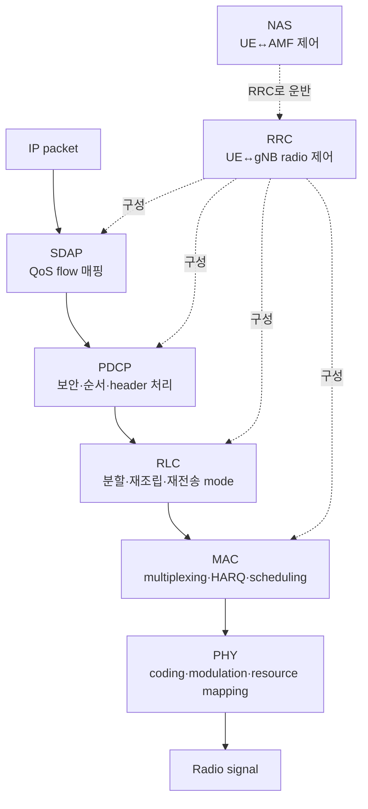

# 10. NR 무선과 프로토콜 스택

자료 확인일: **2026-10-11**

NR은 New Radio, 5G의 무선 접속 기술이다. 이 장은 전파 수식 전체보다 **한 IP packet이 어떤 계층의 상태를 거쳐 radio signal이 되는가**를 설명한다.

## 1. 계층과 제어의 경계

프로토콜 stack은 data를 아래 계층으로 포장하고 위 계층으로 복원하는 처리 구조다. 연결 제어는 UE가 망에 등록되고 무선 bearer와 session을 만드는 절차다.

| 계층 | 풀어 쓴 말 | 입력 | 주요 결과 |
| --- | --- | --- | --- |
| PHY | Physical Layer | coded bits | symbol과 radio resource |
| MAC | Medium Access Control | 여러 logical channel data | transport block, HARQ process |
| RLC | Radio Link Control | 상위 PDU | segmentation·reassembly·mode별 재전송 |
| PDCP | Packet Data Convergence Protocol | IP/QoS data | sequence·ciphering·integrity 대상 기능·header compression·재정렬 |
| SDAP | Service Data Adaptation Protocol | QoS flow | Data Radio Bearer 매핑 |
| RRC | Radio Resource Control | radio 제어 message | 연결·측정·bearer configuration |
| NAS | Non-Access Stratum | UE-core 제어 message | 등록·인증·session·mobility 상태 |

PDU는 Protocol Data Unit, 해당 계층이 처리하는 message 단위다. 상위 계층 PDU는 아래 계층의 payload가 된다. RRC의 논리적 종단은 UE와 gNB이고 NAS의 종단은 UE와 core의 AMF다. gNB가 NAS bytes를 운반해도 그 의미를 종단 처리하지 않는다.

## 2. PHY: bit에서 radio resource까지

PHY는 error-control coding, modulation, layer mapping, resource mapping을 수행한다. QPSK는 symbol 하나에 2 bit, 16QAM은 4 bit, 64QAM은 6 bit를 싣는 이상적 mapping을 갖는다.

~~~text
100 QPSK symbols  → raw mapped bits 200
100 16QAM symbols → raw mapped bits 400
~~~

실제 user payload는 coding, pilot, control, guard, retransmission 비용 때문에 더 작다. 높은 modulation은 같은 symbol에 많은 bit를 넣지만 높은 SINR(Signal-to-Interference-plus-Noise Ratio)을 요구한다.

**Modulation**은 bit 묶음을 amplitude·phase 상태인 symbol로 바꾸는 규칙이다. **Code rate**는 전체 coded bits 중 원래 정보가 차지하는 비율을 단순하게 나타낸다. **CRC(Cyclic Redundancy Check)** 는 block 오류를 찾는 검사값이다. CRC 통과는 bit block이 검사 규칙을 통과했다는 뜻이지 사용자 내용의 업무적 정확성이나 위조 방지를 뜻하지 않는다.

~~~text
원래 정보            1,000 bits
CRC                  24 bits라고 가정
coding input          1,024 bits
code rate 1/2 근사    2,048 coded bits
16QAM                 4 bits/symbol
필요 symbol 근사      2,048 / 4 = 512 symbols
~~~

이는 segmentation, multiple code blocks, rate matching, reference signal, control overhead를 생략한 교육용 모형이며 실제 NR transport block size 계산이 아니다. 64QAM은 raw symbol 수를 줄일 수 있지만 noise와 interference에 더 민감해 decode 실패와 HARQ 재전송이 늘면 이득이 사라질 수 있다.

## 3. Numerology, slot, Resource Block

NR subcarrier spacing은 `15 kHz × 2^μ`다.

~~~text
μ=0 → 15 kHz  → normal-CP slot 1 ms
μ=1 → 30 kHz  → normal-CP slot 0.5 ms
μ=2 → 60 kHz  → normal-CP slot 0.25 ms
μ=3 → 120 kHz → normal-CP slot 0.125 ms
~~~

Normal cyclic prefix 조건에서 한 slot은 14 OFDM symbol을 가진다. OFDM은 Orthogonal Frequency Division Multiplexing이다. SCS가 커지면 symbol과 slot이 짧아져 빠른 시간 변화와 작은 scheduling 단위에 유리할 수 있지만, 같은 대역폭의 subcarrier 수, coverage, phase noise, guard 설계가 달라져 무조건 좋은 것은 아니다.

RB(Resource Block)는 주파수 방향의 연속 12 subcarrier다. 30 kHz SCS에서는 `12 × 30 kHz = 360 kHz`다. 한 slot을 함께 보면 `12 × 14 = 168 resource elements` 격자가 되지만 DM-RS 같은 reference signal, control, reserved resource가 차지하므로 모두 user data는 아니다.

### 계산 A: 10 RB 교육 모형

~~~text
10 RB, RB당 12 subcarrier, data symbol 10개
16QAM = 4 bits/symbol, coding rate = 1/2, layer 1개

resource elements = 10 × 12 × 10 = 1,200
modulated bits = 1,200 × 4 = 4,800 bits
coded payload 근사 = 4,800 × 1/2 = 2,400 bits = 300 bytes
~~~

### 계산 B: 8 RB와 overhead

8 RB와 14 symbol이면 raw RE는 `8 × 12 × 14 = 1,344`다. Pilot·control 224 RE를 빼면 data RE는 1,120개다. 16QAM 4 coded bit/RE와 code rate 1/2를 가정하면 `1,120 × 4 × 0.5 = 2,240 bit = 280 byte`다.

두 계산 모두 실제 TBS 절차가 아니다. 실제 값은 3GPP 절차, MCS table, DM-RS, overhead, rate matching, CRC와 layer 수를 따른다.

## 4. MAC, HARQ, RLC의 재전송 경계

MAC은 logical channel data를 multiplex하고 scheduler grant에 맞춰 transport block을 만든다. HARQ(Hybrid Automatic Repeat reQuest)는 오류 정정 coding과 빠른 재전송을 결합한다. PHY decode가 실패하면 receiver가 NACK을 보내고 HARQ process는 이전 soft information과 재전송을 결합할 수 있다.

RLC mode는 다음처럼 다르다.

| mode | 의미 | 대표 성격 |
| --- | --- | --- |
| TM | Transparent Mode | 최소한의 RLC header |
| UM | Unacknowledged Mode | RLC 재전송 없이 sequence·재조립 |
| AM | Acknowledged Mode | status와 RLC 재전송 |

HARQ는 짧은 PHY/MAC 시간 규모의 radio block 복구이고 RLC AM은 더 긴 시간과 논리 PDU 누락을 다룬다. 함께 쓰여도 같은 일을 단순 중복하지 않는다. AM이 항상 좋은 것도 아니다. 지연에 민감하고 일부 손실을 허용하는 traffic은 늦은 재전송보다 상위 계층 처리를 택할 수 있다.

## 5. 900-byte packet을 끝까지 추적한다

UPF에서 900-byte IP packet이 gNB로 왔다고 하자.

~~~text
입력: 900-byte IP packet
SDAP: QoS flow Q1 → bearer B1
PDCP: sequence·보안 정보를 붙인 PDU 생성
RLC: 현재 MAC grant에 맞게 두 segment로 나눌 수 있음
MAC: 다른 logical channel data와 multiplex
PHY: CRC·coding·rate matching·scrambling·modulation·resource mapping
receiver: CRC 통과 시 HARQ ACK, 실패 시 NACK
결과: 위 계층이 segment를 재조립해 원래 packet 복원
~~~

| 교육용 시각 | 계층 | 중간 상태 |
|---:|---|---|
| 0 ms | SDAP | QoS flow→bearer |
| 0.1 ms | PDCP | sequence·ciphered PDU |
| 0.2 ms | RLC | segment A/B |
| 0.3 ms | MAC | grant에 맞춘 transport block |
| 0.4 ms | PHY | coded bit·QAM symbol |
| 1.0 ms | UE PHY | CRC 결과·HARQ feedback |

한 IP packet은 한 radio transmission과 1:1이 아니다. Grant가 작으면 여러 번으로 나뉘고 여러 작은 PDU가 transport block 하나에 함께 들어갈 수 있다.

## 6. PDCP, SDAP, RRC, NAS

PDCP는 ciphering, sequence, header compression, 재정렬 같은 기능을 제공하며 split bearer나 mobility에서는 중복·순서 처리가 중요할 수 있다. SDAP는 5G QoS flow를 Data Radio Bearer에 매핑한다. 하나의 UE IP session 안에서도 QoS flow별로 지연·우선순위 정책이 다를 수 있다.

| 질문 | RRC | NAS |
| --- | --- | --- |
| 어떤 cell 측정을 보고할까 | 예 | 아니오 |
| 어떤 radio bearer를 만들까 | 예 | NAS 결과에 따라 RRC가 구성 |
| 가입자를 인증할까 | 운반 지원 | 핵심 절차 |
| PDU session을 만들까 | radio 자원 연결 | 핵심 session 요청 |

RRC 연결이 있어도 NAS 등록이나 PDU session이 반드시 성공한 것은 아니다.

## 7. FDD와 TDD

FDD(Frequency Division Duplex)는 uplink와 downlink를 서로 다른 주파수에 둔다. TDD(Time Division Duplex)는 같은 주파수에서 시간을 나눠 전환한다. TDD는 방향 비율을 traffic에 맞출 수 있지만 인접 cell 방향이 어긋나면 간섭이 커질 수 있다. 같은 carrier라고 동시에 양방향인 것은 아니다. FDD는 동시 송수신에 유리하지만 paired spectrum이 필요하다.

## 8. 계층별 상태가 다음 계층에서 소비되는 방식

각 계층은 같은 packet을 단순히 이름만 바꿔 전달하지 않는다. SDAP은 core에서 정한 QoS flow 식별과 mapping rule을 입력받아 어느 Data Radio Bearer로 보낼지 선택한다. 그 결과를 받은 PDCP는 자기 sequence number 상태를 증가시키고, bearer에 설정된 ciphering과 integrity 대상 여부, header compression, 재정렬 규칙을 적용한다. Receiver의 PDCP는 이 sequence 상태로 중복과 순서 뒤바뀜을 판단한다.

RLC는 PDCP PDU와 현재 MAC이 수용할 수 있는 크기를 입력받는다. Grant가 작으면 하나의 상위 PDU를 여러 RLC segment로 만들고, receiver는 segment identity와 sequence 상태로 다시 조립한다. UM은 순서와 재조립을 하되 누락된 PDU를 RLC에서 다시 요구하지 않고, AM은 status report와 retransmission buffer를 유지한다. 따라서 AM 선택은 재전송 지연과 traffic이 허용하는 손실을 함께 본다.

MAC scheduler는 RLC logical channel 대기량, QoS, HARQ process와 channel 조건을 함께 받는다. Grant와 MCS 후보를 소비해 어느 logical channel의 bytes를 transport block에 넣을지 정한다. Padding이나 MAC control element도 들어갈 수 있어 transport block과 IP packet의 경계는 일치하지 않는다. PHY는 transport block과 MCS, layer, RB·symbol 위치를 받아 CRC, coding, rate matching, scrambling과 modulation을 수행한다.

Receiver에서는 PHY가 noisy sample에서 soft bit를 만들고 CRC 결과를 MAC/HARQ 상태에 반영한다. MAC이 logical channel payload를 꺼내고, RLC가 segment를 조립하며, PDCP가 deciphering·순서·중복 처리를 한 뒤 SDAP이 QoS flow 문맥으로 상위 packet을 돌려준다. PHY CRC 통과 뒤에도 RLC segment가 일부 빠질 수 있고 radio stack이 packet을 복원해도 core route나 application은 실패할 수 있다.

### Control plane이 data path를 준비하는 과정

RRC는 measurement configuration, radio bearer와 MAC/RLC/PDCP parameter를 UE와 gNB 양쪽에 설치한다. 이 설정이 맞아야 같은 bit field를 sequence number, bearer identity, timer로 동일하게 해석한다. NAS registration과 PDU session은 UE와 AMF·SMF 쪽 core 상태를 만들고, 그 결과에 맞춰 RRC가 radio bearer를 구성한다. NAS가 RRC로 운반된다는 사실은 RRC가 가입자 인증 의미를 결정한다는 뜻이 아니다.

PDU session에서 QoS flow Q1이 생기면 SDAP mapping과 bearer B1의 RRC configuration이 준비된다. User packet은 Q1→B1→PDCP/RLC/MAC/PHY로 흐른다. RRC 연결만 있고 NAS registration이 끝나지 않았다면 measurement report는 보낼 수 있어도 일반 사용자 packet 경로는 없을 수 있다.

## 9. 계산 조건이 바뀌는 경우

8 RB 계산에서 pilot·control overhead가 224 RE가 아니라 336 RE면 data RE는 `1,344-336=1,008`이다. 같은 16QAM과 rate 1/2에서 `1,008×4×0.5=2,016 bit=252 byte`로 줄어든다. 64QAM이면 raw mapping은 RE당 6 bit지만 channel이 견디지 못해 HARQ가 늘면 첫 전송 계산만으로 throughput을 판단할 수 없다.

10 RB 계산도 data symbol 10개라는 가정이 핵심이다. Mini-slot이나 다른 reference-signal 배치에서는 symbol 수가 바뀐다. RB가 12 subcarrier라는 정의는 유지돼도 usable RE와 TBS는 scheduling·DM-RS·layer·MCS에 따라 달라진다.

TDD에서는 현재 symbol의 uplink/downlink 방향이 grant와 HARQ feedback timing에 영향을 주고, 인접 cell 방향이 다르면 cross-link interference가 생길 수 있다. FDD에서는 paired spectrum과 duplexer 조건을 확인한다. 같은 bandwidth이라는 이유만으로 같은 전송 기회를 가정하지 않는다.

## 10. 예외와 실패 조건

- Normal CP가 아니면 14 symbol 가정을 그대로 쓰지 않는다.
- Mini-slot 전송은 slot 전체 14 symbol을 기다리지 않을 수 있다.
- RB가 12 subcarrier라는 정의와 usable bandwidth 전체 계산은 다르다.
- 높은 MCS는 channel이 나쁘면 재전송 증가로 오히려 느릴 수 있다.
- RRC 연결이 있어도 NAS 등록이나 PDU session은 실패할 수 있다.

## 11. 통합 확인 문제와 해설

### 문제 1
60 kHz SCS의 numerology μ와 normal-CP slot 길이는?

**해설:** SCS 식 `15 kHz×2^μ`에서 60 kHz가 되려면 μ=2다. Normal CP slot은 `1 ms/2²=0.25 ms`다. Extended CP나 mini-slot에서는 14 symbol과 slot 전체를 전제로 한 계산을 그대로 쓰지 않는다.

### 문제 2
30 kHz SCS에서 RB 하나의 주파수 폭은?

**해설:** RB는 주파수 방향 12 subcarrier이므로 `12×30 kHz=360 kHz`다. 이는 RB 정의에 따른 폭이며 guard band와 carrier 전체 usable bandwidth를 포함한 값은 아니다.

### 문제 3
12 RB×12 subcarrier×14 symbol의 raw RE는?

**해설:** 12 RB, RB당 12 subcarrier, normal-CP slot의 14 symbol을 곱해 `12×12×14=2,016 RE`다. Raw grid이므로 DM-RS·control·reserved RE를 빼고 modulation과 code rate를 적용해야 payload 후보가 된다.

### 문제 4
RRC와 NAS의 논리적 상대는 각각 누구인가?

**해설:** RRC는 UE와 gNB가 measurement와 radio bearer configuration을 맞추는 제어다. NAS는 UE와 AMF가 registration·authentication·session 상태를 다룬다. gNB가 NAS bytes를 RRC로 운반해도 NAS의 논리적 종단이 되지는 않는다.

### 문제 5
IP packet 하나가 transport block 하나인가?

**해설:** 아니다. Grant가 작으면 RLC가 하나의 상위 PDU를 여러 segment로 나누고, 여러 작은 logical-channel PDU는 MAC transport block 하나에 multiplex될 수 있다. Grant와 overhead가 바뀌면 같은 IP packet의 radio 전송 횟수도 바뀐다.

### 문제 6
HARQ와 RLC AM의 차이는?

**해설:** HARQ는 PHY/MAC의 짧은 시간 규모에서 failed block의 soft information과 재전송 redundancy를 결합한다. RLC AM은 sequence와 status report로 더 긴 범위의 누락 PDU를 복구한다. 지연 민감 traffic은 늦은 RLC 재전송보다 UM이나 상위 계층 처리를 택할 수도 있다.

## 12. 공식 출처

- 3GPP TS 38.201, *NR; Physical layer; General description*
- 3GPP TS 38.211, *NR; Physical channels and modulation*
- 3GPP TS 38.300, *NR and NG-RAN Overall description*
- 3GPP TS 38.321/322/323/331, MAC·RLC·PDCP·RRC
- 3GPP TS 37.324, *SDAP specification*

다음 장에서는 이 stack이 접속, scheduling, HARQ, handover 시간표에서 어떻게 움직이는지 추적한다.

[이전: 이동통신 세대와 구조](09-cellular-generations-and-architecture.md) · [목차](README.md) · [다음: 접속·스케줄링·이동성](11-access-scheduling-and-mobility.md)
