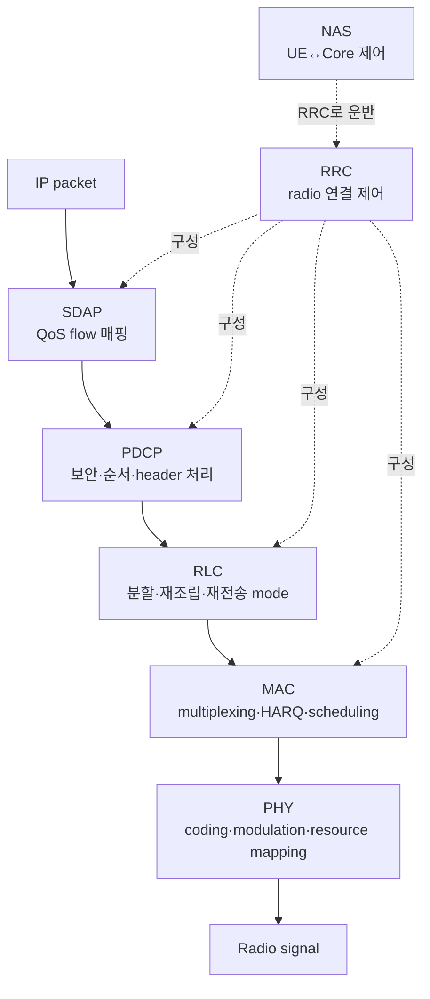

# 10. NR 무선과 프로토콜 스택

[이전: 이동통신 세대와 구조](09-cellular-generations-and-architecture.md) · [목차](README.md) · [다음: 접속·스케줄링·이동성](11-access-scheduling-and-mobility.md)

자료 확인일: **2026-10-11**

NR은 New Radio, 5G의 무선 접속 기술이다. 이 장은 전파 수식 전체보다 **한 IP packet이 어떤 계층의 상태를 거쳐 radio signal이 되는가**를 설명한다.

## 1. Stack과 연결 제어를 먼저 분리한다

프로토콜 stack은 data를 아래 계층으로 포장하고 위 계층으로 복원하는 처리 구조다. 연결 제어는 UE가 망에 등록되고 무선 bearer와 session을 만드는 절차다.

## 2. 각 계층의 책임

| 계층 | 풀어 쓴 말 | 입력 | 주요 결과 |
| --- | --- | --- | --- |
| PHY | Physical layer, 물리 계층 | coded bits | symbol과 radio resource |
| MAC | Medium Access Control | 여러 logical channel data | transport block, HARQ process |
| RLC | Radio Link Control | 상위 PDU | segmentation·reassembly |
| PDCP | Packet Data Convergence Protocol | IP/QoS data | ciphering·integrity 일부·순서 처리 |
| SDAP | Service Data Adaptation Protocol | QoS flow | Data Radio Bearer 매핑 |
| RRC | Radio Resource Control | radio 제어 message | 연결·측정·bearer configuration |
| NAS | Non-Access Stratum | UE-core 제어 message | 등록·인증·session·mobility 상태 |

PDU는 Protocol Data Unit, 해당 계층이 처리하는 message 단위다. 상위 계층 PDU는 아래 계층에서는 payload가 된다.

## 3. PHY는 bit를 radio resource에 놓는다

PHY는 error-control coding, modulation, layer mapping, resource mapping을 수행한다. QPSK는 symbol 하나에 2 bit, 16QAM은 4 bit, 64QAM은 6 bit를 싣는 이상적 bit mapping을 갖는다.

~~~text
100 QPSK symbols  → raw mapped bits 200
100 16QAM symbols → raw mapped bits 400
~~~

실제 user payload는 coding, pilot, control, guard, retransmission 비용 때문에 이 값보다 작다. 높은 modulation은 같은 symbol에 더 많은 bit를 넣지만 높은 SINR을 요구한다. SINR은 Signal-to-Interference-plus-Noise Ratio, 신호 대 간섭·잡음 비다.

### Modulation, code rate, CRC가 차례로 하는 일

**Modulation**은 bit 묶음을 전파에 실을 수 있는 amplitude·phase 상태인 symbol로 바꾸는 규칙이다. QPSK는 2 bit를 한 symbol state에 매핑하고 16QAM은 4 bit를 매핑한다. QAM은 Quadrature Amplitude Modulation이다.

**Code rate**는 오류 정정 coding 뒤 전체 coded bits 중 원래 정보가 차지하는 비율을 단순하게 나타낸다. Code rate 1/2라면 정보 1 bit당 대략 2 coded bits를 보내는 감각이다. 실제 NR rate matching과 coding block은 더 복잡하다.

**CRC**는 Cyclic Redundancy Check다. 송신자가 data에서 검사값을 만들고 수신자가 다시 계산해 block 오류를 찾는다. CRC가 맞았다는 것은 해당 bit block이 검사 규칙을 통과했다는 뜻이지, 사용자 내용이 업무적으로 옳거나 악의적으로 위조되지 않았다는 뜻은 아니다.

교육용 한 block:

~~~text
원래 정보            1,000 bits
CRC                  24 bits라고 가정
coding input          1,024 bits
code rate 1/2 근사    2,048 coded bits
16QAM                 4 bits/symbol
필요 symbol 근사      2,048 / 4 = 512 symbols
~~~

이 값은 실제 NR transport block size 계산이 아니다. Segmentation, multiple code blocks, rate matching, reference signal, control overhead를 생략한 **교육용 모형**이다.

Channel이 좋아 64QAM을 선택하면 raw symbol 수를 줄일 수 있지만 symbol point 사이 간격이 좁아져 noise와 interference에 더 민감하다. Decode 실패와 HARQ 재전송이 늘면 높은 modulation의 이득이 사라질 수 있다.

## 4. NR numerology

NR은 subcarrier spacing을 numerology로 바꿀 수 있다.

~~~text
subcarrier spacing = 15 kHz × 2^μ
μ=0 → 15 kHz
μ=1 → 30 kHz
μ=2 → 60 kHz
μ=3 → 120 kHz
~~~

일반적인 normal cyclic prefix 조건에서 slot은 14 OFDM symbol을 가진다. OFDM은 Orthogonal Frequency Division Multiplexing, 직교 부반송파 다중화다.

교육용 기본 시간 관계:

~~~text
μ=0: slot 1 ms
μ=1: slot 0.5 ms
μ=2: slot 0.25 ms
μ=3: slot 0.125 ms
~~~

Subcarrier spacing이 커지면 symbol과 slot이 짧아져 빠른 시간 변화와 낮은 scheduling 단위에 유리할 수 있다. 같은 대역폭에서 subcarrier 수, coverage, phase noise, guard 설계가 달라지므로 무조건 좋지는 않다.

## 5. Resource Block은 12 subcarrier다

RB는 Resource Block, 주파수 방향 자원 묶음이다. NR에서 한 RB는 12개 연속 subcarrier로 정의한다.

~~~text
30 kHz SCS에서 RB 주파수 폭
= 12 × 30 kHz
= 360 kHz
~~~

한 slot의 14 symbol과 결합해 `12 × 14 = 168 resource elements`라는 격자를 생각할 수 있다. Resource Element는 한 subcarrier와 한 OFDM symbol의 교차점이다.

168개가 모두 user data는 아니다. DM-RS 같은 reference signal, control, reserved resource가 차지한다.

## 6. 작은 전송량 계산

조건:

~~~text
10 RB
한 RB당 12 subcarrier
한 slot 14 symbols
그중 data symbol 10개라고 가정
16QAM = 4 bits/symbol
coding rate = 1/2로 단순 가정
layer 1개
~~~

계산:

~~~text
resource elements = 10 × 12 × 10 = 1,200
modulated bits = 1,200 × 4 = 4,800 bits
coded payload 근사 = 4,800 × 1/2 = 2,400 bits = 300 bytes
~~~

이는 교육용 근사다. 실제 transport block size는 3GPP 절차와 MCS table, DM-RS, overhead, rate matching, CRC, layer 수에 따라 정해진다.

## 7. MAC은 여러 흐름을 한 전송으로 묶는다

MAC은 logical channel의 data를 multiplexing하고 scheduler grant에 맞춰 transport block을 만든다. HARQ는 Hybrid Automatic Repeat reQuest, 오류 정정 coding과 빠른 재전송을 결합한 방식이다.

PHY decoding이 실패하면 receiver는 NACK를 보내고 HARQ process가 재전송할 수 있다. RLC AM의 재전송과 같은 층이 아니다. HARQ는 더 빠르고 낮은 계층, RLC 재전송은 더 긴 시간과 논리 PDU를 다룰 수 있다.

한 packet을 더 구체적으로 따라가자.

~~~text
입력: 900-byte IP packet
SDAP: QoS flow Q1 → bearer B1
PDCP: sequence·보안 정보를 붙인 PDU 생성
RLC: 현재 MAC grant에 맞게 두 segment로 나눌 수 있음
MAC: 다른 logical channel data와 multiplex
PHY: CRC·coding·modulation·resource mapping
receiver: CRC 통과 시 HARQ ACK, 실패 시 NACK
결과: 위 계층이 segment를 재조립해 원래 packet 복원
~~~

여기서 `900 byte IP packet = radio transmission 한 번`이라는 등식은 성립하지 않는다. Grant가 작으면 여러 번으로 나뉘고, 여러 작은 PDU가 하나의 transport block에 함께 들어갈 수도 있다.

## 8. RLC mode

| mode | 의미 | 대표 성격 |
| --- | --- | --- |
| TM | Transparent Mode | 최소한의 RLC header |
| UM | Unacknowledged Mode | RLC 재전송 없음 |
| AM | Acknowledged Mode | status와 RLC 재전송 |

AM을 쓰면 무조건 좋지 않다. 지연에 민감하고 일부 손실을 허용하는 traffic은 늦은 재전송보다 상위 계층 처리를 택할 수 있다.

## 9. PDCP와 SDAP

PDCP는 ciphering, sequence 처리, header compression 같은 기능을 제공한다. Split bearer나 mobility에서 중복·순서 처리가 중요할 수 있다.

SDAP는 5G QoS flow를 Data Radio Bearer에 매핑한다. QoS는 Quality of Service다. 하나의 UE IP session 안에서도 서로 다른 QoS flow가 다른 지연·우선순위 정책을 가질 수 있다.

## 10. RRC와 NAS는 같은 제어가 아니다

RRC는 UE와 gNB 사이 radio access 제어다. Cell 측정, 연결 설정, radio bearer 구성이 대표적이다.

NAS는 UE와 5GC 사이 제어다. NAS message는 radio 구간에서 RRC를 통해 운반될 수 있지만 논리적 상대는 gNB가 아니라 core의 AMF 등이다.

| 질문 | RRC | NAS |
| --- | --- | --- |
| 어떤 cell 측정을 보고할까 | 예 | 아니오 |
| 어떤 radio bearer를 만들까 | 예 | NAS 결과에 따라 RRC가 구성 |
| 가입자를 인증할까 | 운반 지원 | 핵심 절차 |
| PDU session을 만들까 | radio 자원 연결 | 핵심 session 요청 |

## 11. FDD와 TDD

FDD는 Frequency Division Duplex, uplink와 downlink를 서로 다른 주파수에 둔다. TDD는 Time Division Duplex, 같은 주파수에서 시간을 나눠 uplink와 downlink를 전환한다.

TDD는 downlink/uplink 비율을 traffic에 맞출 수 있지만 인접 cell의 방향이 어긋나면 간섭이 커질 수 있다. FDD는 동시 송수신에 유리하지만 paired spectrum이 필요하다.

## 12. 한 packet의 시간표

| 시점 | 계층 | 상태 변화 |
| --- | --- | --- |
| T0 | SDAP | QoS flow → bearer 결정 |
| T1 | PDCP | sequence·보안 header 추가 |
| T2 | RLC | grant 크기에 맞게 segment |
| T3 | MAC | logical channel multiplex, HARQ process 선택 |
| T4 | PHY | coding·modulation·RB mapping |
| T5 | receiver PHY/MAC | decode 성공이면 ACK, 실패면 NACK |
| T6 | receiver RLC/PDCP | reassembly·순서·복호 처리 |

## 13. 반례와 경계

- Normal CP가 아닌 조건에서는 14 symbol 가정을 그대로 쓰지 않는다.
- Mini-slot 전송은 slot 전체 14 symbol을 기다리지 않을 수 있다.
- 한 RB가 12 subcarrier라는 정의와 실제 usable bandwidth 전체 계산은 다르다.
- 높은 MCS는 channel이 나쁘면 재전송 증가로 오히려 느릴 수 있다.
- RRC 연결이 있어도 NAS 등록이나 PDU session이 반드시 성공한 것은 아니다.

## 14. 확인 문제

### 문제 1

60 kHz SCS의 numerology μ와 normal CP slot 길이는?

**해설:** `15 × 2^2 = 60`이므로 μ=2이고 slot은 0.25 ms다.

### 문제 2

30 kHz SCS에서 RB 하나의 주파수 폭은?

**해설:** 12 subcarrier × 30 kHz = 360 kHz다.

### 문제 3

NAS와 RRC의 상대는 각각 누구인가?

**해설:** NAS는 논리적으로 UE와 core 사이, RRC는 UE와 gNB 사이 제어다.

## 15. 공식 출처

- 3GPP TS 38.201, *NR; Physical layer; General description*
- 3GPP TS 38.211, *NR; Physical channels and modulation*
- 3GPP TS 38.300, *NR and NG-RAN Overall description*
- 3GPP TS 38.321/322/323/331, MAC·RLC·PDCP·RRC
- 3GPP TS 37.324, *SDAP specification*

다음 장에서는 이 stack이 접속, scheduling, HARQ, handover 시간표에서 어떻게 움직이는지 추적한다.
