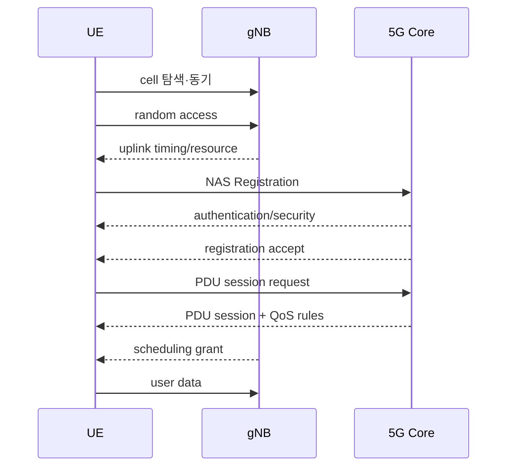
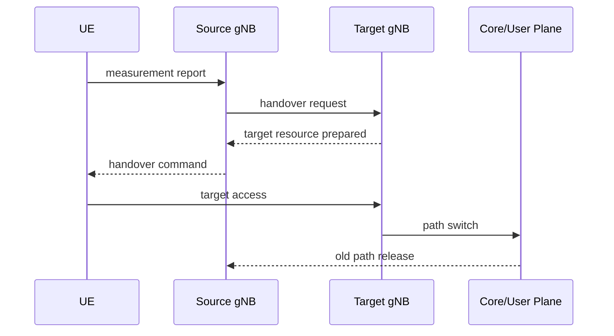

# 11. 접속, 스케줄링, HARQ, 이동성

[이전: NR 무선과 프로토콜 스택](10-nr-radio-and-protocol-stack.md) · [목차](README.md) · [다음: RAN 분할과 Cloud RAN](12-ran-splits-fronthaul-and-cloud.md)

자료 확인일: **2026-10-11**

이 장은 UE가 전원을 켠 뒤 사용자 packet을 보내고, 여러 UE와 radio resource를 나누며, 이동 중 다른 cell로 넘어가는 순서를 설명한다. 가장 중요한 구분은 **random access, registration, authentication, PDU session은 서로 다른 절차**라는 점이다.

## 1. 전체 시간표

## 2. Cell 탐색과 동기

UE는 먼저 주파수에서 cell 신호를 찾고 시간·주파수 동기를 맞춘다. Cell identity와 기본 system information을 얻는다. 이 단계는 가입자 인증이 아니다.

입력은 수신 radio sample이다. UE PHY가 동기 신호를 탐지하고, broadcast system information을 해석한다. 결과는 “이 cell에 접속을 시도할 수 있다”는 상태다.

## 3. Random Access는 무선 발언권 얻기

Random Access Channel 절차는 UE가 uplink timing을 맞추고 초기 radio resource와 임시 identity를 얻도록 돕는다.

대표적인 contention-based 흐름을 단순화하면:

| 순서 | message | 상태 변화 |
| --- | --- | --- |
| 1 | UE preamble | gNB가 접속 시도 감지 |
| 2 | Random Access Response | timing advance와 uplink grant 제공 |
| 3 | UE scheduled transmission | UE identity/요청 전달 |
| 4 | contention resolution | 같은 preamble 충돌을 해소 |

Random access 성공은 가입자 등록 성공이 아니다. 무선 구간에서 초기 message를 주고받을 발판을 얻은 것이다.

## 4. Registration과 Authentication

Registration은 UE가 5GC에 자신을 알리고 mobility·access 상태를 만드는 절차다. Authentication은 가입 정보와 cryptographic challenge를 이용해 UE와 network가 신뢰를 확인하는 절차다.

| 단계 | 입력 | 주체 | 중간 상태 | 결과 |
| --- | --- | --- | --- | --- |
| 등록 요청 | UE identity·capability | UE, gNB, AMF | 임시 registration context | 인증 필요 판단 |
| 인증 | challenge/response | UE, authentication functions | key material | 가입자 검증 |
| security mode | 선택한 algorithm | UE와 core | NAS 보안 활성 | 보호된 제어 message |
| 등록 수락 | allowed area 등 | AMF | registered state | mobility 관리 가능 |

인증 성공 뒤 정책이나 roaming 제한 때문에 등록이 거절될 수도 있다. 반대로 emergency access는 일반 인증 조건과 다를 수 있다.

## 5. PDU Session

PDU Session은 UE와 Data Network 사이 사용자 data 연결의 논리 상태다. SMF가 session을 관리하고 UPF와 QoS rule을 선택한다.

PDU는 Protocol Data Unit이다. Session이 만들어지면 UE IP 주소, QoS flow, 사용자 평면 tunnel 정보가 정해질 수 있다.

~~~text
Registration 성공
  ≠ PDU session 성공
  ≠ DNS 성공
  ≠ application server 성공
~~~

## 6. Scheduler가 필요한 이유

같은 cell의 여러 UE가 같은 시간·주파수 자원을 마음대로 쓰면 충돌한다. Scheduler는 channel 상태, QoS, buffer, fairness, retransmission을 보고 resource를 배정한다.

**Grant**는 UE가 언제 어느 resource로 얼마나 보낼 수 있는지 알려 주는 허가다. Downlink에서는 gNB가 어떤 UE의 data를 어느 resource에 실을지 정한다.

Grant에는 “앞으로 계속 쓸 수 있는 전용 주파수”라는 뜻이 없다. 대표적인 dynamic scheduling에서는 특정 시점의 resource assignment다. 다음 slot에는 다른 UE가 같은 RB를 쓸 수 있다.

~~~text
입력:
  UE-A buffer 20 KiB
  UE-B buffer 4 KiB
  UE별 CQI, QoS, HARQ 상태

담당:
  gNB MAC scheduler

중간 상태:
  후보 MCS
  RB와 symbol 배치
  HARQ process 번호
  예상 transport block size

결과:
  downlink assignment 또는 uplink grant

조건:
  실제 decode 성공은 아직 모름
~~~

## 7. CQI, MCS, transport block

CQI는 Channel Quality Indicator, UE가 보고하는 channel 품질 지표다. MCS는 Modulation and Coding Scheme, modulation과 coding rate의 조합이다.

~~~text
좋은 channel
  → 높은 CQI
  → 높은 MCS 후보
  → 같은 resource에서 더 많은 bits 가능

나쁜 channel
  → 낮은 MCS
  → payload는 줄지만 decode 성공 가능성 증가
~~~

CQI는 미래를 완벽히 예측하지 않는다. 측정·보고·scheduling 사이 시간이 지나고 UE가 움직이면 channel이 바뀔 수 있다.

## 8. 작은 scheduling 계산

교육용 조건:

~~~text
slot마다 data resource 100 units
UE-A 요구 80, 좋은 channel
UE-B 요구 80, 나쁜 channel
정책: 이번 slot에 A 60, B 40 할당
효율: A 6 bits/unit, B 2 bits/unit
~~~

계산:

~~~text
A scheduled bits = 60 × 6 = 360 bits
B scheduled bits = 40 × 2 = 80 bits
총 440 bits
~~~

모두 A에 주면 순간 총량은 600 bits일 수 있지만 B가 굶는다. Scheduler 목적은 최대 throughput 하나가 아니라 QoS, fairness, delay, retransmission을 함께 만족하는 것이다.

## 9. HARQ의 시간표

HARQ는 Hybrid Automatic Repeat reQuest다.

| 시간 | 사건 | 상태 |
| --- | --- | --- |
| T0 | gNB가 transport block 전송 | HARQ process N 대기 |
| T1 | UE decode 실패 | soft information 보존 가능 |
| T2 | UE가 NACK | 재전송 필요 |
| T3 | gNB가 redundancy를 달리해 재전송 | 이전 정보와 결합 |
| T4 | decode 성공, ACK | HARQ process 재사용 가능 |

HARQ ACK는 radio transport block의 decode 확인이다. TCP ACK나 application commit이 아니다.

### CQI→MCS→grant→HARQ를 한 건으로 연결한다

UE-A가 `CQI=10`을 보고했다고 하자. 숫자 10 자체가 10 dB나 10 Mbit/s라는 뜻은 아니다. CQI table과 configuration 안에서 UE가 지원 가능하다고 보는 spectral efficiency 후보를 나타낸다.

gNB는 CQI만 보지 않고 오래된 정도, target error rate, UE capability, interference를 고려해 MCS를 고른다. MCS는 modulation order와 coding rate를 결정하는 index다.

교육용 모형:

~~~text
UE 보고: CQI 10
gNB 선택: 16QAM, code rate 약 1/2라고 단순화
grant: data resource element 2,000개
raw mapped bits = 2,000 × 4 = 8,000 bits
정보 bits 근사 = 8,000 × 1/2 = 4,000 bits = 500 bytes
~~~

MAC header, CRC, reference signal과 실제 TBS 절차를 생략했으므로 최대 성능 보장이 아니다.

| 시간 | 주체 | 입력 | 중간 상태 | 결과 |
| --- | --- | --- | --- | --- |
| T0 | UE | channel measurement | CQI 10 | gNB로 report |
| T1 | gNB scheduler | CQI·buffer·QoS | MCS·grant 후보 | 500-byte 근사 block 배정 |
| T2 | gNB PHY | transport block | CRC·coding·16QAM | radio signal |
| T3 | UE PHY | noisy samples | soft bits·CRC | 실패, NACK |
| T4 | gNB | NACK·HARQ state | 재전송 resource | redundancy version 전송 |
| T5 | UE | 이전+새 soft information | combined decode | 성공, ACK |

첫 전송의 높은 MCS가 너무 공격적이었다면 재전송으로 지연과 resource 사용량이 늘어난다. CQI가 낮다고 항상 낮은 throughput인 것도 아니다. 다른 UE가 적어 더 많은 RB를 받을 수 있기 때문이다.

## 10. Buffer Status와 grant

Uplink scheduler는 UE가 보낼 data가 얼마나 있는지 알아야 한다. BSR은 Buffer Status Report다. UE는 logical channel group의 대기량을 보고하고 gNB는 uplink grant를 배정한다.

Buffer에 100 KiB가 있어도 grant가 10 KiB 상당이면 한 번에 모두 보내지 못한다. 다음 scheduling 기회를 기다린다. 이 대기가 radio latency의 일부다.

## 11. Handover가 필요한 이유

UE가 이동하면 serving cell 신호가 약해지고 neighbor cell이 좋아질 수 있다. Handover는 연결을 target cell로 옮겨 service를 이어 가는 절차다.

입력은 UE measurement report, cell load, policy다. Source gNB가 판단하고 target 자원을 준비한다. UE가 target으로 동기·접속하고 사용자 plane path가 전환된다.

## 12. Handover 중 packet trace

조건:

~~~text
Packet P1, P2, P3가 downlink로 진행
P1은 source에서 UE에 전달 완료
P2는 source PDCP buffer에 있음
P3는 core에서 source 방향으로 이동 중
~~~

| 시점 | source | target | 결과 |
| --- | --- | --- | --- |
| T0 | P1 ACK, P2 대기 | context 없음 | UE는 source 사용 |
| T1 | handover 시작, P2 forwarding 가능 | UE context 준비 | 중복·순서 상태 이동 |
| T2 | UE가 target 접속 | P2 또는 재전송 data 수신 | 짧은 interruption 가능 |
| T3 | path switch | 새 packet이 target으로 향함 | old path 정리 |

PDCP sequence number는 중복 제거와 순서 복구에 도움을 준다. 실제 forwarding과 lossless handover 동작은 architecture, bearer, 구현에 따라 달라진다.

## 13. 실패 사례를 절차에 매핑한다

| 증상 | 가능한 단계 |
| --- | --- |
| Preamble 반복 | random access collision·coverage |
| 등록 reject | subscription·policy·roaming |
| 등록 성공, IP 없음 | PDU session 실패 |
| 높은 CQI인데 느림 | scheduler load·core·server 병목 |
| NACK 증가 | radio channel·interference·MCS 과대 |
| 이동 때 짧은 끊김 | measurement·target 준비·path switch |

## 14. 조건이 달라지는 반례

- Contention-free random access는 handover 등에서 전용 preamble을 쓸 수 있다.
- Configured grant는 매번 동적 uplink grant를 기다리지 않는 경우가 있다.
- Dual connectivity는 두 radio node를 함께 활용할 수 있어 단순 source→target 전환과 다르다.
- Beam change는 cell handover가 아니어도 radio path를 바꿀 수 있다.
- CQI가 좋아도 core congestion이나 application 병목이면 throughput은 낮다.

## 15. 확인 문제

### 문제 1

Random access 성공이면 가입자 인증도 성공한 것인가?

**해설:** 아니다. Random access는 초기 radio timing과 resource를 얻는 절차다. Registration과 authentication은 뒤의 NAS 절차다.

### 문제 2

CQI가 높으면 scheduler가 반드시 그 UE에 모든 RB를 주는가?

**해설:** 아니다. QoS, fairness, buffer, 다른 UE, HARQ 상태를 함께 고려한다.

### 문제 3

HARQ ACK는 HTTP 요청 성공을 뜻하는가?

**해설:** 아니다. 특정 radio transport block decode를 확인할 뿐이다.

## 16. 공식 출처

- 3GPP TS 23.502, *Procedures for the 5G System*
- 3GPP TS 38.300, *NR and NG-RAN Overall description*
- 3GPP TS 38.321, *NR MAC protocol*
- 3GPP TS 38.331, *NR RRC protocol*
- 3GPP TS 24.501, *5G NAS protocol*

다음 장에서는 gNB 기능을 RU, DU, CU로 나누는 이유와 fronthaul 시간·대역폭 비용을 계산한다.
