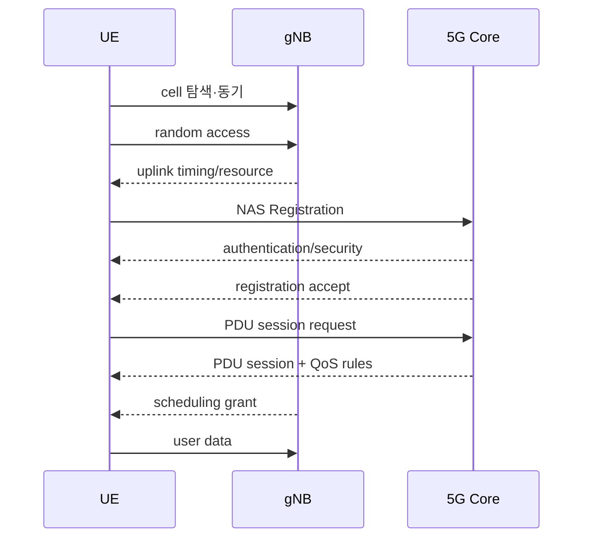
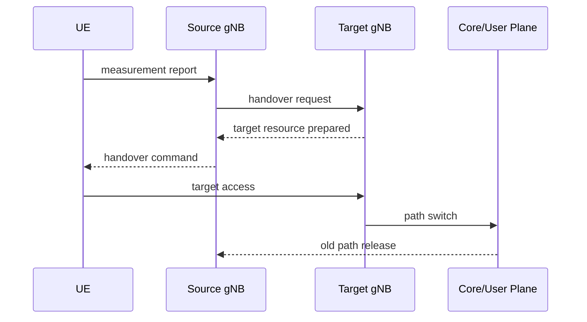

# 11. 접속, 스케줄링, HARQ, 이동성

자료 확인일: **2026-10-11**

이 장은 UE가 전원을 켠 뒤 사용자 packet을 보내고, 여러 UE와 radio resource를 나누며, 이동 중 다른 cell로 넘어가는 순서를 설명한다. **Cell 탐색, random access, registration, authentication, PDU session은 서로 다른 절차**다.

## 1. 접속 객체와 전체 시간표

UE는 synchronization signal로 cell timing과 식별 후보를 찾고 system information을 읽는다. **Random access**는 uplink timing과 초기 발언권을 맞추는 radio 절차다. **Registration**과 authentication은 core의 AMF와 수행하고, **PDU session**은 data network까지 사용자 plane 문맥을 만든다.

Cell 탐색의 입력은 radio sample이고 UE PHY가 동기 신호와 broadcast information을 해석한다. 결과는 접속을 시도할 cell이지 가입자 인증이 아니다.

대표 contention-based random access는 다음과 같다.

| 순서 | message | 상태 변화 |
| --- | --- | --- |
| 1 | UE preamble | gNB가 접속 시도 감지 |
| 2 | Random Access Response | timing advance와 uplink grant 제공 |
| 3 | UE scheduled transmission | UE identity/요청 전달 |
| 4 | contention resolution | 같은 preamble 충돌 해소 |

Registration은 mobility·access 상태를 만들고 authentication은 가입 정보와 cryptographic challenge로 신뢰를 확인한다.

| 단계 | 입력 | 주체 | 중간 상태 | 결과 |
| --- | --- | --- | --- | --- |
| 등록 요청 | UE identity·capability | UE, gNB, AMF | 임시 context | 인증 필요 판단 |
| 인증 | challenge/response | UE, authentication functions | key material | 가입자 검증 |
| security mode | 선택 algorithm | UE와 core | NAS 보안 활성 | 보호된 제어 message |
| 등록 수락 | allowed area 등 | AMF | registered state | mobility 관리 가능 |

인증 뒤에도 정책이나 roaming 제한으로 등록이 거절될 수 있고 emergency access는 일반 조건과 다를 수 있다. PDU session은 SMF가 관리하며 UE IP 주소, QoS flow, UPF tunnel 정보가 정해질 수 있다.

~~~text
Random access 성공
  ≠ Registration·authentication 성공
  ≠ PDU session 성공
  ≠ DNS 성공
  ≠ application server 성공
~~~

## 2. Scheduler, grant, CQI, MCS

**Scheduler**는 gNB MAC 안에서 제한된 시간·주파수 resource를 UE 사이에 배분한다. 입력은 buffer, QoS deadline, CQI, HARQ 상태, fairness와 TDD 방향이다. **Grant**는 특정 시점에 어떤 resource와 전송 조건을 사용할지 알리는 허가이며 계속 쓰는 전용 주파수가 아니다.

**CQI(Channel Quality Indicator)** 는 channel 품질을 정해진 범주로 보고한 값이고 **MCS(Modulation and Coding Scheme)** 는 modulation과 coding 조합이다. CQI가 MCS 하나를 자동 결정하는 절대 법칙은 아니다. 오래된 정도, target error rate, UE capability, interference와 vendor scheduler가 관여한다.

~~~text
입력: UE-A buffer 20 KiB, UE-B buffer 4 KiB, UE별 CQI·QoS·HARQ 상태
담당: gNB MAC scheduler
중간 상태: 후보 MCS, RB·symbol 배치, HARQ process, 예상 TBS
결과: downlink assignment 또는 uplink grant
조건: 실제 decode 성공은 아직 모름
~~~

| 시각 | 상태 | scheduler 행동 |
|---:|---|---|
| 0 ms | UE A buffer 1000 B, CQI 10 | 후보 MCS 선택 |
| 0.5 ms | UE B deadline 1 ms | B 우선 grant |
| 1.0 ms | A CQI가 5로 악화 | 더 robust MCS |
| 1.5 ms | A HARQ NACK | 재전송 resource |

### Throughput와 fairness 계산

~~~text
slot data resource 100 units
UE-A 요구 80, 좋은 channel, 6 bits/unit
UE-B 요구 80, 나쁜 channel, 2 bits/unit
이번 slot 할당: A 60, B 40

A = 60 × 6 = 360 bits
B = 40 × 2 = 80 bits
합계 = 440 bits
~~~

모두 A에 주면 순간 600 bits일 수 있지만 B가 굶는다. 목적은 최대 throughput 하나가 아니라 QoS, fairness, delay, retransmission을 함께 만족하는 것이다.

Uplink에서는 BSR(Buffer Status Report)로 logical channel group의 대기량을 알린다. Buffer가 100 KiB여도 grant가 10 KiB 상당이면 나머지는 다음 기회를 기다리며, 이 대기가 radio latency의 일부다. Configured grant처럼 매번 dynamic grant를 기다리지 않는 경우도 있다.

## 3. CSI aging과 HARQ 상태 흐름

t=0 CQI 12 측정, t=5 ms 보고, t=10 ms scheduling, t=15 ms 실제 전송이라고 하자. Channel coherence time이 5 ms라면 전송 시점 channel은 측정과 크게 다를 수 있다. 높은 MCS가 NACK과 deadline miss를 만들 수 있다. 보수적 MCS는 성공률을 높이지만 같은 payload에 더 많은 RE를 써 다른 UE를 지연시킨다.

교육용으로 data RE 2,000개, 16QAM 4 bit/RE, code rate 1/2를 가정하면 `2,000 × 4 × 0.5 = 4,000 bit = 500 byte`다. CQI=10 자체가 10 dB나 10 Mbit/s라는 뜻은 아니다.

| 시간 | 주체 | 입력 | 중간 상태 | 결과 |
| --- | --- | --- | --- | --- |
| T0 | UE | channel measurement | CQI 10 | gNB report |
| T1 | gNB scheduler | CQI·buffer·QoS | MCS·grant 후보 | 500-byte 근사 block |
| T2 | gNB PHY | transport block | CRC·coding·16QAM | radio signal |
| T3 | UE PHY | noisy samples | soft bits·CRC | 실패, NACK |
| T4 | gNB | NACK·HARQ state | 재전송 resource | 다른 redundancy version |
| T5 | UE | 이전+새 soft information | combined decode | 성공, ACK |

HARQ ACK는 radio transport block decode 확인이지 TCP ACK나 application commit이 아니다. 높은 MCS가 공격적이면 지연과 자원 소모가 늘고, CQI가 낮아도 다른 UE가 적어 많은 RB를 받으면 throughput이 높을 수 있다.

## 4. Handover의 제어와 packet 흐름

UE measurement report, source의 판단, target 자원 준비, UE 명령, target random access, core path switch가 이어진다.

P1은 source에서 전달 완료, P2는 source PDCP buffer, P3는 core에서 source 방향으로 이동 중이라고 하자.

| 시점 | source | target | 결과 |
| --- | --- | --- | --- |
| T0 | P1 ACK, P2 대기 | context 없음 | UE는 source 사용 |
| T1 | handover 시작, P2 forwarding 가능 | UE context 준비 | 중복·순서 상태 이동 |
| T2 | UE가 target 접속 | P2 또는 재전송 data 수신 | 짧은 interruption 가능 |
| T3 | path switch | 새 packet이 target으로 향함 | old path 정리 |

PDCP sequence number는 중복 제거와 순서 복구를 돕는다. 실제 forwarding과 lossless 동작은 architecture, bearer, 구현에 따라 다르다. Source queue, forwarding, path switch와 reordering 경계에서 loss가 생길 수 있다.

## 5. 각 절차가 소유하는 상태와 다음 소비자

Cell 탐색 단계에서 UE PHY는 후보 주파수별 correlation과 timing 상태를 만들고, broadcast information에서 cell identity와 접속 parameter를 얻는다. 이 결과는 random access가 사용할 preamble·occasion 선택의 입력이 된다. 아직 AMF에는 UE registration context가 없고 UPF에도 사용자 경로가 없다.

Random access response의 timing advance는 UE uplink signal이 gNB 수신 창에 맞도록 송신 시점을 보정하는 상태다. Uplink grant는 다음 scheduled message를 보낼 자원을 준다. Contention resolution까지 끝나야 같은 preamble을 고른 UE 사이에서 어느 시도가 살아남았는지 정리된다. Coverage가 나쁘거나 collision이 반복되면 core authentication에 도달하기 전부터 실패한다.

Registration request는 radio 절차의 결과를 이용해 NAS message로 AMF에 도착한다. AMF와 authentication function은 subscriber context와 challenge/response를 확인하고 security context를 만든다. Registration accept 뒤에도 SMF가 PDU session을 만들고 UPF tunnel·QoS rule을 설치해야 user plane이 열린다. 따라서 화면의 실패를 “접속 실패” 하나로 묶지 않고 마지막으로 생성된 상태를 확인한다.

Scheduler는 매 slot의 입력 snapshot으로 결정을 내린다. Buffer report가 오래되면 이미 비어 있는 UE에 grant를 주거나 새 burst를 늦게 발견할 수 있다. CQI age가 길면 MCS가 실제 channel과 맞지 않는다. HARQ NACK가 있으면 새 data와 retransmission 사이에서도 선택해야 한다. Deadline이 가까운 UE를 먼저 주면 신뢰성 목표에는 유리하지만 다른 UE의 starvation을 막을 fairness state가 필요하다.

## 6. Handover 상태를 control plane과 user plane으로 나누기

Measurement report는 target으로 즉시 이동하라는 명령이 아니라 source gNB 판단의 입력이다. Source는 neighbor 품질, hysteresis, time-to-trigger, target load와 policy를 보고 handover를 결정한다. Target이 context와 resource를 준비한 뒤에야 UE에 command를 보낸다. UE는 target timing을 맞추고 random access를 수행하며, core/user-plane path switch는 새 downlink packet의 목적지를 target으로 바꾼다.

이때 세 상태가 동시에 움직인다. Radio connection은 source에서 target으로 바뀌고, PDCP sequence·buffer 상태는 forwarding과 중복 제거에 쓰이며, core tunnel endpoint는 path switch에서 바뀐다. P2가 source buffer에 남은 상태로 새 packet P3가 target 경로에 먼저 도착하면 receiver 재정렬이 필요하다. Forwarding을 지원하지 않거나 timer가 만료되면 loss가 생길 수 있다. 반대로 같은 PDU가 old/new path에서 모두 오면 sequence number로 duplicate를 제거한다.

Dual connectivity에서는 UE가 두 node의 radio resource를 동시에 활용할 수 있어 source 하나를 끊고 target 하나로 옮기는 표만으로 충분하지 않다. Beam change는 같은 cell 안에서 path를 바꿀 수 있으므로 handover event와 같지 않다. Contention-free random access는 target이 전용 preamble을 미리 제공할 수 있어 일반 contention 흐름의 collision 조건이 달라진다.

## 7. 수치 결과를 조건 판단으로 연결하기

2,000 data RE 계산의 500 byte는 MAC header, CRC, reference signal과 실제 TBS 절차를 생략한 후보값이다. 첫 decode가 실패하면 receiver는 hard bit만 버리고 끝내는 것이 아니라 reliability를 담은 soft information을 HARQ buffer에 보존한다. 다른 redundancy version이 오면 두 관측을 결합해 codeword를 다시 decode한다. 성공한 ACK는 이 HARQ process를 재사용 가능하게 만들지만 application server의 처리 성공까지 확인하지 않는다.

CQI가 12였던 t=0부터 실제 전송 t=15 ms까지 coherence time 5 ms가 세 번 지나면 측정의 예측력이 크게 낮을 수 있다. 이 경우 낮은 MCS를 택하면 RE당 payload는 줄지만 재전송 가능성을 낮춘다. 반대로 channel이 그대로 좋은데 지나치게 보수적이면 같은 payload가 더 많은 RE를 차지해 cell 전체 queue를 늘린다. Scheduler 평가는 평균 throughput뿐 아니라 deadline miss, NACK, fairness와 tail latency를 함께 봐야 한다.

## 8. 실패, 예외, AI 제어 조건

| 증상 | 가능한 단계 |
| --- | --- |
| Preamble 반복 | random access collision·coverage |
| 등록 reject | subscription·policy·roaming |
| 등록 성공, IP 없음 | PDU session 실패 |
| 높은 CQI인데 느림 | scheduler load·core·server 병목 |
| NACK 증가 | channel·interference·MCS 과대 |
| 이동 때 짧은 끊김 | measurement·target 준비·path switch |

- Contention-free random access는 handover 등에서 전용 preamble을 쓸 수 있다.
- Dual connectivity는 두 radio node를 함께 써 단순 source→target과 다르다.
- Beam change는 cell handover 없이 radio path를 바꿀 수 있다.
- CQI가 좋아도 core congestion이나 application 병목이면 throughput은 낮다.

AI scheduler proposal은 CQI, buffer, mobility로 control 후보를 만들 수 있지만 표준 interface가 허용한 knob, inference deadline, fallback, stale model 탐지와 다른 UE의 fairness 검증이 필요하다. Offline 평균 throughput 향상은 실시간 deadline 안전을 보장하지 않는다.

## 9. 통합 확인 문제와 해설

### 문제 1
Random access 성공이면 인증도 성공했는가?

**해설:** 아니다. Random access가 만든 상태는 uplink timing advance, 임시 identity와 초기 grant다. 이 상태를 사용해 NAS registration request를 보낼 수 있게 될 뿐, AMF와 authentication function이 subscriber context와 challenge/response를 검증한 것은 아니다. Contention-free access처럼 preamble 조건이 달라도 radio 절차와 core 인증의 경계는 유지된다.

### 문제 2
1,500 RE, QPSK, rate 1/2의 정보량은?

**해설:** QPSK는 RE당 2 mapped bit이므로 raw bit는 `1,500×2=3,000`이다. Rate 1/2를 적용한 정보량 근사는 `3,000×0.5=1,500 bit`다. Reference signal, CRC, MAC header와 실제 TBS 절차를 뺀 교육값이므로 실제 payload로 보장하지 않는다.

### 문제 3
CQI가 높으면 모든 RB를 받는가?

**해설:** 아니다. 높은 CQI는 높은 MCS의 후보를 제공하지만 scheduler 입력에는 deadline, buffer, fairness, 다른 UE의 channel과 HARQ retransmission도 있다. 높은 CQI UE에 모두 배정하면 순간 throughput은 커져도 다른 UE가 starvation될 수 있다.

### 문제 4
CQI가 오래되면 무엇이 실패하는가?

**해설:** 측정·보고·scheduling·전송 사이 시간이 coherence time보다 길면 CQI가 현재 channel을 대표하지 못한다. 과도한 MCS는 CRC failure와 NACK를 늘리고, 지나치게 보수적인 MCS는 같은 payload에 더 많은 RE를 써 다른 queue를 지연시킨다.

### 문제 5
HARQ NACK 뒤 receiver가 보존하는 것은?

**해설:** Receiver는 bit의 reliability를 담은 soft information을 HARQ buffer에 보존한다. 다른 redundancy version이 오면 이전 관측과 결합해 decode를 다시 시도한다. ACK가 나와도 확인 범위는 radio transport block이며 TCP나 application 성공은 별도다.

### 문제 6
Handover loss는 어디에서 생길 수 있는가?

**해설:** Source PDCP queue의 packet이 target으로 forwarding되지 않거나 timer가 만료될 수 있고, core path switch 앞뒤 packet이 서로 다른 경로로 가며 순서가 바뀔 수 있다. PDCP sequence는 duplicate 제거와 reordering을 돕지만 forwarding 지원·bearer·구현 조건에 따라 lossless를 보장하지 않는다.

## 10. 공식 출처

- 3GPP TS 23.502, *Procedures for the 5G System*
- 3GPP TS 38.300, *NR and NG-RAN Overall description*
- 3GPP TS 38.321, *NR MAC protocol*
- 3GPP TS 38.331, *NR RRC protocol*
- 3GPP TS 24.501, *5G NAS protocol*

다음 장에서는 gNB 기능을 RU, DU, CU로 나누는 이유와 fronthaul 시간·대역폭 비용을 계산한다.

[이전: NR 무선과 프로토콜 스택](10-nr-radio-and-protocol-stack.md) · [목차](README.md) · [다음: RAN 분할과 Cloud RAN](12-ran-splits-fronthaul-and-cloud.md)
