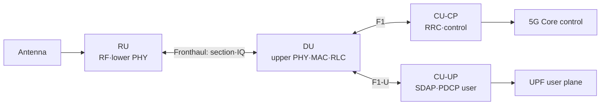

# 12. RAN 분할, Fronthaul, Cloud RAN

자료 확인일: **2026-10-11**

기지국 기능은 한 장비에 모두 넣거나 여러 위치로 나눌 수 있다. 이 장은 RU, DU, CU가 **어떤 입력과 상태를 소유하고 왜 지연·대역폭·동기 조건이 달라지는지** 설명한다.

## 1. RU, DU, CU와 transport 경계

| 구성 | 풀어 쓴 말 | 대표 책임 |
| --- | --- | --- |
| RU | Radio Unit | RF 송수신, digital front end, lower PHY 일부 |
| DU | Distributed Unit | upper PHY, MAC, RLC 등 시간 민감 처리 |
| CU | Centralized Unit | PDCP, SDAP, RRC 등 중앙화 가능한 처리 |

CU-CP는 RRC와 control-plane PDCP, CU-UP는 SDAP와 user-plane PDCP를 맡는다. 제어와 사용자 data의 scaling·placement가 달라 CU-CP 하나가 여러 CU-UP를 관리할 수 있지만 물리 server를 반드시 나눠야 하는 것은 아니다. 기능 경계는 split option과 구현에 따라 달라지므로 RU·DU·CU는 장소나 서버 대수의 이름이 아니다.

RU–DU는 fronthaul, DU–CU는 midhaul 또는 F1 transport, CU–core 방향은 backhaul 문맥으로 부른다. 문헌마다 범위가 조금 달라 endpoint를 함께 적는다.

Split은 RU를 antenna 가까이 두어 RF cable 손실을 줄이고, DU를 cell 가까이 두어 HARQ·scheduling deadline을 지키며, CU를 모아 자원 공유와 mobility coordination을 쉽게 하려는 선택이다. 중앙화가 커질수록 transport latency, jitter, bandwidth와 동기 품질 요구도 커진다.

## 2. 7-2x와 PHY block 흐름

PHY는 coding·rate matching, scrambling, modulation, layer mapping, precoding, resource element mapping, FFT/IFFT, cyclic prefix, digital front end로 이어진다. FFT/IFFT는 시간·주파수 영역 표현을 변환하고 precoding은 여러 antenna의 complex weight를 적용한다. DAC는 digital sample을 analog signal로 바꾼다.

7-2x 계열은 FFT/IFFT와 resource mapping·precoding 주변에서 upper/lower PHY를 나눈다. 정확한 owner는 Category A/B, uplink/downlink와 beamforming 위치에 따라 달라진다.

~~~text
DU 입력: MAC transport block와 scheduling 결과
DU upper PHY: coded bits → modulation symbols → layer/resource 정보
Fronthaul: section/control 정보와 frequency-domain IQ 계열 payload
RU lower PHY: precoding/beamforming → IFFT·CP·digital front end
결과: DAC/RF chain을 거쳐 antenna signal
~~~

DU가 만든 IQ와 section 정보는 radio deadline 전에 RU에 도착해야 한다. 늦은 packet은 일반 파일처럼 나중에 재전송해 완성할 수 없을 수 있다.

## 3. IQ rate를 조건과 함께 계산한다

### 계산 A: active subcarrier 기반 7-2x 근사

~~~text
active subcarriers 3,300
14 symbols/slot, 2,000 slots/s (30 kHz SCS)
antennas/streams 8
I 16 bits + Q 16 bits
downlink one-way, compression·header·guard·control 제외

complex samples/s = 3,300 × 14 × 2,000 × 8
                  = 739,200,000
raw rate = 739,200,000 × 32
         = 23,654,400,000 bit/s ≈ 23.65 Gbit/s
~~~

64 antenna/stream이고 다른 조건이 같으면 `23.65 × (64/8) ≈ 189.2 Gbit/s`다. 실제 massive MIMO에서는 beamforming 위치, layer 수, section 구성, PRB 사용률과 compression이 달라 이 값을 상용 RU 요구량으로 인용하면 안 된다.

### 계산 B: time-domain sample 단순 모형

한 방향, antenna path 4개, I/Q 각각 12 bit, 초당 30.72M complex sample이면 `30.72M × 2 × 12 × 4 = 2.94912 Gbit/s`다. Compression, line coding, Ethernet·eCPRI·section header와 control은 별도다.

## 4. Packetization, deadline, jitter

IQ sample의 I(In-phase)와 Q(Quadrature)는 complex baseband 값이다. Fronthaul endpoint는 antenna, symbol, PRB 구간을 section으로 설명하고 timing, compression parameter, sequence number를 붙여 eCPRI/O-RAN message와 Ethernet frame으로 packetize할 수 있다.

9,000-byte IQ payload를 Ethernet payload 1,500 byte 이하로 나누는 단순 모형이면 header를 무시해도 최소 6 frame이다. 실제 header와 section 경계 때문에 더 많을 수 있다. 한 frame의 유실·지연은 해당 antenna·symbol resource를 비워 radio 품질에 영향을 줄 수 있다.

| 시각 | 주체 | 상태 |
|---:|---|---|
| 0 μs | DU | symbol IQ 생성 |
| 20 μs | packetizer | sequence·section header |
| 40 μs | switch | queue 대기 |
| 90 μs | RU | 일부 frame 수신 |
| deadline | RU | 완전 IQ 여부 판정 |

교육용 deadline이 250 μs이고 RU processing 40 μs, DU processing 80 μs, switch/serialization 30 μs라면 transport propagation·queue에 남는 budget은 `250-40-80-30=100 μs`다. 평균 50 또는 70 μs여도 일부 packet이 200~300 μs에 도착하면 실패한다. Jitter는 지연의 변화이므로 평균만으로 안전을 판단하지 않는다.

## 5. PTP와 SyncE

PTP(Precision Time Protocol)는 timestamp message로 clock time·phase offset과 path delay를 추정한다. Forward/reverse path가 비대칭이면 offset 계산이 틀릴 수 있다. Boundary clock과 transparent clock은 clock 구간과 switch residence time을 관리한다.

SyncE(Synchronous Ethernet)는 Ethernet PHY에서 frequency를 전달하지만 time-of-day와 phase를 혼자 제공하지 않는다. Frequency는 SyncE, phase/time은 PTP로 보완할 수 있으며 GNSS source와 holdover 설계도 가능하다. 동기 packet 우선순위만 높여도 비대칭과 oscillator 문제가 모두 해결되지는 않는다.

## 6. Virtualization과 shared compute

Virtualized RAN은 network function을 전용 appliance 대신 일반 compute와 software에 배치하는 설계다. Container와 Kubernetes는 배포 수단이지 radio deadline 보장은 아니다.

- CPU core pinning과 NUMA locality
- huge page와 memory bandwidth
- NIC queue, SR-IOV, DPDK packet path
- accelerator와 driver
- real-time scheduling과 interrupt
- failure recovery의 deadline 영향

Pod가 Running이어도 DU deadline을 지켰다는 증거가 아니며 bare metal도 자동 보장은 아니다. AI inference와 DU가 GPU·CPU·NIC를 공유하면 queue interference가 생길 수 있어 평균 AI latency뿐 아니라 worst-case, fallback과 admission control을 본다. 표준 interface와 제품 지원은 연구 model 정확도와 별도 조건이다.

## 6. 기능 분할은 처리 상태의 소유권을 나눈다

CU-UP가 받은 IP/QoS PDU는 PDCP sequence와 security state를 거쳐 DU로 전달된다. DU의 RLC는 segmentation·reassembly state를, MAC은 UE별 buffer·grant·HARQ process state를, upper PHY는 coding·modulation·resource mapping 결과를 소유한다. Fronthaul section은 어느 frame·slot·symbol·antenna·PRB의 IQ인지 알려 RU가 payload를 정확한 radio 시점에 소비하게 한다. RU는 lower-PHY state와 beam weight를 사용해 time-domain sample과 RF signal을 만든다.

이 경계에서 payload만 도착해서는 충분하지 않다. Section identity나 timing이 맞지 않으면 IQ 값이 정상이어도 잘못된 symbol 또는 antenna에 놓일 수 있다. Sequence gap은 유실 범위를 찾는 데 쓰이고 compression parameter는 receiver가 bit representation을 복원하는 데 필요하다. Control-plane section 정보와 user-plane IQ payload가 일관되어야 한다.

기능을 중앙으로 옮기면 여러 cell의 compute pool과 coordination 기회가 생기지만, 이전에는 한 장비 내부에 있던 producer-consumer deadline이 transport network를 가로지르게 된다. DU가 제때 계산했어도 switch queue에서 늦으면 RU가 소비할 수 없다. 반대로 link bandwidth가 충분해도 DU processing이나 RU IFFT/RF 시간이 budget을 넘으면 실패한다. Split 평가는 bandwidth 하나가 아니라 end-to-end worst-case budget으로 한다.

## 7. 두 IQ rate 모형이 다른 이유

23.65 Gbit/s 계산은 active subcarrier와 OFDM symbol을 세어 frequency-domain resource를 표현한 7-2x 감각이다. 2.94912 Gbit/s 계산은 초당 complex sample 수를 직접 주고 antenna path를 곱한 단순 모형이다. 두 숫자는 서로 모순되는 link specification이 아니라 입력 가정과 표현 지점이 다른 계산이다. 실제 비교에는 sample rate, active PRB, antenna와 layer, beamforming 위치, bit width, compression, header, control과 line coding 조건을 같은 표로 맞춰야 한다.

64 antenna에서 단순히 8배한 189.2 Gbit/s도 antenna마다 동일 IQ stream을 운반한다는 가정의 민감도 계산이다. RU에서 beamforming하면 fronthaul 객체 수가 antenna 수와 똑같이 늘지 않을 수 있고, DU에서 antenna별 precoding을 끝내면 반대로 많은 stream이 필요할 수 있다. 이 차이가 Category와 beamforming 위치를 명시해야 하는 이유다.

Compression은 I/Q bit width나 표현 방법을 줄여 link rate를 낮추지만 quantization error가 EVM에 영향을 줄 수 있고 compressor/decompressor latency와 compute가 더해진다. 평균 compression ratio만 보고 radio 품질과 tail latency를 생략하지 않는다.

## 8. 동기와 packet 전달 실패의 상호작용

PTP offset 계산은 forward와 reverse delay가 대칭에 가깝다는 가정의 영향을 받는다. 한 방향 queue만 길어지면 clock offset으로 잘못 추정할 수 있다. Transparent clock은 switch residence time을 보정 정보에 반영하고 boundary clock은 clock distribution 구간을 나누지만, 잘못된 timestamp 위치나 oscillator holdover 품질까지 자동 해결하지 않는다.

SyncE로 frequency가 안정돼도 frame boundary의 phase와 time-of-day가 맞는다는 뜻은 아니다. 반대로 PTP timestamp가 오가더라도 oscillator가 불안정하거나 packet delay variation이 크면 두 update 사이의 clock 품질이 나빠질 수 있다. 실제 설계에서는 source 선택, failure 전환과 holdover 동안 허용 오차를 본다.

9,000-byte payload의 6 frame 가운데 하나가 deadline 뒤에 도착하면 나머지 다섯 frame이 정시에 왔다는 평균 통계로 해당 IQ 구간을 완성할 수 없다. Radio symbol은 기다리는 동안 다음 symbol processing도 진행해야 하므로 일반 reliable file transfer처럼 긴 retransmission을 허용하기 어렵다. Queue percentile과 연속 burst loss를 함께 측정하는 이유다.

## 9. Cloud 실행 상태와 radio 준비 상태

Kubernetes scheduler가 Pod를 node에 배치하고 DRA나 device plugin이 accelerator를 연결해도, 이것은 application lifecycle의 한 단계다. DU가 deadline을 지키려면 CPU core와 memory가 같은 NUMA domain에 있는지, NIC queue와 interrupt가 경쟁 workload에 막히지 않는지, hugepage와 DMA path가 준비됐는지, accelerator kernel의 worst-case 시간이 얼마인지 확인해야 한다.

Pod health check는 process 응답을 확인할 수 있지만 slot별 deadline miss나 PTP phase error를 자동 증명하지 않는다. 반대로 radio KPI가 잠시 정상이어도 failover 때 cold cache, container restart, route convergence가 deadline을 흔들 수 있다. AI workload를 같은 GPU에 둘 때는 RAN 예약량을 먼저 보호하고, preemption 지연을 측정하며, 남는 capacity보다 큰 AI batch는 admission control로 거부하거나 다른 queue로 보낸다.

## 10. 연결된 downlink 흐름과 split tradeoff

| 시간 | 주체 | 입력 | 중간 상태 | 결과 |
| --- | --- | --- | --- | --- |
| T0 | CU-UP | IP/QoS PDU | PDCP PDU | DU 방향 전달 |
| T1 | DU RLC/MAC | PDCP/RLC data | scheduling·HARQ | transport block |
| T2 | DU upper PHY | coded/modulated data | frequency-domain symbols | fronthaul message |
| T3 | RU lower PHY/RF | IQ·beam weights | time-domain signal | antenna 송신 |
| T4 | UE | radio signal | decode·HARQ feedback | 상위 PDU |

| 더 중앙화 | 장점 | 비용 |
| --- | --- | --- |
| PHY까지 중앙 | cell 간 자원 공유 가능성 | 높은 fronthaul rate·짧은 latency |
| PDCP 중심 중앙 | transport 요구 완화 | low-layer coordination 제한 |
| 현장 DU 강화 | fronthaul 부담 완화 | edge site 운영 자원 증가 |

## 11. 예외와 실패 조건

- 평균 latency가 낮아도 jitter tail이 deadline을 넘을 수 있다.
- Capacity가 충분해도 PTP path 비대칭이면 phase 오차가 생긴다.
- CPU 50%여도 한 core·NUMA path만 포화될 수 있다.
- IQ compression은 bitrate를 줄이지만 EVM과 compute cost를 악화시킬 수 있다.
- 모든 gNB가 RU/DU/CU를 물리 분리하지 않는다.

EVM(Error Vector Magnitude)은 이상적 modulation point와 실제 signal의 차이를 나타낸다.

## 12. 통합 확인 문제와 해설

### 문제 1
2 antenna, I/Q 16 bit, 10 Msps의 raw rate는?

**해설:** Complex sample 하나는 I 16 bit와 Q 16 bit로 32 bit다. 초당 10M sample과 antenna path 2개를 곱해 `10M×32×2=640 Mbit/s`다. Header, line coding, synchronization과 compression을 제외한 raw one-way payload다.

### 문제 2
7-2x rate는 cell user throughput과 같은가?

**해설:** 아니다. User throughput은 성공적으로 전달된 application payload이고 fronthaul은 IQ, section·control, reference·padding과 header를 운반할 수 있다. Beamforming 위치, antenna 수, PRB 사용률과 compression이 바뀌면 같은 user traffic에서도 rate가 달라진다.

### 문제 3
PTP와 SyncE의 차이는?

**해설:** PTP는 timestamp 교환으로 time·phase offset과 path delay를 추정하므로 asymmetry와 packet delay variation의 영향을 받는다. SyncE는 PHY bit stream으로 frequency를 전달하지만 time-of-day를 혼자 주지 않는다. 서로 대체어가 아니라 보완적으로 쓸 수 있다.

### 문제 4
평균 지연이 budget 아래거나 container가 Running이면 충분한가?

**해설:** 평균 아래여도 일부 packet이 deadline을 넘으면 해당 symbol을 잃을 수 있다. Pod Running은 process 배치 상태일 뿐 CPU pinning, NUMA, NIC queue, interrupt와 accelerator worst-case를 증명하지 않는다. Tail latency와 end-to-end deadline miss를 측정해야 한다.

### 문제 5
Fronthaul packet이 늦으면?

**해설:** Section timing이 가리키는 symbol 처리 창이 지나면 RU가 늦은 IQ를 사용할 수 없을 수 있다. 9,000-byte payload의 여섯 frame 중 하나만 늦어도 그 IQ 범위가 비므로, 일반 파일 전송처럼 나중에 완성하는 재전송 모델을 적용할 수 없다.

## 13. 공식 출처

- 3GPP TS 38.401, *NG-RAN architecture description*
- 3GPP TS 38.470/471/472/473, *F1 interface*
- O-RAN Alliance, *Open Fronthaul Specifications*
- IEEE 1588, *Precision Time Protocol*
- ITU-T G.826x series, packet/frequency synchronization

다음 장에서는 이 분할된 RAN을 SMO, RIC, xApp, rApp이 서로 다른 시간 규모에서 제어하는 방식을 본다.

[이전: 접속·스케줄링·이동성](11-access-scheduling-and-mobility.md) · [목차](README.md) · [다음: O-RAN RIC와 제어 루프](13-oran-ric-and-control-loops.md)
