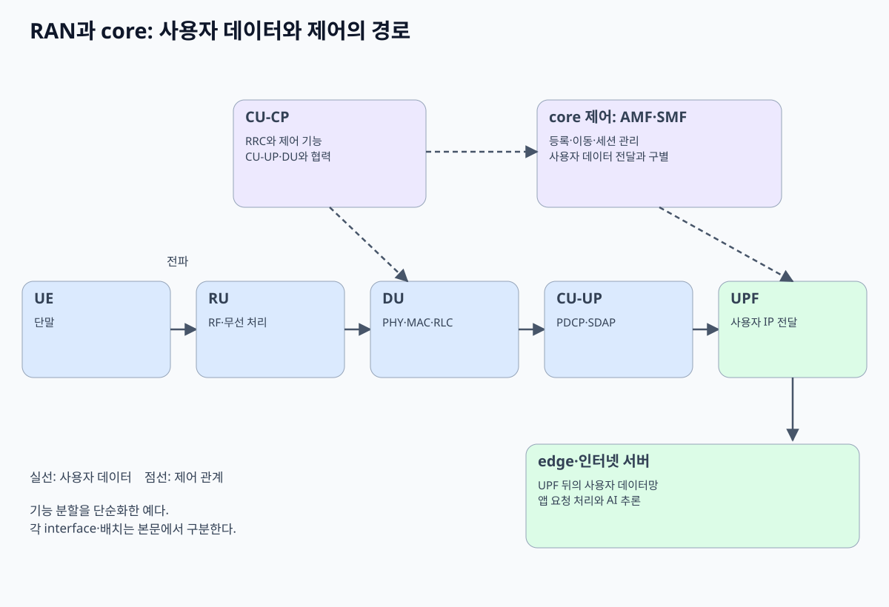
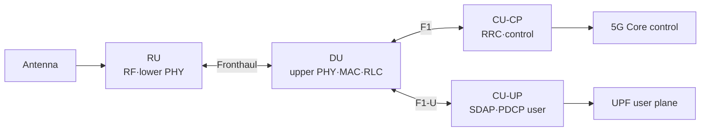

# 12. RAN 분할, Fronthaul, Cloud RAN

[이전: 접속·스케줄링·이동성](11-access-scheduling-and-mobility.md) · [목차](README.md) · [다음: O-RAN RIC와 제어 루프](13-oran-ric-and-control-loops.md)

자료 확인일: **2026-10-11**

기지국 기능을 모두 안테나 옆 장비 하나에 넣을 수도 있고, 기능을 여러 위치로 나눌 수도 있다. 이 장은 RU, DU, CU가 **어떤 입력과 상태를 소유하고 왜 지연·대역폭·동기 조건이 달라지는지** 설명한다.

## 1. 세 구성 요소

| 구성 | 풀어 쓴 말 | 대표 책임 |
| --- | --- | --- |
| RU | Radio Unit | RF 송수신, digital front end, lower PHY 일부 |
| DU | Distributed Unit | upper PHY, MAC, RLC 등 시간 민감 처리 |
| CU | Centralized Unit | PDCP, SDAP, RRC 등 상대적으로 중앙화 가능한 처리 |

기능 경계는 선택한 split option과 구현에 따라 달라진다. “RU는 안테나, DU는 서버, CU는 cloud”라는 한 문장만으로는 부족하다.

## 2. CU-CP와 CU-UP

CU-CP는 Centralized Unit Control Plane이다. RRC와 control-plane PDCP 같은 기능을 담당한다. CU-UP는 Centralized Unit User Plane이며 SDAP와 user-plane PDCP를 담당한다.

분리 이유는 제어와 사용자 data의 scaling·placement 요구가 다르기 때문이다. CU-CP 하나가 여러 CU-UP를 관리할 수 있는 구조가 가능하다. 그렇다고 모든 배포가 물리 server를 따로 써야 하는 것은 아니다.

## 3. 왜 split하는가?

- RU를 안테나 가까이 두어 RF cable 손실을 줄인다.
- DU를 cell 가까이 두어 HARQ와 scheduling의 짧은 deadline을 지킨다.
- CU를 모아 자원 공유와 mobility coordination을 쉽게 한다.
- Software function을 공통 compute에서 운영해 배치 유연성을 얻는다.

중앙화는 공짜가 아니다. 기능을 멀리 옮길수록 transport latency, jitter, bandwidth, 동기 품질 요구가 커진다.

## 4. Fronthaul과 Backhaul

Fronthaul은 RU와 DU 같은 radio 기능 분할 사이 연결이다. Midhaul은 DU-CU 구간을 가리키는 데 쓰인다. Backhaul은 RAN과 core 방향 연결을 가리킨다.

이 말은 문헌과 사업자에 따라 범위가 조금 다를 수 있으므로 endpoint를 함께 적는다.

~~~text
정확한 표현:
  RU–DU fronthaul
  DU–CU F1 transport
  CU–5GC transport
~~~

## 5. 7-2x split의 감각

O-RAN Open Fronthaul에서 널리 다루는 7-2x 계열은 PHY 기능을 RU와 DU 사이에서 나눈다. RU는 lower PHY 쪽, DU는 upper PHY 쪽 처리를 맡는다.

어디까지 frequency-domain IQ를 운반하고 beamforming을 누가 하는지는 category와 설정에 따라 달라질 수 있다. 따라서 “7-2x는 언제나 같은 bitrate”라고 말할 수 없다.

### PHY block을 RU와 DU 사이에서 왜 나누는가

PHY는 하나의 함수가 아니다. Coding·rate matching, scrambling, modulation, layer mapping, precoding, resource element mapping, FFT/IFFT, cyclic prefix, digital front end 같은 block이 이어진다.

FFT는 Fast Fourier Transform, 시간 영역과 주파수 영역 표현을 효율적으로 변환하는 계산이다. IFFT는 inverse FFT다. Precoding은 여러 antenna가 원하는 방향과 layer로 신호를 보내도록 complex weight를 적용하는 처리다.

7-2x의 감각은 FFT/IFFT와 resource mapping·precoding 주변에서 lower PHY와 upper PHY 책임을 나누는 것이다. 정확한 block owner는 Category A/B, uplink/downlink, beamforming 위치에 따라 달라진다.

~~~text
DU 쪽 입력:
  MAC transport block와 scheduling 결과

DU upper PHY 중간 상태:
  coded bits → modulation symbols
  layer/resource mapping 정보

Fronthaul:
  section/control 정보와 frequency-domain IQ 계열 payload

RU lower PHY 중간 상태:
  precoding 또는 beamforming
  IFFT·cyclic prefix·digital front end

결과:
  DAC/RF chain을 거쳐 antenna signal
~~~

DAC는 Digital-to-Analog Converter, digital sample을 analog signal로 바꾸는 장치다.

## 6. IQ rate 한 방향 손계산

다음은 **실제 규격 산출값이 아니라 조건을 명시한 교육용 근사**다.

~~~text
active subcarriers: 3,300
OFDM symbols: 14 per slot
slot rate: 2,000 slots/s  # 30 kHz SCS, 0.5 ms slot
antennas/streams: 8
I sample: 16 bits
Q sample: 16 bits
direction: downlink one-way
compression·header·guard·control overhead 제외
~~~

계산:

~~~text
complex samples/s
= 3,300 × 14 × 2,000 × 8
= 739,200,000 samples/s

bits/sample = I 16 + Q 16 = 32 bits

raw one-way IQ rate
= 739,200,000 × 32
= 23,654,400,000 bit/s
≈ 23.65 Gbit/s
~~~

Ethernet/eCPRI/O-RAN header, line coding, synchronization, control plane, padding을 더하면 link 요구량은 커질 수 있다. Compression을 적용하면 줄지만 품질·지연·구현 비용이 생긴다.

## 7. 조건이 바뀌는 계산

안테나/stream을 8에서 64로 늘리고 다른 조건이 같으면 단순 raw rate는 8배다.

~~~text
23.65 Gbit/s × (64 / 8)
≈ 189.2 Gbit/s
~~~

그러나 실제 massive MIMO에서는 beamforming 위치와 layer 수, section 구성, PRB 사용률, compression이 달라진다. 이 숫자를 상용 RU 요구량으로 인용하면 안 된다.

## 8. Time budget와 jitter

Latency는 packet 하나가 도착하는 데 걸린 시간이다. Jitter는 latency 변화다. Radio processing은 정해진 symbol·slot deadline 안에 끝나야 하므로 평균만 낮고 tail이 큰 transport는 위험하다.

교육용 deadline:

~~~text
총 budget 250 μs
RU processing 40 μs
DU processing 80 μs
switch/serialization 30 μs
남는 transport propagation·queue budget
= 250 - 40 - 80 - 30
= 100 μs
~~~

한 번 90 μs, 다음 번 180 μs라면 평균만 보고 안전하다고 할 수 없다. Deadline을 넘긴 frame은 늦게 도착해도 쓸 수 없을 수 있다.

### IQ sample이 Ethernet packet이 되는 과정

IQ sample은 complex baseband sample의 실수축 I(In-phase)와 직교축 Q(Quadrature) 값이다. 한 sample의 I와 Q가 각각 16 bit라면 raw payload는 32 bit다.

Fronthaul은 sample을 cable에 숫자만 연속 흘리는 것이 아니다. 여러 antenna, symbol, PRB 구간을 section으로 설명하고, IQ payload를 eCPRI/O-RAN message와 Ethernet frame에 packetize할 수 있다.

~~~text
입력: 특정 symbol·antenna의 IQ 값
담당: DU/RU fronthaul endpoint
중간 상태:
  section identity
  frame/slot/symbol timing
  compression parameter
  sequence number
결과: Ethernet packet 여러 개
조건: packet이 해당 radio deadline 전에 도착해야 함
~~~

예를 들어 IQ payload 9,000 byte를 Ethernet payload 1,500 byte씩 정확히 나눈다는 단순 모형이면 최소 6 frame이 필요하다. 실제로는 fronthaul header와 MTU 때문에 frame 수가 더 많을 수 있다.

한 frame이 사라지거나 늦으면 그 frame에 해당하는 IQ 범위를 쓸 수 없을 수 있다. 일반 파일 전송처럼 몇 초 뒤 재전송해 완성하는 방식은 radio symbol deadline과 맞지 않는다.

**Jitter**가 중요한 이유가 이것이다. 평균 도착 70 μs라도 일부 packet이 300 μs에 도착하면 해당 symbol의 processing window를 놓칠 수 있다.

## 9. 동기화: PTP와 SyncE

PTP는 Precision Time Protocol, packet message로 clock time·phase를 맞추는 protocol이다. SyncE는 Synchronous Ethernet, Ethernet physical layer에서 frequency를 전달하는 기술이다.

| 요구 | PTP | SyncE |
| --- | --- | --- |
| 시간·phase 정보 | 제공 가능 | 단독으로 절대 시간 제공 아님 |
| frequency 안정 | packet delay 영향 | PHY frequency 전달 |
| network 장비 지원 | timestamp·boundary clock 중요 | SyncE 지원 PHY 필요 |

둘은 경쟁 제품명이 아니라 보완적으로 쓸 수 있는 동기 도구다. GNSS를 포함한 다른 source와 holdover 설계도 있을 수 있다.

PTP packet은 timestamp를 교환해 clock offset과 path delay를 추정한다. Forward와 reverse path delay가 크게 비대칭이면 계산 오차가 생길 수 있다. Boundary clock과 transparent clock은 network 장비가 packet residence time과 clock distribution을 더 정확히 다루도록 돕는다.

SyncE는 bit stream의 physical frequency를 따라가게 하지만 “현재 시각이 12:00:00”이라는 time-of-day를 단독으로 알려 주지 않는다. 그래서 frequency는 SyncE, phase/time은 PTP로 보완하는 구성이 가능하다.

## 10. Virtualization은 Kubernetes와 같은 말이 아니다

Virtualized RAN은 network function을 전용 appliance 대신 일반 compute와 software로 실행하는 설계다. Container와 Kubernetes는 배포 수단이 될 수 있지만 실시간 성능을 자동 제공하지 않는다.

확인할 항목:

- CPU core pinning과 NUMA locality
- Huge page와 memory bandwidth
- NIC queue, SR-IOV, DPDK 같은 packet path
- Accelerator와 driver
- Real-time scheduling과 interrupt
- Failure recovery가 radio deadline에 미치는 영향

Kubernetes Pod가 Running이어도 DU deadline을 지켰다는 증거가 아니다. 반대로 bare metal만 쓴다고 deadline이 자동 보장되지도 않는다.

## 11. 한 downlink block의 경로

| 시간 | 주체 | 입력 | 중간 상태 | 결과 |
| --- | --- | --- | --- | --- |
| T0 | CU-UP | IP/QoS PDU | PDCP PDU | DU 방향 전달 |
| T1 | DU RLC/MAC | PDCP/RLC data | scheduling·HARQ state | transport block |
| T2 | DU upper PHY | coded/modulated data | frequency-domain symbols | fronthaul message |
| T3 | RU lower PHY/RF | IQ·beam weights | time-domain signal | antenna 송신 |
| T4 | UE | radio signal | decode·HARQ feedback | 상위 PDU |

## 12. Split 선택의 tradeoff

| 더 중앙화 | 장점 | 비용 |
| --- | --- | --- |
| PHY까지 중앙 | cell 간 자원 공유 가능성 | 높은 fronthaul rate·짧은 latency |
| PDCP 중심 중앙 | transport 요구 완화 | low-layer coordination 제한 |
| 현장 DU 강화 | fronthaul 부담 완화 | edge site 운영 자원 증가 |

## 13. 반례와 실패 조건

- 평균 latency가 낮아도 jitter tail이 deadline을 넘을 수 있다.
- Link capacity가 충분해도 PTP timestamp 경로가 비대칭이면 phase 오차가 생길 수 있다.
- CPU utilization이 50%여도 한 core·NUMA path만 포화될 수 있다.
- IQ compression이 bitrate를 줄여도 EVM과 compute cost가 나빠질 수 있다.
- 모든 gNB가 RU/DU/CU를 물리적으로 분리하는 것은 아니다.

EVM은 Error Vector Magnitude, 이상적 modulation point와 실제 signal의 차이를 나타내는 품질 지표다.

## 14. 확인 문제

### 문제 1

RU–DU 7-2x fronthaul rate가 cell user throughput과 같은가?

**해설:** 아니다. IQ·reference·control·header·unused resource 표현과 compression 조건이 달라진다.

### 문제 2

PTP와 SyncE의 핵심 차이는?

**해설:** PTP는 packet으로 시간·phase를 전달하고, SyncE는 Ethernet PHY frequency 동기를 제공한다.

### 문제 3

DU를 container로 실행하면 Cloud RAN 요구가 모두 충족되는가?

**해설:** 아니다. CPU·NUMA·NIC·accelerator·real-time deadline과 동기 품질을 별도로 검증해야 한다.

## 15. 공식 출처

- 3GPP TS 38.401, *NG-RAN architecture description*
- 3GPP TS 38.470/471/472/473, *F1 interface*
- O-RAN Alliance, *Open Fronthaul Specifications*
- IEEE 1588, *Precision Time Protocol*
- ITU-T G.826x series, packet/frequency synchronization

다음 장에서는 이 분할된 RAN을 SMO, RIC, xApp, rApp이 서로 다른 시간 규모에서 어떻게 제어하는지 본다.
