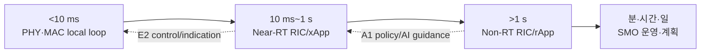
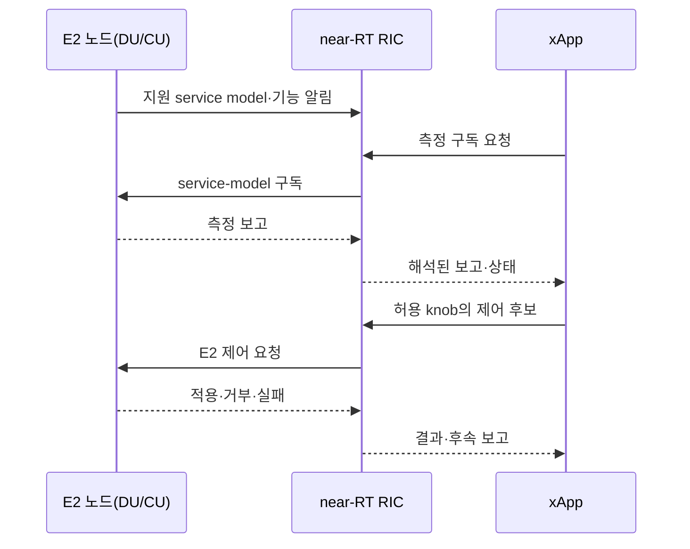

# 13. O-RAN, RIC, 제어 루프

자료 확인일: **2026-10-11**

**O-RAN**은 무선접속망(RAN)의 구성요소가 개방된 인터페이스로 연결되고 제어되도록 하는 구조다. 여기서 **인터페이스(interface)**는 두 구성요소가 어떤 요청과 데이터를 주고받으며 결과를 어떻게 해석할지 정한 약속이다. 이 장은 측정이 제어 앱으로 들어와 실제 기지국 상태를 바꾼 뒤, 다음 측정으로 효과를 확인하는 과정을 따라간다. 각 실행 주체의 역할을 먼저 설명하고 시간 규모와 연결 경로를 비교한다.

## 1. RIC와 제어 앱의 실행 위치·관리자·입출력·수명

**RIC(RAN Intelligent Controller, RAN 지능형 제어기)** 는 단순한 분석 화면이 아니라 RAN measurement를 받아 내부 상태를 만들고, 허용된 action을 다시 RAN node에 전달하는 software 실행 환경이다. **Real-Time**은 관측 뒤 정해진 시간 안에 결과가 유효해야 한다는 뜻이다. 여기서 near-Real-Time과 Non-Real-Time은 컴퓨터가 막연히 빠르거나 느리다는 평가가 아니라 어떤 control loop의 시간 규모와 상태 수명을 소유하는지 구분한다.

**SMO(Service Management and Orchestration)** 는 RAN service와 network function의 configuration·fault·performance·software lifecycle, 그리고 O-Cloud resource orchestration을 조정하는 관리 영역이다. 운영자와 management system이 관리 주체이며 O1을 통해 managed function의 상태를, O2를 통해 infrastructure lifecycle을 다룬다. SMO가 DU software를 배포하는 일, xApp이 handover parameter 후보를 내는 일, DU가 다음 slot RB를 고르는 일은 서로 다른 상태와 시간 경계를 가진다.

**Near-RT RIC**는 SMO가 관리하는 O-RAN 환경에서 near-real-time control platform으로 실행된다. E2 node인 O-CU/O-DU의 indication과 subscription 결과를 입력받고, xApp의 판단을 policy·권한·service-model 조건과 결합해 E2 control request로 보낸다. 내부 상태는 최근 수십 ms에서 1초 안팎의 measurement window, UE·cell context, action 결과처럼 비교적 짧게 변한다. Near-RT RIC가 모든 radio 결정을 대신하지 않으며 DU scheduler는 slot별 local state를 계속 소유한다.

**Non-RT RIC**는 SMO의 non-real-time 기능 영역에 놓여 1초보다 긴 분석, policy와 AI/ML lifecycle을 다룬다. 여러 cell의 장기 performance 자료, configuration, fault history와 operator objective를 입력으로 받고 A1 policy, enrichment information 또는 AI/ML guidance를 산출할 수 있다. 그 상태의 수명은 초 단위 결정보다 길며 시간대별 정책, model version, training·validation 결과처럼 분·시간·일 단위로 유지될 수 있다.

**xApp**은 near-RT RIC 안에서 실행되는 application이다. E2로 올라온 cell load, UE radio quality, handover 통계를 구독해 짧은 관측 창의 feature와 application state를 만든다. A1 policy와 현재 telemetry를 함께 보고 service model이 허용한 control knob의 후보를 출력한다. xApp 자체가 임의의 node memory를 쓰는 것이 아니며 near-RT RIC와 E2 node의 검사·적용 결과를 다시 입력받아 다음 판단을 갱신한다. Crash나 timeout 때 마지막 action이 언제 만료되는지도 lifecycle의 일부다.

**rApp**은 SMO의 Non-RT RIC 영역에서 실행되는 application이다. 더 긴 기간의 performance data, 구성, 장애 이력과 사업자 목표를 입력으로 정책·model·권고를 만든다. 산출물은 A1을 통해 near-RT 영역이 소비하거나 O1 운영 절차로 이어질 수 있다. rApp이 model artifact를 만들었다는 사실만으로 xApp이나 node에 배포·활성화된 것은 아니다. Validation, version, 적용 cell과 rollback 조건을 별도로 관리한다.

| 객체 | 주 실행 위치·관리자 | 입력 | 바꾸는 상태·출력 | 대표 수명 |
| --- | --- | --- | --- | --- |
| DU scheduler | O-DU, RAN local owner | buffer·CQI·HARQ·QoS | 다음 slot grant·MCS | μs~ms |
| xApp | Near-RT RIC, operator-authorized app | E2 telemetry·A1 policy | E2 action 후보·짧은 feature state | 10 ms~1 s loop |
| Near-RT RIC | SMO 관리 platform | subscription·xApp request·policy | 검증된 E2 request·result routing | session·loop 동안 |
| rApp | Non-RT RIC/SMO | 장기 KPI·fault·configuration | policy·model·guidance | 초보다 긴 기간 |
| Non-RT RIC | SMO 영역 | rApp data·operator objective | A1·AI lifecycle state | 분~일 이상 가능 |
| SMO | 운영 관리 영역 | inventory·fault·performance·cloud state | O1 configuration·O2 deployment | function 운영 수명 |

## 2. 실행 주체와 시간 규모를 함께 비교한다

| 이름 | 주요 책임 |
| --- | --- |
| SMO(Service Management and Orchestration) | RAN service·function·cloud 자원 관리 조정 |
| Non-RT RIC | 1초보다 긴 정책·분석·AI/ML lifecycle |
| Near-RT RIC | 약 10 ms~1 s의 telemetry 기반 RAN 최적화 |
| rApp | Non-RT RIC의 장기 분석·정책·model 앱 |
| xApp | Near-RT RIC의 짧은 주기 제어 앱 |
| O-Cloud | O-RAN function의 cloud infrastructure |

기지국 slot scheduler는 수백 μs~ms, 운영자는 분·시간 규모를 다룬다. RIC는 그 사이 측정을 상태로 만들고 허용된 제어를 RAN node에 보내는 실행 환경이다. 시간 범위는 기능 구분이지 모든 요청의 보장 latency benchmark가 아니다.

30 kHz SCS slot은 0.5 ms이므로 near-RT 하한 10 ms도 이미 `10/0.5=20 slots`다. E2 수집·network·xApp·적용을 거쳐 다음 slot의 정확한 RB를 고르기 어렵고, 그 일은 DU/MAC local scheduler가 맡는다.

## 3. A1, E2, O1, O2와 service model

| interface | 연결 | 전달 객체 | 대표 수명 |
| --- | --- | --- | --- |
| A1 | Non-RT→Near-RT RIC | policy·enrichment·AI/ML guidance | 초~시간 |
| E2 | Near-RT RIC↔RAN node | report·subscription·control | 10 ms~1 s loop |
| O1 | SMO↔managed function | configuration·fault·performance·software 관리 | 운영 수명 |
| O2 | SMO↔O-Cloud | infrastructure deployment·resource lifecycle | 배포 수명 |

Policy는 목표와 적용 조건이고 control knob는 interface가 실제로 노출한 parameter나 action이다. “지연 최소화”는 정책이지 장비에 쓸 숫자 명령이 아니다. E2 연결만으로 모든 제어가 가능하지 않다. E2 Service Model이 measurement, trigger, action, parameter, 성공·거부 의미를 정의하고 node와 xApp이 같은 기능·version을 구현해야 한다.

지원 knob가 없으면 경보를 내거나 O1 절차로 넘긴다. O2로 VM/container를 확보해도 E2 control 준비가 된 것은 아니다.

## 4. 한 UE의 closed loop

DU가 UE A의 CQI, PRB 사용량, HARQ 실패를 모으고 E2 agent가 report로 바꾼다. xApp은 최근 500 ms feature로 offset 후보를 계산한다.

| 시각 | 주체 | 상태 |
|---:|---|---|
| 0~500 ms | DU | CQI·HARQ·buffer 측정 |
| 520 ms | E2 agent | service-model report |
| 540 ms | xApp | feature·추론 결과 |
| 550 ms | near-RT RIC | policy·guard 검사 |
| 570 ms | E2 node | 지원·범위 검사 |
| 600~1100 ms | DU | 새 parameter 아래 scheduling |
| 1120 ms | xApp | 전후 비교 report |

Model이 `offset +5`를 내도 A1 허용 범위가 ±3이면 +3으로 제한하거나 거부한다. Node가 action을 지원하지 않으면 관측만 한다.

Load balancing 교육 예에서는 Cell A/B PRB가 90%/35%, 경계 UE가 40대일 때 후보 10대를 B로 유도하고 새 측정 78%/48%를 본다. 한 번 이동이 최적을 보장하지 않으며 channel·traffic 변화와 handover cost가 있다.

| 단계 | 입력 | 주체 | 결과 |
| --- | --- | --- | --- |
| T0 | E2 indication | Near-RT RIC | A/B·UE state 갱신 |
| T1 | policy+telemetry | xApp | 후보 UE 10대·proposal |
| T2 | E2 control | E2 node | 적용 또는 거부 |
| T3 | 새 measurement | xApp | 다음 action 판단 |

## 5. 지연, oscillation, fallback

Telemetry가 100 ms마다 생성되고 transport·processing 80 ms, xApp 계산 40 ms, node 적용이 t=150 ms라면 action은 최소 150 ms 전 상태에 근거한다. 고속 UE나 끝난 burst에는 stale decision이다. Timestamp와 age를 검사하고 100 ms 유효 측정을 250 ms 뒤 적용하지 않아야 한다.

두 controller가 A→B와 B→A를 반복하면 ping-pong이 생긴다. Action priority·ownership, guard time·hysteresis, rate limit, conflict detection, observation delay, rollback과 safe default가 필요하다. Model timeout 때 마지막 action을 무기한 유지하지 않고 검증된 rule baseline, 이전 안전값 또는 no-op으로 fallback한다.

## 6. A1 장기 정책과 AI/ML lifecycle

지난 7일 load로 평일 08:00~09:00 혼잡을 예측한 rApp이 “그 시간에는 energy saving보다 capacity 우선”이라는 A1 policy를 보내면 xApp은 live telemetry 안에서 이를 지킨다. A1은 매 UE packet을 전달하지 않는다.

| 단계 | owner | 산출물 |
| --- | --- | --- |
| data collection | RAN·SMO | telemetry dataset |
| training | Non-RT 환경 | model artifact·metrics |
| validation | operator policy | 승인·적용 범위 |
| distribution | SMO/Non-RT RIC | model·version |
| inference | rApp 또는 xApp | recommendation/action |
| monitoring | SMO/RIC | drift·failure·rollback signal |

정확도만으로 control 안정성은 보장되지 않는다. 지연, constraint와 distribution shift를 함께 검증한다.

### Policy에서 node 적용까지 상태가 바뀌는 순서

운영 목표가 “평일 혼잡 시간에 음성 품질을 우선한다”라고 하자. rApp은 적용 cell·시간·우선순위와 허용 범위를 포함한 A1 policy를 만든다. Near-RT RIC가 이를 저장하면 xApp은 live E2 measurement와 함께 읽어 action 후보를 계산한다. Service model은 후보가 실제로 표현 가능한 parameter인지 결정한다. E2 node는 현재 radio state, 범위와 권한을 다시 검사한 뒤 적용·거부·실패 결과를 돌려준다. 후속 indication이 적용 전후 KPI를 제공해야 xApp이 유지·수정·철회를 결정할 수 있다.

| 단계 | 입력 | 담당 | 중간 상태 | 소비되는 결과 |
| --- | --- | --- | --- | --- |
| 1 | operator objective·장기 KPI | rApp/Non-RT RIC | 대상·시간·범위 policy | A1 consumer |
| 2 | A1 policy·E2 indication | xApp | feature·action candidate | Near-RT guard |
| 3 | 후보·capability | Near-RT RIC | 권한·범위 검증 | E2 request |
| 4 | request·radio state | E2 node | local constraint | 적용/거부 result |
| 5 | measurement·result | xApp | 전후 KPI·history | 다음 action/rollback |

Report만 지원하고 control은 지원하지 않는 node에서는 관측은 가능해도 상태 변경은 성립하지 않는다. Service model version이나 parameter 의미가 맞지 않아도 연결은 살아 있을 수 있다. 임의 값을 쓰지 않고 capability를 확인해 관측 모드나 O1 절차로 전환한다.

### 오래된 측정과 충돌을 수치로 판정하기

Measurement t=0, RIC 도착 t=80 ms, inference 완료 t=120 ms, node 적용 t=150 ms이면 age는 최소 150 ms다. 유효 조건이 100 ms이면 150>100이므로 거부하거나 baseline으로 fallback한다. 500 ms window의 cell load 추세라면 같은 150 ms가 곧 무효라고 단정하지 않고 application freshness 조건을 적용한다.

xApp A가 UE를 B로 옮기고 xApp B가 quality를 이유로 A로 돌려보내면 local metric은 좋아 보여도 ping-pong이 증가한다. Ownership·priority, hysteresis, minimum dwell time, rate limit를 shared state로 관리한다. KPI가 나빠졌을 때 되돌릴 이전 안전 parameter와 action version이 있어야 rollback 대상도 명확하다.

## 7. 실패와 반례

| 실패 | 확인할 안전 경계 |
| --- | --- |
| RIC 연결 끊김 | node local fallback |
| xApp crash | 마지막 action 만료 |
| 잘못된 model | scope·canary·rollback |
| telemetry 누락 | missing을 0으로 오해하지 않기 |
| xApp 충돌 | priority·arbitration |

- xApp 이름만으로 10 ms deadline 충족을 뜻하지 않는다.
- rApp model이 near-RT node에 자동 배포되지는 않는다.
- E2 control이 있어도 vendor가 모든 parameter를 노출할 의무는 없다.
- 잘못된 closed-loop feedback은 장애를 증폭할 수 있다.
- Rule-based xApp도 가능하다.

## 8. 통합 확인 문제와 해설

### 문제 1
xApp이 다음 slot RB를 직접 배정하는가?

**해설:** 30 kHz SCS slot은 0.5 ms이고 near-RT 하한 10 ms는 이미 20 slots다. E2 report, network, xApp 계산과 node 적용을 거치므로 다음 slot의 exact RB는 DU/MAC local scheduler가 정한다. xApp은 더 긴 창의 policy parameter와 handover·interference knob에 맞는다.

### 문제 2
A1과 E2의 방향·목적은?

**해설:** A1은 rApp/Non-RT가 만든 장기 목표·허용 범위·AI guidance를 Near-RT가 소비하게 한다. E2는 node measurement를 올리고 지원 action을 내려보낸다. A1 policy 자체가 antenna 값을 쓰지 않고 xApp 판단과 E2 node 검사를 거쳐야 한다.

### 문제 3
E2 연결이 살아 있으면 모든 제어가 가능한가?

**해설:** 아니다. Transport 연결은 message가 오갈 길만 증명한다. Service model이 action과 parameter 의미를 정의하고 node 구현·version·권한이 이를 지원해야 한다. Report-only node라면 관측은 가능하지만 control은 O1 절차 등으로 넘긴다.

### 문제 4
두 xApp이 각각 성능을 높이면 전체도 안정적인가?

**해설:** 아니다. A가 load를 낮추려고 UE를 B로 보내고 B가 quality를 이유로 돌려보내면 각 local metric은 좋아도 ping-pong이 생긴다. Ownership, priority, hysteresis, dwell time, rate limit와 rollback state가 필요하다.

### 문제 5
Prototype 정확도 95%는 표준 보장인가?

**해설:** 아니다. 95%는 지정 dataset, label, metric과 simulation 조건의 결과다. 표준은 message와 lifecycle 계약을 정의하며 제품은 service model·control·deadline을 구현해야 한다. 다른 cell·traffic·hardware에는 validation과 fallback을 다시 확인한다.

## 9. 공식 출처

- O-RAN Alliance, [O-RAN Architecture and Resources](https://www.o-ran.org/)
- O-RAN Alliance, *O-RAN Architecture Description*
- O-RAN Alliance, *A1, E2, O1 and O2 Interface Specifications*
- O-RAN Alliance, [NTN Deployments White Paper](https://mediastorage.o-ran.org/ecosystem-resources/O-RAN-2025.04.02.WP.O-RAN_NTN_Deployments-v08.4.pdf): near-RT·non-RT 시간 규모

다음 장은 [AI-RAN의 세 방향](14-ai-ran-three-directions.md)에서 AI for RAN, AI and RAN, AI on RAN을 구분한다.

[이전: RAN 분할과 Cloud RAN](12-ran-splits-fronthaul-and-cloud.md) · [목차](README.md) · [다음: AI-RAN의 세 방향](14-ai-ran-three-directions.md)
