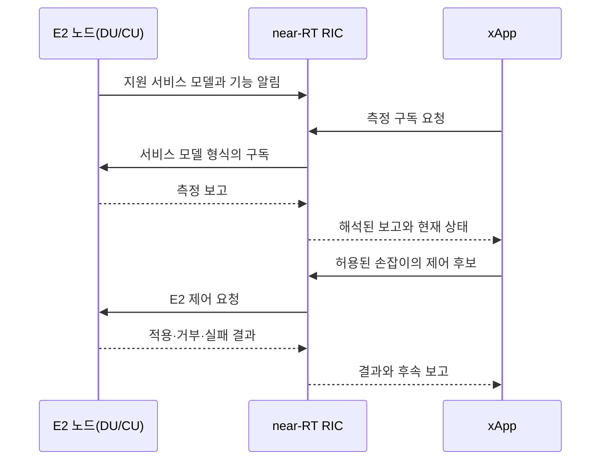
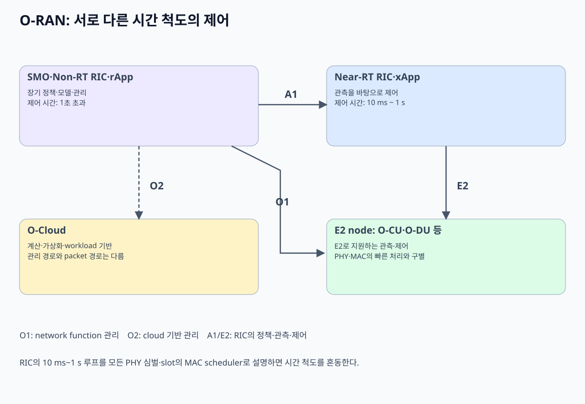
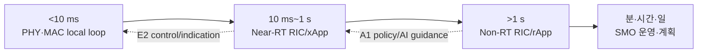

# 13. O-RAN, RIC, 제어 루프

## 용어를 실제 실행 위치와 데이터 흐름에 연결하기

`RIC(RAN Intelligent Controller, RAN 지능형 제어기)`는 단순한 분석 화면 이름이 아니다. RAN에서 측정값을 받아 상태를 만들고, 허용된 제어 명령을 다시 RAN 노드에 전달하는 소프트웨어 실행 환경이다. `near-RT(near-Real-Time, 준실시간)`와 `Non-RT(Non-Real-Time, 비실시간)`의 구분은 컴퓨터가 빠르냐 느리냐가 아니라 **어떤 시간 규모의 판단을 맡는가**에 관한 경계다.

- **xApp**은 near-RT RIC 안에서 실행된다. 입력은 E2로 올라온 셀 부하, UE별 무선 품질, 핸드오버 통계 같은 보고다. xApp은 이 보고를 내부 상태로 누적하고, 해당 E2 서비스 모델이 허용하는 제어 요청을 만든다.
- **rApp**은 SMO의 Non-RT RIC 영역에서 실행된다. 입력은 더 긴 기간의 성능 자료, 구성 정보, 장애 이력, 사업자의 목표다. rApp은 정책 또는 모델을 만들고 A1을 통해 near-RT RIC에 전달할 수 있다.
- **DU 내부 스케줄러**는 매 슬롯에 어느 UE를 보낼지 결정한다. xApp이 “다음 슬롯의 37번 자원 블록을 UE A에 배정하라”는 방식으로 모든 슬롯을 직접 조종한다고 가정하면 시간 경계를 잘못 이해한 것이다.

한 셀의 혼잡을 완화하는 실제 흐름을 따라가 보자.

1. DU와 CU는 처리량, 자원 사용률, 핸드오버 결과를 측정한다.
2. E2 에이전트가 서비스 모델에 정의된 형식으로 측정 보고를 near-RT RIC에 보낸다.
3. xApp은 최근 500 ms 동안의 보고를 상태로 유지하고, 특정 이웃 셀로 부하를 분산할 조건을 계산한다. 500 ms는 동작 이해를 위한 교육용 예시이며 제품 보장값이 아니다.
4. xApp은 임의의 장비 메모리 주소를 바꾸지 않는다. 서비스 모델이 정의한 제어 동작과 매개변수만 담아 E2 제어 요청을 보낸다.
5. E2 노드가 요청을 검증하고 적용하면 RAN 내부 설정 상태가 바뀐다. 실제 UE 선택과 무선 전송은 이후에도 gNB 내부 절차가 수행한다.
6. 새 측정 보고가 돌아오면 xApp은 결과를 관측한다. 개선되지 않으면 원상 복구하거나 다른 허용 값을 시도할 수 있다.

이 흐름에는 조건이 있다. 노드가 해당 E2 서비스 모델과 제어 동작을 구현해야 하며, 사업자가 xApp에 권한을 부여해야 한다. 보고만 지원하고 제어를 지원하지 않는 노드라면 같은 xApp은 관측은 할 수 있어도 설정을 바꿀 수 없다.

### 정책과 제어 손잡이는 다르다

**정책(policy)** 은 달성할 목표와 적용 조건을 표현한다. **제어 손잡이(control knob)** 는 소프트웨어가 실제로 바꿀 수 있도록 인터페이스에 노출된 매개변수나 동작이다. 예를 들어 핸드오버 판단에 쓰는 오프셋, 특정 트래픽 종류의 상대 우선순위, 보고 주기가 손잡이가 될 수 있다. 어떤 값을 손잡이로 제공하는지는 서비스 모델과 제품 구현에 달려 있다. “지연을 최소화하라”는 문장은 목표인 정책이지, 그 자체로 장비에 쓸 수 있는 숫자 명령은 아니다.

| 단계 | 입력 | 담당 주체 | 중간 상태 | 결과 |
|---|---|---|---|---|
| 1 | 업무 목표: 음성 품질 우선 | 운영자·rApp | 적용 대상 셀과 시간대가 포함된 정책 | A1 정책 생성 |
| 2 | A1 정책과 E2 측정 | near-RT RIC·xApp | 현재 혼잡도와 정책 조건을 결합한 판단 | 제어 후보 선택 |
| 3 | 지원되는 손잡이 목록 | xApp·E2 서비스 모델 | 허용 범위 안의 값 | E2 제어 요청 |
| 4 | 제어 요청 | E2 노드 | 유효성·권한·현재 상태 검사 | 적용 또는 거부 |
| 5 | 후속 성능 보고 | xApp | 적용 전후 지표 | 유지·수정·철회 |

`E2`는 연결 통로의 이름이고, **E2 서비스 모델(E2 Service Model)** 은 그 통로에서 특정 RAN 기능을 어떻게 관측하고 제어할지 정하는 공통 의미 체계다. 메시지가 바이트 단위로 도착했다는 사실만으로는 “이 숫자가 셀 처리량인지, UE 식별자인지, 핸드오버 임계값인지” 알 수 없다. 서비스 모델은 어떤 측정을 어떤 조건과 주기로 보고할지, 제어 동작과 매개변수는 무엇인지, 성공·거부·실패를 어떻게 표시할지를 맞춘다.

정책이 “음성 우선”이어도 E2 서비스 모델이 트래픽별 우선순위 제어를 정의하지 않았거나 노드가 그 동작을 구현하지 않았다면 xApp은 그 손잡이를 사용할 수 없다. 이때 가능한 일은 경보를 내거나 O1 구성 절차로 넘기는 것이다. 서비스 모델 버전이나 지원 기능이 맞지 않으면 연결이 살아 있어도 원하는 폐루프 제어는 성립하지 않는다.

[이전: RAN 분할과 Cloud RAN](12-ran-splits-fronthaul-and-cloud.md) · [목차](README.md) · [다음: AI-RAN의 세 방향](14-ai-ran-three-directions.md)

자료 확인일: **2026-10-11**

O-RAN은 개방형 interface와 지능형 제어를 이용해 RAN 구성 요소를 상호 운용·자동화하려는 architecture다. 이 장은 SMO, RIC, xApp, rApp과 A1·E2·O1·O2 interface가 **어느 시간 규모에서 어떤 상태를 바꾸는지** 구분한다.

## 1. 먼저 주체를 구분한다

| 이름 | 풀어 쓴 말 | 주요 책임 |
| --- | --- | --- |
| SMO | Service Management and Orchestration | RAN service·network function·cloud 자원 관리 조정 |
| Non-RT RIC | Non-Real-Time RAN Intelligent Controller | 1초보다 긴 규모의 정책·분석·AI/ML lifecycle |
| Near-RT RIC | Near-Real-Time RAN Intelligent Controller | 약 10 ms~1 s 규모의 RAN 최적화 제어 |
| rApp | Non-RT RIC application | 긴 시간 규모 분석·정책·모델 관리 application |
| xApp | Near-RT RIC application | 짧은 시간 규모의 telemetry 기반 제어 application |
| O-Cloud | O-RAN Cloud | O-RAN function이 실행되는 cloud infrastructure |

**Near-real-time은 slot마다 직접 PHY 결정을 내린다는 뜻이 아니다.** 30 kHz SCS의 slot은 0.5 ms인데 near-RT 하한 10 ms는 이미 20 slots다. Slot scheduler는 DU/MAC 안의 더 빠른 loop가 담당한다.

## 2. 제어 시간 규모

O-RAN 공식 자료는 near-RT RIC를 약 10 ms에서 1 s, non-RT RIC를 1 s보다 긴 시간 규모로 구분한다. 경계 숫자는 application deadline과 구현 능력을 보장하는 benchmark가 아니다.

## 3. 주요 interface

| interface | 연결 | 전달하는 것의 예 |
| --- | --- | --- |
| A1 | Non-RT RIC → Near-RT RIC | policy, enrichment information, AI/ML guidance |
| E2 | Near-RT RIC ↔ O-RAN node | telemetry indication, control action |
| O1 | SMO ↔ managed network function | configuration, fault, performance management |
| O2 | SMO ↔ O-Cloud | infrastructure deployment·resource lifecycle |

Interface 이름만 같아도 지원하는 service model과 profile이 다르면 상호 운용되지 않을 수 있다.

## 4. SMO와 RIC를 섞지 않는다

SMO는 lifecycle과 운영 관리의 큰 틀을 담당한다. Near-RT RIC는 live RAN telemetry를 받아 비교적 짧은 주기로 control action을 낼 수 있다. Non-RT RIC는 긴 기간 data와 policy를 사용해 near-RT 동작을 안내한다.

~~~text
SMO가 DU software version을 배포
  ≠ xApp이 cell별 handover threshold를 조정
  ≠ DU scheduler가 다음 slot의 RB를 배정
~~~

## 5. E2 node와 service model

Near-RT RIC는 E2를 통해 O-CU, O-DU 같은 E2 node와 상호 작용할 수 있다. E2 Service Model은 어떤 measurement와 control을 표현하는지 정한다.

E2 연결이 있다는 사실만으로 모든 scheduler parameter를 바꿀 수 있는 것은 아니다. Node와 xApp이 공통 service model과 action을 지원해야 한다.

## 6. 한 load-balancing loop

교육용 예:

~~~text
Cell A PRB utilization: 90%
Cell B PRB utilization: 35%
두 cell 경계 UE: 40대
목표: 일부 UE를 B로 유도
~~~

| 시간 | 입력 | 주체 | 중간 상태 | 결과 |
| --- | --- | --- | --- | --- |
| T0 | E2 indication | Near-RT RIC | A/B load와 UE measurement | xApp state 갱신 |
| T1 | policy + telemetry | xApp | 후보 UE 10대 선택 | control proposal |
| T2 | E2 control | E2 node | 허용 범위와 현재 radio 상태 확인 | parameter 적용/거절 |
| T3 | 새 measurement | xApp | load 78%/48% | 다음 action 판단 |

한 번 10대를 옮겼다고 최적 상태가 보장되지 않는다. UE channel과 traffic이 바뀌며 handover cost가 생긴다.

## 7. Oscillation을 막아야 한다

두 controller가 같은 parameter를 반대 방향으로 바꾸면 진동할 수 있다.

~~~text
xApp A: Cell A 부하가 높으니 UE를 B로 이동
xApp B: B의 품질이 낮으니 UE를 A로 복귀
결과: ping-pong handover
~~~

필요한 설계:

- action priority와 ownership
- guard time과 hysteresis
- 변경 rate limit
- conflict detection
- rollback과 safe default
- observation delay 고려

## 8. 관측 지연이 만드는 오래된 판단

Telemetry가 100 ms마다 생성되고 transport·processing에 80 ms가 걸리며 xApp 계산에 40 ms가 걸린다고 하자.

~~~text
measurement 시각      t=0
RIC 도착              t=80 ms
decision 완료         t=120 ms
node 적용             t=150 ms
~~~

Action은 최소 150 ms 전 상태에 근거한다. UE가 빠르게 이동하거나 burst traffic이 끝났다면 이미 오래된 결정일 수 있다.

## 9. Slot scheduler가 아닌 이유를 숫자로 본다

30 kHz SCS에서 slot은 0.5 ms다.

~~~text
Near-RT lower scale 10 ms / 0.5 ms
= 20 slots
~~~

E2 telemetry 수집, network 전달, xApp scheduling, action 적용까지 거치면 다음 slot의 exact RB를 고르는 loop로 쓰기 어렵다. Near-RT RIC는 policy parameter, handover, interference coordination처럼 더 느린 action에 맞는다.

## 10. A1의 역할

Non-RT RIC는 긴 시간 data를 분석해 A1로 policy나 AI/ML guidance를 near-RT RIC에 전달할 수 있다.

예:

~~~text
입력: 지난 7일의 시간대별 load
rApp 결과: 평일 08:00~09:00에는 cell A congestion 위험
A1 policy: 해당 시간대 energy saving보다 capacity 우선
xApp: live telemetry 안에서 policy를 지키며 action 선택
~~~

A1 policy는 매 UE packet을 전달하지 않는다. 행동의 허용 범위와 목표를 전달한다.

## 11. O1과 O2

O1은 network function의 configuration, fault, performance, software management 같은 운영 관리에 쓰인다. O2는 SMO가 O-Cloud infrastructure 자원과 deployment lifecycle을 관리하는 경계다.

O2로 VM이나 container resource를 확보했다고 RAN function이 E2 service model을 지원하는 것은 아니다. Infrastructure readiness와 RAN control readiness는 다른 상태다.

## 12. AI/ML loop의 상태

| 단계 | owner | 산출물 |
| --- | --- | --- |
| data collection | RAN·SMO | telemetry dataset |
| training | Non-RT 환경 | model artifact와 metrics |
| validation | operator policy | 승인·적용 범위 |
| distribution | SMO/Non-RT RIC | model과 version |
| inference | rApp 또는 xApp | recommendation/action |
| monitoring | SMO/RIC | drift·failure·rollback signal |

모델 정확도가 높아도 control 안정성이 자동 보장되지 않는다. 지연, action constraint, distribution shift를 함께 검증한다.

## 13. 실패와 안전 경계

| 실패 | 안전한 질문 |
| --- | --- |
| RIC 연결 끊김 | Node의 local fallback은 무엇인가 |
| xApp crash | 마지막 action이 만료되는가 |
| 잘못된 model | 적용 범위·rollback·canary가 있는가 |
| telemetry 누락 | missing을 0으로 오해하지 않는가 |
| xApp 충돌 | priority와 arbitration은 누가 하는가 |

## 14. 반례

- xApp이라는 이름만으로 10 ms deadline을 충족했다는 뜻은 아니다.
- rApp이 model을 만들었다고 near-RT node에 자동 배포되는 것은 아니다.
- E2 control이 가능해도 vendor가 모든 parameter를 노출할 의무는 없다.
- Closed loop가 open loop보다 항상 안전하지 않다. 잘못된 feedback은 장애를 증폭한다.
- AI 없이 rule-based xApp도 가능하다.

## 15. 확인 문제

### 문제 1

Near-RT RIC가 30 kHz NR의 다음 slot RB를 직접 배정한다고 일반화해도 되는가?

**해설:** 아니다. 0.5 ms slot보다 near-RT loop가 훨씬 느리며 실제 slot scheduling은 DU/MAC local loop다.

### 문제 2

A1과 E2의 방향과 목적은?

**해설:** A1은 Non-RT에서 Near-RT로 policy·AI guidance를 전달한다. E2는 Near-RT RIC와 O-RAN node 사이 telemetry와 control에 쓰인다.

### 문제 3

두 xApp이 독립적으로 성능을 높이면 전체도 안정적인가?

**해설:** 아니다. 같은 parameter나 UE를 반대로 제어해 oscillation을 만들 수 있어 conflict 조정이 필요하다.

## 16. 공식 출처

- O-RAN Alliance, [O-RAN Architecture and Resources](https://www.o-ran.org/)
- O-RAN Alliance, *O-RAN Architecture Description*
- O-RAN Alliance, *A1, E2, O1 and O2 Interface Specifications*
- O-RAN Alliance, [NTN Deployments White Paper](https://mediastorage.o-ran.org/ecosystem-resources/O-RAN-2025.04.02.WP.O-RAN_NTN_Deployments-v08.4.pdf): near-RT·non-RT 시간 규모

다음 장은 [AI-RAN의 세 방향](14-ai-ran-three-directions.md)에서 AI for RAN, AI and RAN, AI on RAN을 구분한다.
