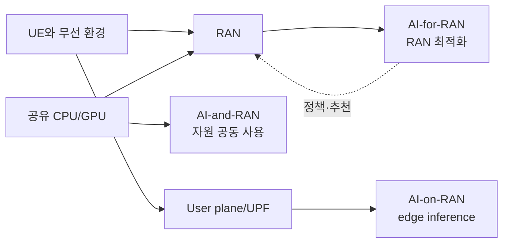

# 14. AI-RAN의 세 방향: AI-for, AI-and, AI-on

AI-RAN은 하나의 무선 규격 이름이 아니다. RAN에 AI를 적용하거나, RAN과 AI가 계산 자원을 공유하거나, RAN 가까이에서 AI 서비스를 실행하는 연구·산업 범주다. AI-RAN Alliance는 이를 AI-for-RAN, AI-and-RAN, AI-on-RAN으로 구분한다.

## 1. 기본 객체와 세 범위

**AI(Artificial Intelligence, 인공지능)**는 데이터에서 패턴을 학습한 모델로 분류·예측·생성·의사결정을 돕는 기술 범주다. 항상 neural network만 뜻하지 않는다. **모델(model)**은 입력 숫자에서 출력 숫자를 계산하는 규칙과 조절 가능한 수치의 묶음이다. “100 ms 뒤 혼잡 확률 0.82”는 예측이지 antenna power 명령이 아니다.

**학습(training)**은 데이터로 정한 목적에 맞춰 모델의 조절 가능한 수치인 **매개변수(parameter)**를 바꾸는 과정이다. **추론(inference)**은 정해진 모델에 새 입력을 넣어 결과를 계산하는 과정이다. **RAN(Radio Access Network, 무선접속망)**은 사용자 장비인 UE를 코어 네트워크에 연결하는 안테나·무선 장치·베이스밴드 처리·스케줄링·연결 제어 기능이다. **워크로드(workload)**는 계산 자원이 수행하는 일의 묶음이다. RAN 작업에는 정해진 시각 안에 끝나야 하는 **마감 시각(deadline)**이 있다. **엣지(edge)**는 사용자나 데이터가 생기는 곳에 가까운 처리 위치를 뜻한다. 그 가까움은 거리뿐 아니라 라우터·사용자 평면 경로와 운영 경계를 함께 봐야 판단할 수 있다.

| 방향 | 목적·입력 | 실행 위치 | 직접 결과 | 실패 영향 |
|---|---|---|---|---|
| AI-for-RAN | CSI·traffic·KPI로 RAN 개선 | RIC·RAN 앱 | control 추천·예측 | radio 성능·안전 |
| AI-and-RAN | RAN job과 AI job의 compute 공유 | CPU·GPU·NIC 기반 | 배치·격리·입장 결정 | radio deadline miss |
| AI-on-RAN | UE/application AI 요청 | RAN 인접 edge | inference response | 앱 지연·정확도 |

`for`는 RAN이 개선 대상이고, `and`는 RAN과 AI가 기반 자원을 나누며, `on`은 AI 응용을 RAN 가까이 배치한다. 세 방향은 배타적 SKU가 아니다. 목적, 입력 경로, 출력 소비자와 자원 관계로 분류한다.



같은 영상 model도 장비 고장을 찾아 maintenance action을 추천하면 AI-for, baseband와 GPU를 나누면 AI-and, UE 영상을 edge에서 분석해 사용자에게 돌려주면 AI-on 성격이 있다.

## 2. 경기장 한 UE의 연결된 흐름

경기장에 100개 cell과 edge GPU가 있고 경기 직전 uplink 영상과 downlink 요청이 급증한다고 하자. AI-for model은 PRB, CQI, handover 실패율로 혼잡을 예측해 energy saving 해제나 scheduler parameter를 추천한다. AI-and manager는 DU PHY kernel의 deadline을 먼저 예약하고 남은 GPU slice에 영상 inference를 배치한다. AI-on service는 local UPF로 breakout된 영상을 받아 요약·번역·객체 탐지 결과를 UE 앱에 돌려준다.

| 시각 | 방향 | 주체 | 상태 |
|---:|---|---|---|
| 0 ms | AI-for | DU·xApp | CQI·buffer 측정 |
| 5 ms | AI-and | admission manager | RAN deadline budget |
| 8 ms | AI-for | RAN node | 안전한 control 적용 |
| 12 ms | AI-on | edge service | video tensor queue |
| 30 ms | AI-on | GPU | inference result |

더 상세한 교육용 AI-for loop는 다음과 같다.

```text
t=0 ms   UE 측정 보고와 기지국 counter 수집
t=20 ms  feature 집계: cell load, BLER, CQI 분포
t=25 ms  AI-for inference: 혼잡 확률 0.82
t=27 ms  policy guard: 허용 범위와 confidence 확인
t=30 ms  controller가 안전한 후보 action 적용
t=100 ms KPI 재측정, 효과와 부작용 기록
```

실제 주기는 기능과 구현에 따라 다르다. 수집에 20 ms가 필요한 model을 microsecond PHY deadline에 직접 넣을 수 없다. 영상 정확도가 높아도 DU deadline을 침범하면 AI-and 실패이며, RAN throughput이 높아도 객체 탐지 model이 drift하면 AI-on 품질 실패다.

## 3. 한 UE의 measurement·decision·inference data path

UE A가 uplink video packet을 보내는 순간 세 방향은 같은 data를 동일하게 처리하지 않는다. Radio 쪽에서는 UE PHY/MAC report와 gNB counter가 CQI, buffer, PRB usage, BLER 같은 telemetry를 만든다. 이 telemetry는 RAN 내부나 RIC의 AI-for model 입력이 된다. Model은 혼잡 확률이나 scheduler parameter 후보를 출력하지만, controller의 policy guard와 node capability 검사를 거친 뒤에야 RAN state가 바뀐다. 후속 KPI가 그 action의 효과와 부작용을 다시 학습·관측 data로 만든다.

동시에 AI-and resource manager는 video 내용보다 compute queue와 deadline을 본다. DU PHY/MAC job의 release time, worst-case 실행 시간, GPU memory·NIC queue 사용량과 AI batch의 요구량을 입력받아 admission·priority·placement state를 만든다. RAN job이 예약된 시간에 끝날 수 없으면 AI batch를 늦추거나 거부한다. AI inference 정확도가 아무리 높아도 이 경계에서 radio deadline miss를 만들면 shared-compute 설계는 실패다.

AI-on service가 소비하는 것은 UE의 user-plane video payload다. Packet은 gNB에서 UPF 경로를 거쳐 edge application에 도착하고 decoder·preprocessing 뒤 model tensor가 된다. Inference result는 객체 label, 번역문, 영상 요약처럼 application response로 UE에 돌아간다. 이 결과는 본래 RAN scheduler command가 아니다. 다만 별도의 승인된 integration이 결과를 RAN 운영 입력으로 사용하면 그 부분에는 AI-for 책임과 guard가 추가된다.

~~~text
UE radio measurement
  → DU/gNB telemetry
  → AI-for feature/model
  → policy·capability guard
  → RAN parameter 후보 적용
  → 새 radio KPI

DU job deadline + AI job demand
  → AI-and admission/priority
  → GPU·CPU·NIC 실행 순서
  → deadline miss와 utilization 측정

UE video user packet
  → gNB → local UPF → edge application
  → preprocessing → AI-on inference
  → application response → UE
~~~

세 흐름이 같은 GPU에서 만날 수 있지만 state owner와 success metric이 다르다. AI-for는 radio KPI와 action safety, AI-and는 deadline·isolation·resource efficiency, AI-on은 application latency·accuracy·service availability를 평가한다.

## 4. Training, inference와 model lifecycle의 위치

Training은 historical dataset과 label 또는 objective를 사용해 model parameter를 갱신한다. 산출물은 model artifact, version과 validation metric이다. Inference는 고정된 version에 current feature를 넣어 prediction을 만든다. 운영 controller는 prediction timestamp, confidence, 적용 scope와 version을 action history에 묶어야 stale model이나 rollback 대상을 찾을 수 있다.

AI-for training data가 여러 cell에서 모였더라도 특정 cell, UE 속도, spectrum과 traffic 조건이 달라지면 distribution shift가 생길 수 있다. AI-on model도 camera angle이나 사용자 언어가 바뀌면 drift할 수 있다. AI-and manager는 model accuracy보다 kernel execution time, memory footprint와 preemption 가능성을 입력으로 삼는다. 같은 model artifact라도 세 방향에서 검증해야 할 조건이 서로 다르다.

Multi-task 또는 federated 실험에서 여러 task를 한 model에 모으면 shared representation의 이점이 있을 수 있지만, 한 task gradient가 다른 task를 방해하는 negative transfer도 생긴다. 네 simulation task와 partial federation이라는 논문 조건을 실제 모든 RAN workload에 일반화하지 않는다. Dataset partition, baseline, metric과 hardware 조건을 함께 기록한다.


## 5. 같은 GPU의 서로 다른 책임

GPU가 행렬곱과 signal processing을 모두 빠르게 수행해도 다음은 별도 설계다.

- Radio deadline 보장 주체와 worst-case execution time
- AI 작업의 중단·preemption 지연
- RAN·AI memory 격리
- 장애 fallback과 admission control
- Data 권한과 개인정보 관리
- CPU·NIC path와 queue 간섭

평균 GPU 사용률 50%여도 deadline 직전 burst와 충돌할 수 있다. Kubernetes DRA(Dynamic Resource Allocation)는 GPU 같은 장치를 claim으로 할당하는 장치 선택·lifecycle 기능이다. 1 ms slot 안의 microsecond kernel 완료를 보장하는 real-time scheduler와 책임이 다르다.

cuPHY와 cuMAC은 NVIDIA GPU 가속 RAN software/library 이름이다. PHY와 MAC은 3GPP 계층 개념이지만 `cuPHY`, `cuMAC` 자체는 3GPP 표준 interface가 아니다. 상호운용성을 논할 때 3GPP 규격, O-RAN interface와 vendor API를 구분한다.

## 6. 실패와 조건이 달라지는 반례

AI-for model 정확도가 높아도 action 안전을 뜻하지 않는다. 잘못된 label, stale feature, 범위 밖 cell에는 guard와 rollback이 필요하다. AI-on edge가 물리적으로 가까워도 traffic이 중앙 UPF를 먼저 왕복하면 latency 이점이 줄어든다. 위치와 user-plane routing을 함께 본다.

1. Handover 실패 예측으로 neighbor relation을 추천한다: AI-for-RAN.
2. 야간의 남는 GPU로 언어 model batch를 처리한다: AI-and-RAN.
3. 기지국 인접 edge에서 camera 객체 탐지를 실행한다: AI-on-RAN.
4. RAN GPU에서 실행되는 model이 scheduler도 개선한다: for와 and가 함께 존재한다.

AI-RAN Alliance의 세 방향은 NR waveform, channel coding과 protocol을 대체하는 전파 규격이 아니다. 3GPP Release 18 완료와 AI/ML 연구가 “6G 완성”을 뜻하지 않는다. 5G-Advanced 기능, 연구 항목, alliance reference architecture와 상용 구현 성숙도를 따로 기록해야 한다.

## 7. 표준과 연구 결과를 읽는 조건

표준 interface는 message 의미, role과 상호운용 계약을 정의한다. 연구 prototype은 특정 hardware, dataset, simulation과 metric에서 방법을 비교한다. O-RAN R005가 AI lifecycle 기능을 다룬다는 사실을 특정 model의 throughput 향상으로 읽지 않는다.

Multi-task learning 연구의 네 simulation task와 partial federation 결과는 [연구 조건](https://arxiv.org/abs/2404.15197) 안에서 읽는다. 한 task가 다른 task 학습을 방해하는 negative transfer가 생길 수 있어 공동 model이 항상 낫지 않다.

## 8. 통합 확인 문제와 해설

### 문제 1
xApp의 MCS 추천과 기지국 전력 sleep 후보는 어느 방향인가?

**해설:** 입력이 CQI·전력·traffic KPI이고 출력 소비자가 scheduler나 RAN 운영 controller이므로 AI-for-RAN이다. Model 출력은 guard와 capability 검사를 거쳐야 action이 된다. 같은 model이 baseband와 GPU를 나누면 deadline·격리라는 AI-and 조건도 추가된다.

### 문제 2
DU와 LLM이 GPU 시간을 나누거나 야간 잔여 GPU를 쓰는 문제는?

**해설:** Resource manager가 DU job deadline과 LLM batch 요구량을 입력으로 admission·priority를 정하므로 AI-and-RAN이다. 평균 GPU 여유가 있어도 burst와 preemption 지연으로 radio deadline을 놓칠 수 있어 worst-case 실행 시간을 본다.

### 문제 3
기지국 edge 영상 탐지나 추천 model은 항상 AI-on인가?

**해설:** UE user-plane data를 local UPF와 edge application이 받아 사용자에게 inference response를 주면 AI-on이다. 같은 추천 model의 출력이 RAN scheduler parameter를 바꾸는 목적이면 AI-for다. 위치보다 입력 경로와 결과 소비자로 판단한다.

### 문제 4
DRA로 GPU Claim을 받으면 RAN 1 ms deadline이 보장되는가?

**해설:** 아니다. DRA Claim은 device 선택과 lifecycle 상태를 만든다. RAN deadline은 kernel worst-case, priority, preemption, memory, CPU와 NIC queue까지 포함한 end-to-end 조건이다. Claim 성공 뒤에도 deadline miss를 측정해야 한다.

### 문제 5
같은 GPU를 쓰면 세 방향이 같은 시스템인가?

**해설:** 아니다. AI-for는 radio telemetry→control safety, AI-and는 job demand→compute schedule, AI-on은 user payload→application response를 다룬다. 한 GPU에서 함께 실행돼도 state owner와 성공 metric이 다르며 세 방향이 한 시스템에 동시에 존재할 수 있다.

### 문제 6
표준 release와 model 성능 결과의 차이는?

**해설:** 표준 release는 role, message와 lifecycle 상호운용 계약을 정의한다. Model 성능은 특정 dataset, hardware, baseline과 metric의 실험 결과다. Release 18 완료나 R005 기능을 특정 model의 throughput 또는 6G 완성으로 해석하지 않는다.

## 9. 공식 자료

- [AI-RAN Alliance: 세 작업 방향](https://ai-ran.org/)
- [AI-RAN Alliance WG1: AI-for-RAN white paper](https://ai-ran.org/documents/AI-RAN-WG1-AI-for-RAN-Whitepaper.pdf)
- [O-RAN Alliance specifications 안내](https://www.o-ran.org/specifications)
- [3GPP specifications](https://www.3gpp.org/specifications-technologies/specifications-by-series)

공식 근거 확인일: **2026-10-11**.

[← 이전: O-RAN RIC와 제어 고리](13-oran-ric-and-control-loops.md) · [다음: AI-for-RAN 데이터와 제어](15-ai-for-ran-data-training-control.md)
