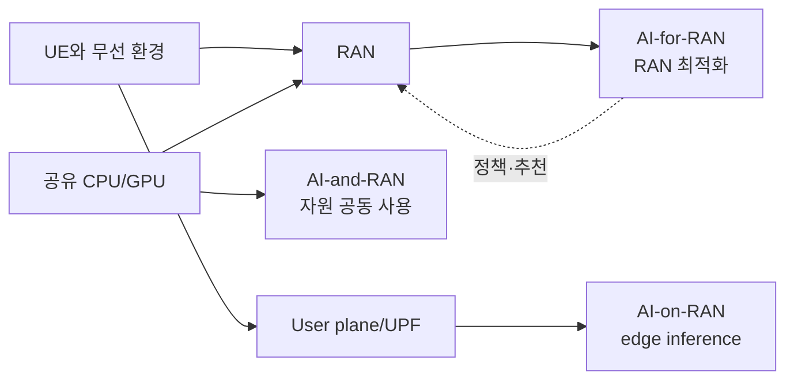

# 14. AI-RAN의 세 방향: AI-for, AI-and, AI-on

## 같은 AI라는 말이 세 가지 다른 문제를 가린다

첫째, RAN이 더 나은 무선 결정을 하도록 AI를 쓰는 문제가 있다. 측정값을 보고 beam·MCS·parameter 후보를 만드는 방향을 **AI-for-RAN**이라 부른다.

둘째, RAN processing과 AI workload가 같은 GPU·CPU·NIC를 나눠 쓰는 문제가 있다. radio deadline을 지키면서 남는 계산 자원을 AI에 주는 방향을 **AI-and-RAN**이라 부른다.

셋째, RAN 가까운 edge 위치에서 사용자·산업용 AI inference를 제공하는 문제가 있다. 카메라 분석이나 언어 모델처럼 무선 제어가 아닌 AI 서비스를 RAN edge에 배치하는 방향을 **AI-on-RAN**이라 부른다.

| 방향 | 입력 | 실행 위치 | 결과 | 실패 영향 |
|---|---|---|---|---|
| AI-for | CSI·traffic·KPI | RIC·RAN 앱 | control 후보 | radio 성능 |
| AI-and | RAN job+AI job | 공유 compute | 두 workload schedule | deadline miss |
| AI-on | 사용자 model request | edge GPU | inference response | 앱 지연·정확도 |

## 경기장 한 UE를 세 방향으로 추적한다

UE A가 경기장 cell에서 영상 uplink를 보낸다. AI-for 앱은 cell congestion과 UE radio 품질로 scheduling parameter 후보를 만든다. AI-and resource manager는 DU PHY kernel deadline을 먼저 예약하고 남은 GPU slice에 영상 inference를 배치한다. AI-on service는 실제 영상 객체를 입력받아 결과를 앱에 돌려준다.

| 시각 | 방향 | 주체 | 상태 |
|---:|---|---|---|
| 0 ms | AI-for | DU·xApp | CQI·buffer 측정 |
| 5 ms | AI-and | admission manager | RAN deadline budget |
| 8 ms | AI-for | RAN node | 안전한 control 적용 |
| 12 ms | AI-on | edge service | video tensor queue |
| 30 ms | AI-on | GPU | inference result |

영상 inference 정확도가 높아도 DU deadline을 침범하면 AI-and 설계는 실패다. RAN throughput이 높아도 객체 탐지 model이 drift하면 AI-on 품질은 실패다.

## 표준과 prototype을 분리한다

표준 interface는 메시지 의미·역할·상호 운용 계약을 정의한다. 연구 prototype은 특정 hardware, dataset, simulation, metric에서 방법을 비교한다. O-RAN R005가 AI lifecycle 기능을 다룬다는 사실을 특정 model의 throughput 향상 논문으로 읽지 않는다.

multi-task learning 연구의 네 simulation task와 partial federation 결과는 [연구 조건](https://arxiv.org/abs/2404.15197) 안에서 읽는다. 한 task가 다른 task 학습을 방해하는 negative transfer가 생길 수 있어 공동 model이 항상 낫지 않다.

## 추가 문제와 완전 해설

### 1. xApp의 MCS 추천은 어느 방향인가?
무선 제어를 개선하므로 AI-for-RAN이다.

### 2. DU와 LLM이 GPU 시간을 나누는 문제는?
공유 compute deadline 문제이므로 AI-and-RAN이다.

### 3. 기지국 edge의 영상 탐지는?
사용자 AI service이면 AI-on-RAN이다.

### 4. 같은 GPU를 쓰면 세 방향이 같은 시스템인가?
아니다. 입력·책임·deadline·실패 영향이 다르다.

### 5. 표준 release와 model 성능 결과의 차이는?
표준은 interface/lifecycle 계약이고 성능은 특정 평가 조건의 실험 결과다.

[이 책 목차](README.md)

[← 이전: O-RAN RIC와 제어 고리](13-oran-ric-and-control-loops.md) · [다음: AI-for-RAN 데이터와 제어](15-ai-for-ran-data-training-control.md)

AI-RAN은 하나의 무선 규격 이름이 아니다.
무선 접속망(RAN, Radio Access Network)에 AI를 적용하거나, RAN과 AI가 계산 자원을 공유하거나, RAN 가까이에서 AI 서비스를 실행하는 연구·산업 범주다.
AI-RAN Alliance는 이를 AI-for-RAN, AI-and-RAN, AI-on-RAN의 세 방향으로 구분한다.

## 14.0 처음 나오는 단어부터 풀기

**AI(Artificial Intelligence, 인공지능)**는 사람이 일일이 규칙을 쓰는 대신 데이터에서 패턴을 학습한 모델을 사용해 분류, 예측, 생성, 의사결정을 돕는 기술 범주다. AI가 항상 neural network를 뜻하는 것은 아니며, 통계 모델과 규칙을 결합한 시스템도 넓은 의미의 AI 시스템에 포함할 수 있다.

**RAN(Radio Access Network, 무선 접속망)**은 휴대전화나 modem 같은 **UE(User Equipment, 사용자 장비)**를 이동통신 core network에 연결하는 부분이다. Antenna, radio unit, baseband 처리, scheduler, 연결 제어 같은 기능이 여기에 놓인다. RAN은 단순히 antenna 한 개를 뜻하지 않는다.

**Model(모델)**은 입력 숫자에서 출력 숫자를 계산하는 학습된 함수다. 예를 들어 최근 cell 사용률 열 개를 입력받아 “100 ms 뒤 혼잡할 확률 0.82”를 출력할 수 있다. 이 확률은 그 자체로 antenna power를 바꾸는 명령이 아니다.

**Training(학습)**은 과거 데이터와 정답을 사용해 모델 내부 parameter를 바꾸는 단계다. **Inference(추론)**는 학습이 끝난 모델에 새 입력을 넣어 예측을 얻는 단계다. 운영 중에는 training과 inference의 위치, 계산량, 데이터 권한이 다를 수 있다.

**Workload(워크로드)**는 컴퓨터가 수행하는 일의 묶음이다. RAN workload는 정해진 시간 안에 무선 신호를 처리하는 일이고, AI workload는 모델 학습이나 추론 요청을 처리하는 일이다.

**Edge(에지)**는 사용자와 가까운 network 위치의 compute를 뜻한다. “가깝다”는 말은 지리 거리만이 아니라 packet이 통과하는 router, UPF, transport 구간과 운영 경계를 포함한다.

세 방향은 다음 질문으로 시작하면 구별하기 쉽다.

1. AI의 출력이 RAN 설정이나 동작을 개선하는가? 그러면 AI-for-RAN을 먼저 본다.
2. RAN 처리와 AI 처리가 CPU·GPU·memory를 함께 쓰는가? 그러면 AI-and-RAN 문제다.
3. 사용자 application의 AI 결과를 RAN 가까운 edge에서 만드는가? 그러면 AI-on-RAN이다.

### 같은 “AI 모델”이 세 위치에서 다른 일을 하는 예

영상 분석 model 하나를 생각하자.

- 기지국 camera 영상에서 장비 고장을 찾아 maintenance action을 추천하면 RAN 운영 개선이므로 AI-for-RAN 성격이 있다.
- 그 model이 baseband와 같은 GPU를 나누어 쓰면 자원 관점에서 AI-and-RAN 문제도 생긴다.
- UE가 보낸 영상을 가까운 edge에서 분석해 사용자에게 결과를 돌려주면 AI-on-RAN service다.

분류 대상은 model 이름이 아니라 **목적, 입력 경로, 출력의 소비자, 계산 자원 관계**다.

## 14.1 세 방향을 한 문장으로 구별하기

| 방향 | 목적 | 입력 | 직접 결과 |
|---|---|---|---|
| AI-for-RAN | AI로 RAN 성능·운영을 개선 | 무선 측정값, 구성, 장애 기록 | 무선 제어 추천·예측·자동화 |
| AI-and-RAN | AI와 RAN이 기반 계산을 공유 | RAN deadline과 AI 작업 요구량 | 자원 배치·격리·입장 결정 |
| AI-on-RAN | RAN edge에서 AI 응용을 실행 | UE user-plane 데이터 또는 edge 입력 | 가까운 위치의 추론 결과 |

`for`는 RAN이 개선 대상이다.
`and`는 RAN과 AI가 같은 기반 자원을 나누는 문제다.
`on`은 AI 응용이 RAN 인프라 가까이에서 실행되는 배치 문제다.



## 14.2 한 경기장 예제로 세 방향 보기

경기장에 100개 cell과 edge GPU 서버가 있다고 하자.
경기 시작 전에는 사용자가 적고, 시작 직전에는 uplink 영상과 downlink 요청이 급증한다.

AI-for-RAN 모델은 cell별 PRB(Physical Resource Block), CQI(Channel Quality Indicator), handover 실패율을 읽고 혼잡을 예측한다.
결과는 특정 cell의 에너지 절약 해제나 scheduler 파라미터 추천일 수 있다.

AI-and-RAN 관리자는 같은 GPU에서 baseband 처리와 영상 AI를 실행할지 결정한다.
RAN 1 ms 처리 창을 침범할 가능성이 있으면 영상 AI batch를 받지 않거나 낮은 우선순위 queue로 보낸다.

AI-on-RAN 응용은 경기장 edge에서 영상 요약이나 번역 추론을 수행한다.
UE 트래픽이 local UPF(User Plane Function)에서 breakout되어 edge 응용으로 가면 먼 중앙 cloud 왕복을 줄일 수 있다.

## 14.3 입력에서 결과까지의 시간표

```text
t=0 ms   UE 측정 보고와 기지국 counter 수집
t=20 ms  feature 집계: cell load, BLER, CQI 분포
t=25 ms  AI-for-RAN inference: 혼잡 확률 0.82
t=27 ms  정책 guard: 허용 범위와 confidence 확인
t=30 ms  controller가 안전한 후보 action 적용
t=100 ms KPI 재측정, 효과와 부작용 기록
```

이 시간표는 교육용이다.
실제 제어 주기는 기능과 구현에 따라 다르다.
수집이 20 ms 걸리는 모델을 microsecond PHY deadline에 직접 넣을 수는 없다.

## 14.4 같은 GPU라고 같은 책임은 아니다

GPU는 행렬곱과 신호처리를 모두 빠르게 할 수 있다.
그러나 GPU가 있다는 사실만으로 다음이 해결되지는 않는다.

- 무선 deadline을 누가 보장하는가
- AI 작업을 언제 중단할 수 있는가
- RAN과 AI memory가 어떻게 격리되는가
- 장애 시 어느 경로로 복귀하는가
- 데이터 사용 권한과 개인정보는 누가 관리하는가

Kubernetes DRA(Dynamic Resource Allocation)는 GPU 같은 장치를 claim으로 할당할 수 있다.
이는 장치 선택과 수명주기 기능이다.
1 ms slot 안의 microsecond 단위 kernel 완료를 보장하는 실시간 scheduler와는 다른 책임이다.

## 14.5 cuPHY와 cuMAC의 이름을 읽는 법

cuPHY와 cuMAC은 NVIDIA가 제공하는 GPU 가속 RAN 소프트웨어·라이브러리 이름이다.
PHY(Physical Layer)와 MAC(Medium Access Control)은 3GPP가 정의하는 무선 계층 개념이지만, `cuPHY`와 `cuMAC` 자체가 3GPP 표준 인터페이스 이름은 아니다.

따라서 “3GPP가 cuPHY를 표준화했다”라고 쓰면 계층 개념과 vendor 구현을 섞는다.
상호운용성을 논할 때는 3GPP 규격, O-RAN 인터페이스, vendor library API를 각각 구분한다.

## 14.6 AI-RAN은 전파 규격인가

아니다.
AI-RAN Alliance의 세 방향은 연구와 구현을 분류하는 틀이다.
NR(New Radio)의 waveform, channel coding, protocol 절차를 대체하는 단일 전파 규격이 아니다.

3GPP Release 18의 완료와 AI/ML 연구는 “6G가 완성됐다”는 뜻도 아니다.
5G-Advanced 기능, 연구 항목, 산업 alliance의 reference architecture, 실제 상용 구현의 성숙도를 따로 기록해야 한다.

## 14.7 분류 연습

다음 사례를 분류해 보자.

1. handover 실패 예측으로 neighbor relation을 추천한다: AI-for-RAN.
2. 야간에 남는 GPU로 언어 모델 batch를 처리한다: AI-and-RAN.
3. 기지국 인접 edge에서 카메라 객체 탐지를 실행한다: AI-on-RAN.
4. AI 모델이 RAN GPU에서 실행되며 scheduler도 개선한다: for와 and가 동시에 존재할 수 있다.

세 방향은 배타적 제품 SKU가 아니다.
한 시스템이 여러 방향을 포함할 수 있으므로 질문의 목적과 결과를 기준으로 표시한다.

## 14.8 조건과 반례

AI-for-RAN 모델의 정확도가 높아도 action이 안전하다는 뜻은 아니다.
잘못된 label, 지연된 feature, 범위 밖 cell에서는 안전 guard가 필요하다.

AI-and-RAN에서 평균 GPU 사용률이 50%여도 RAN deadline 직전의 짧은 burst와 충돌할 수 있다.
평균값 대신 worst-case 실행 시간과 preemption 지연을 본다.

AI-on-RAN이 edge에 있어도 UE 트래픽이 중앙 UPF로 먼저 갔다 돌아오면 local latency 이점이 줄어든다.
물리적 위치와 user-plane routing을 함께 확인한다.

## 14.9 확인 문제와 해설

### 문제 1

기지국 전력 소비를 예측해 sleep 후보를 추천하는 기능은 어느 방향인가?

**해설:** AI-for-RAN이다. 개선 대상과 action이 RAN 운영 상태다. 모델이 공유 GPU에서 실행된다면 AI-and-RAN 문제도 추가된다.

### 문제 2

DRA로 GPU Claim을 받으면 RAN의 1 ms deadline이 보장되는가?

**해설:** 아니다. DRA는 장치 할당을 다룬다. kernel 실행 시간, 우선순위, preemption, CPU와 NIC 경로까지 포함한 실시간 보장은 별도다.

### 문제 3

edge GPU에서 추천 모델을 실행하면 항상 AI-on-RAN인가?

**해설:** RAN 인프라 가까이에서 사용자 응용 추론을 제공한다면 AI-on-RAN으로 볼 수 있다. RAN scheduler 자체를 추천 모델로 조정한다면 AI-for-RAN이다.

## 14.10 공식 자료

- [AI-RAN Alliance: 세 작업 방향](https://ai-ran.org/)
- [AI-RAN Alliance WG1: AI-for-RAN white paper](https://ai-ran.org/documents/AI-RAN-WG1-AI-for-RAN-Whitepaper.pdf)
- [O-RAN Alliance specifications 안내](https://www.o-ran.org/specifications)
- [3GPP specifications](https://www.3gpp.org/specifications-technologies/specifications-by-series)

공식 근거 확인일: **2026-10-11**.

[← 이전](13-oran-ric-and-control-loops.md) · [다음 →](15-ai-for-ran-data-training-control.md)
