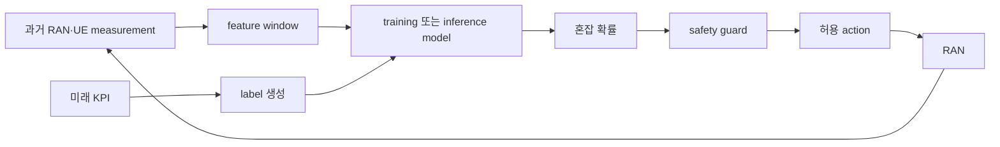

# 15. AI-for-RAN: 데이터에서 안전한 제어까지

AI-for-RAN은 AI로 무선 성능과 운영 효율을 개선하는 방향이다. 모델 정확도만 높이는 일이 아니라 데이터 수집, label, 배포 지연, action guard와 feedback을 하나의 제어 고리로 설계해야 한다.

## 15.0 제어 고리에서 쓰는 기본 단어

**Measurement(측정값)**는 기지국 counter나 UE report가 만든 원시 관측이다. 아직 모델 입력으로 집계되지 않은 시각·cell·UE별 값이며, 이후 feature를 만들 근거이기 때문에 필요하다.

**KPI(Key Performance Indicator, 핵심 성능 지표)**는 운영 상태를 숫자로 표현한 관측값이다. PRB 사용률, BLER, handover 실패율과 사용자 latency가 예다. KPI는 원인을 확정하는 값이 아니라 상태를 보는 창이다. PRB 95%만으로 traffic 증가, 잘못된 설정, interference 가운데 무엇이 원인인지 정할 수 없다.

**Feature(특징값)**는 원시 measurement·KPI·event를 모델 입력에 맞게 평균, 변화율, 범주나 결측 표시로 바꾼 값이다. 최근 1초 PRB 평균, 직전 100 ms 대비 queue 증가량, CQI 하위 10%가 예다. Model은 문자열 이름이 아니라 정해진 순서·단위의 숫자 tensor를 받으므로 feature schema가 필요하다.

**Label(정답표)**은 training에서 prediction과 비교하는 목표다. “다음 100 ms에 혼잡했는가”라는 0/1이나 다음 window의 실제 throughput이 될 수 있다. Label 정의가 바뀌면 같은 data라도 다른 문제를 학습한다.

**Training dataset(학습 데이터셋)**은 feature와 label을 짝지은 여러 행이다. **Training(학습)**은 이 행에서 오차를 줄이도록 model parameter를 반복해 바꾸는 계산이다. Test data는 parameter를 바꾸는 데 쓰지 않고 처음 보는 환경에서 성능을 확인하는 데 필요하다.

**Leakage(정보 누수)**는 prediction 시점에 알 수 없는 미래 정보나 train 장면의 복제·인접 장면이 test 입력에 섞여 평가가 부풀려지는 오류다. 시간과 cell을 분리한 평가가 필요한 이유다.

**Inference(추론)**는 운영 시점의 새 feature를 이미 학습된 model에 넣어 prediction을 얻는 계산이다. **Action(동작)**은 prediction을 받은 controller가 실제 RAN 설정을 바꾸는 일이다. Probability는 action 자체가 아니며, 둘 사이의 **guard(안전 검사)**가 허용 범위·최신성·confidence·장애 상태를 확인해야 한다.

**Feedback(피드백)**은 action 뒤 KPI 변화를 다시 관측해 prediction뿐 아니라 action이 목적을 달성했는지 기록하는 과정이다. **Baseline(기준선)**은 AI와 비교할 기존 규칙이나 단순 방법이다. AI가 복잡하다는 이유만으로 baseline보다 낫다고 가정하지 않는다.

**Drift(분포 변화)**는 운영 환경이 training 때와 달라지는 현상이다. Data drift는 입력 분포 변화이고 concept drift는 같은 입력과 결과의 관계 변화다. 새 단말, software upgrade, 계절 traffic과 spectrum 구성 변경이 원인이 될 수 있다.

**Negative transfer(부정적 전이)**는 여러 cell·task를 함께 학습할 때 한 task의 gradient나 공통 표현이 다른 task의 성능을 해치는 현상이다. 공유 학습의 이득과 task별 손실을 따로 확인해야 하는 이유다.

**SIL(Software-in-the-Loop)**은 software simulator나 기록 재생으로 제어 고리를 시험하는 방법이다. **HIL(Hardware-in-the-Loop)**은 대표 hardware와 실제 interface·timing을 시험 고리에 포함한다. **Canary 배포**는 전체 cell이 아니라 제한된 일부에 새 model을 먼저 적용해 영향과 rollback을 확인하는 단계다.

이 객체들은 위치와 수명이 다르다. Measurement는 DU·CU에서 ms~초 동안 생성되고 feature store에는 더 오래 보관될 수 있다. Training dataset은 offline 저장소에 있고 model artifact는 version과 승인 상태를 가진다. Inference 결과와 action 후보는 짧은 control window 안에서만 유효할 수 있다.

## 15.1 문제와 제어 계약을 먼저 고정한다

주 예제의 목표는 “다음 100 ms에 cell `A-17`이 혼잡할지 예측하고 scheduler 설정 후보를 고른다”이다. UE A의 보고를 cell KPI와 함께 사용한다.

```text
입력: 최근 1초의 cell KPI와 UE 분포
출력: congestion probability 0..1
action: 임계값을 넘으면 허용된 설정 후보 중 하나 추천
목표: throughput 개선, BLER와 latency 상한 유지
```

Model 출력과 실제 RAN action은 같은 것이 아니다. 정책 계층이 confidence, 안전 범위, feature age와 현재 장애 상태를 확인한 뒤 action을 적용한다.

## 15.2 UE A의 measurement가 action과 feedback이 되는 시간표

Cell `A-17`에서 UE A와 기지국의 최근 1초 관측을 다음 한 행으로 집계했다고 하자.

```text
관측 window: 09:59:59.000 ~ 10:00:00.000
cell_id: A-17
ue_id: A
mean_prb: 80.7 %
max_prb: 92.0 %
queue_growth: +2400 packets/s
cqi_p10: 5
feature_age_at_inference: 7 ms
```

| 상대 시각 | 주체 | 입력·상태 | 출력·동작 |
|---:|---|---|---|
| -1000~0 ms | DU·UE A | PRB·queue·HARQ·CQI measurement | timestamp가 붙은 원시 관측 |
| 0~3 ms | feature pipeline | 같은 1초 window 집계 | mean·max·slope·CQI·missing flag |
| 3 ms | schema 검사기 | 범위·결측·단위·feature 순서 | 유효한 feature vector |
| 5 ms | model server | feature vector, 승인 model version | congestion probability `0.91` |
| 6 ms | policy guard | age 7 ms, threshold 0.8, 허용 범위 | PASS 또는 거부 |
| 7 ms | controller·RAN node | 허용 후보 `profile-B` | 100 ms 동안 적용 |
| 100 ms | 관측기·평가기 | UE A와 cell KPI, baseline cell | 효과·부작용 feedback |

```text
prediction: congestion=0.91
guard result: PASS (fresh, in-range, confidence≥0.8)
action: profile-B for 100 ms
feedback: queue -18%, BLER +0.2 percentage points, p95 latency -3 ms
```

Queue가 줄어도 action이 항상 성공한 것은 아니다. BLER guard가 `+0.1 percentage points 이하`였다면 `+0.2`는 위반이다. Controller는 기존 profile로 rollback하고 이 사례를 failure로 기록해야 한다.

더 느린 별도 조건에서는 목표를 “다음 500 ms의 혼잡을 예측해 admission parameter를 조정”으로 잡을 수 있다. DU가 100 ms 간격으로 5개 measurement를 만들고, `t=520 ms`에 mean·slope·missing flag, `540 ms`에 probability 0.82, `545 ms`에 guard 결과, `560 ms`에 적용 또는 거부, `1060 ms`에 전후 KPI를 평가한다. 이 500 ms 예제와 위 100 ms scheduler 예제는 control horizon과 action 종류가 다르며, 시간을 서로 섞어 성능을 주장하지 않는다.

## 15.3 데이터와 feature 계산

원시 입력 후보는 다음과 같다.

- PRB 사용률과 queue 길이
- CQI와 SINR(Signal-to-Interference-plus-Noise Ratio) 분포
- BLER(Block Error Rate)와 HARQ 재전송
- handover 시도·성공·실패 수
- UE 수, traffic class, 시간대
- 장애·정비·software version

10 ms counter 열 개에서 평균 PRB와 최대값, 증가량을 만든다고 하자.

```text
PRB samples: 60, 65, 70, 82, 88, 91, 92, 89, 86, 84
mean PRB = 80.7%
max PRB = 92%
증가량 = 84 - 60 = 24 percentage points
```

평균만 쓰면 짧은 peak를 숨길 수 있고 최댓값만 쓰면 일시적 spike에 과민할 수 있다. Feature schema에는 계산 window, 단위, 순서와 결측 처리도 포함한다.

## 15.4 Label과 leakage의 시간 경계

혼잡 label을 “다음 100 ms 동안 queue가 5,000 packet을 넘거나 p95 latency가 20 ms를 넘음”으로 정했다고 하자. Label 계산에는 prediction 시점 뒤의 KPI가 필요하다. 그 미래 값을 input feature에 넣으면 leakage다.



같은 UE의 연속 1초 window를 무작위로 train/test에 나누면 거의 같은 channel 장면이 양쪽에 들어갈 수 있다. 한 cell의 월요일 10:00 행과 같은 10 ms window의 복제 행을 서로 나누는 경우도 test가 독립적이지 않다.

```text
train: cell A,B / 1~20일
validation: cell A,B / 21~24일
test-time: cell A,B / 25~28일
test-cell: 처음 보는 cell C / 25~28일
```

시간 일반화와 cell 일반화를 따로 측정한다. 전체 행을 무작위로 80:20 분할하는 것보다 어렵지만 운영 성능을 더 잘 드러낸다.

## 15.5 Baseline과 학습 결과를 비교한다

AI model은 다음 단순 기준보다 나아야 한다.

1. 현재 값 유지.
2. PRB 85% 초과라는 규칙.
3. 같은 요일·시간대 평균.
4. 직전 window 값을 그대로 예측.

Test 1,000개에서 혼잡 100개인 조건을 보자.

```text
rule baseline: TP=70, FP=80, FN=30, TN=820
precision = 70/(70+80) = 0.467
recall = 70/(70+30) = 0.70
```

Accuracy는 89%지만 혼잡을 30개 놓친다. Action 비용에 맞는 precision, recall, latency와 안전 위반을 함께 본다.

여러 cell·task를 함께 학습하면 공통 표현을 얻을 수 있지만 negative transfer가 생길 수 있다. 2024 multi-task 연구는 네 simulation task와 partial federation 조건을 평가한다. 그 결과는 해당 task·dataset·metric의 증거이며 모든 현장 cell의 보장이 아니다. Task 분리, loss weight 조정, partial sharing과 각 task baseline을 비교한다.

## 15.6 Inference deadline에서 실제 action까지

주 예제의 빠른 경로는 다음과 같다.

```text
t=0 ms    feature window 닫힘
t=3 ms    집계 완료
t=5 ms    model inference 완료, probability=0.91
t=6 ms    guard: freshness와 범위 확인
t=7 ms    controller가 허용 action 적용
t=100 ms  KPI feedback 수집
```

Inference 계산만 빠르다고 제어가 제시간인 것은 아니다. Control 유효 시간이 100 ms인데 feature 생성 40 ms, queue 30 ms, inference 50 ms면 합은 120 ms로 이미 늦다. Inference가 2 ms여도 feature age가 150 ms라면 100 ms 제어에는 낡은 정보다. Transport, queue, feature age, guard와 controller 적용 시간을 모두 합친다.

Deadline 초과, input 범위 이탈, model service 장애 때는 no-op이나 검증된 rule baseline으로 fallback한다. Probability 0.82나 0.91은 action 자체가 아니며 threshold, 현재 policy, 변경 폭, 최소 유지 시간과 rollback 조건이 control 후보를 실제 동작으로 바꾼다.

## 15.7 SIL, HIL과 canary로 승격한다

```text
offline replay → SIL closed loop → HIL → shadow mode → 제한 cell canary → 확대
```

Shadow mode에서는 모델이 추천하되 실제 RAN에는 적용하지 않는다. 추천과 실제 결과를 비교해 위험 조건을 찾는다. SIL·HIL 통과나 canary 성공이 상용 전면 배포를 자동 승인하지 않으며 각 단계의 interface, timing과 환경 범위를 기록한다.

## 15.8 Guard, fallback과 rollback 계약

다음 조건에서는 baseline으로 돌아간다고 정할 수 있다.

- feature가 200 ms 이상 오래됨
- 입력 값이 training 범위 밖
- confidence가 0.7 미만
- inference timeout
- BLER 또는 latency guard 위반
- model service health 실패

Fallback은 “AI를 끈다”에서 끝나지 않는다. 어떤 기존 제어값으로 돌아가고 얼마나 유지하며 재진입 전에 무엇을 확인할지 정한다. Action version, model version, 입력 age, guard 판정과 rollback 원인을 함께 기록한다.

## 15.9 Drift와 feedback을 해석한다

Model action이 data 분포를 바꾸므로 feedback은 독립 관측이 아닐 수 있다. Action을 받은 cell과 baseline cell을 구분하고 version, confidence와 실제 KPI를 함께 기록한다. 전체 평균이 좋아도 cell-edge UE의 p99 latency가 나빠질 수 있으므로 평균과 tail, 사용자 집단별 결과를 분리한다.

Offline AUC가 올랐다고 throughput이 오른다는 보장은 없다. 잘못된 action mapping이나 지연 때문에 KPI가 나빠질 수 있다. Drift 감지는 재학습의 신호일 뿐 자동 배포 승인이 아니며 새 model도 같은 승격과 guard를 거친다.

## 15.10 RIC와 제어 위치의 경계

O-RAN의 Non-RT RIC, Near-RT RIC와 E2는 AI-for-RAN을 구현할 수 있는 한 architecture다. 모든 AI-for-RAN 기능이 반드시 E2를 지나는 것은 아니다. PHY 내부의 빠른 inference와 장기 운영 최적화는 위치와 시간 요구가 다르므로 같은 deadline이나 interface로 묶지 않는다.

## 15.11 종합 문제와 완전 해설

### 문제 1. Measurement와 feature

둘의 차이는 무엇인가?

**해설.** Measurement는 timestamp가 붙은 원시 관측이고 feature는 정해진 window·schema에 따라 모델 입력으로 변환한 값이다.

### 문제 2. Deadline 합산

Feature 생성 40 ms, queue 30 ms, inference 50 ms이면 100 ms deadline을 만족하는가?

**해설.** 총 120 ms라 만족하지 못한다. Fallback을 적용하고 단계별 지연을 줄여야 한다.

### 문제 3. 미래 label leakage

Label 기간의 KPI를 feature에 포함하면 왜 문제인가?

**해설.** Prediction 시점에 알 수 없는 미래 정보가 들어가 test 성능이 부풀려진다.

### 문제 4. 인접 window 누수

같은 UE의 연속 시간 window를 무작위로 train/test에 섞으면 어떤 문제가 생기는가?

**해설.** 거의 같은 channel·traffic 장면이 양쪽에 들어가 일반화 성능이 부풀 수 있다. 시간 구간을 분리한다.

### 문제 5. Prediction과 action

Model probability가 곧 control인가?

**해설.** 아니다. Policy, guard, 허용 범위, age 검사와 실행 interface가 필요하다.

### 문제 6. Negative transfer

공동 학습이 한 task를 해친다면 무엇을 비교하는가?

**해설.** Task 분리, loss weight 조정, partial sharing과 task별 baseline을 같은 split에서 비교한다.

### 문제 7. 전체 정보 age

Model inference가 2 ms지만 feature age가 150 ms라면 100 ms 제어에 충분한가?

**해설.** 아니다. 전체 정보 지연이 제어 시간보다 길다. Inference 시간만으로 판단할 수 없다.

### 문제 8. 새 cell 평가

새 cell에서 성능을 확인하려면 어떤 분할이 필요한가?

**해설.** 그 cell의 모든 기간을 training에서 제외한 cell-held-out test가 필요하다. 시간-held-out 평가도 별도로 둔다.

## 15.12 공식 자료

- [AI-RAN Alliance AI-for-RAN white paper](https://ai-ran.org/documents/AI-RAN-WG1-AI-for-RAN-Whitepaper.pdf)
- [O-RAN Alliance specifications](https://www.o-ran.org/specifications)
- [3GPP AI/ML for NG-RAN 자료 검색](https://www.3gpp.org/ftp/Specs/archive/37_series/37.817/)

공식 근거 확인일: **2026-10-11**.

[이 책 목차](README.md)

[← 이전: AI-RAN 세 방향](14-ai-ran-three-directions.md) · [다음: 공유 계산](16-ai-and-ran-shared-compute.md)
