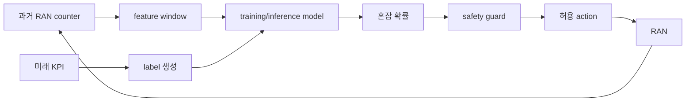

# 15. AI-for-RAN: 데이터에서 안전한 제어까지

## 측정 한 줄이 실제 행동이 되기까지

기지국 counter와 UE report는 원시 **측정값**이다. 모델에 넣기 위해 시간 창의 평균·변화율·범주로 바꾼 입력을 **feature**라고 한다. 예측이 맞았는지 학습 때 비교하는 정답·목표를 **label**이라 한다. 모델을 만드는 반복 계산은 **training**, 운영 요청에서 출력을 계산하는 과정은 **inference**다.

이 용어는 위치와 수명이 다르다. 측정은 DU·CU에서 ms~초 동안 생성되고, feature store에는 더 오래 보관될 수 있다. training dataset은 offline 저장소에 있고, 배포된 model artifact는 version과 승인 상태를 가진다. inference 결과는 짧은 control window 안에서만 유효할 수 있다.

## UE A의 측정부터 행동까지

목표를 “다음 500 ms에 cell 혼잡이 커질지 예측해 admission parameter를 조정”으로 정한다. DU가 PRB 사용률·buffer·HARQ를 100 ms 간격으로 보고한다. feature pipeline이 최근 5개 값을 평균·기울기로 만든다. model server가 20 ms 안에 inference하고 controller가 guard를 검사한다.

| 시각 | 주체 | 객체 |
|---:|---|---|
| 0~500 ms | DU | 5개 measurement |
| 520 ms | feature pipeline | mean·slope·missing flag |
| 540 ms | model server | congestion probability 0.82 |
| 545 ms | controller | policy·범위·age 검사 |
| 560 ms | RAN node | parameter 적용 또는 거부 |
| 1060 ms | evaluator | KPI 전후·부작용 |

probability 0.82가 action 자체는 아니다. threshold, 현재 policy, 변경 폭, 최소 유지 시간, rollback 조건을 적용해 control 후보로 바꾼다.

## train/test 누수와 negative transfer

같은 UE의 연속 1초 window를 무작위로 train/test에 나누면 거의 같은 channel 장면이 양쪽에 들어가 성능이 부풀 수 있다. cell과 날짜를 분리한 test가 새 환경 일반화를 더 엄격히 본다.

여러 cell·task를 함께 학습하면 공통 표현을 얻을 수 있지만 한 task gradient가 다른 task를 해칠 수 있다. 이를 **negative transfer**라고 한다. 2024 multi-task 연구는 네 simulation task와 partial federation 조건을 평가한다. 그 결과를 모든 현장 cell에 일반화하지 않고 task·dataset·metric을 함께 기록한다.

## inference deadline과 fallback

control 유효 시간이 100 ms인데 feature 생성 40, queue 30, inference 50 ms면 합 120 ms로 이미 늦다. 정확한 model이어도 stale action은 위험하다. deadline 초과, input 범위 이탈, model service 장애 때 no-op이나 검증된 rule baseline으로 fallback한다.

canary는 일부 cell·traffic에 제한 배포해 영향과 rollback을 확인하는 단계다. SIL은 software simulation, HIL은 실제 hardware 일부와 연결한 시험이다. 둘의 통과가 상용 전면 배포를 자동 승인하지 않는다.

## 추가 문제와 완전 해설

### 1. measurement와 feature 차이는?
measurement는 원시 관측, feature는 모델 입력용으로 변환한 값이다.

### 2. 40+30+50 ms inference chain이 100 ms deadline을 만족하는가?
총 120 ms라 만족하지 못한다.

### 3. 같은 시간 window를 train/test에 섞으면?
유사 장면 누수로 일반화 성능이 부풀 수 있다.

### 4. model probability가 곧 control인가?
아니다. policy·guard·범위·age 검사와 실행 interface가 필요하다.

### 5. negative transfer를 발견하면?
task 분리, weight 조정, partial sharing과 baseline 비교를 검토한다.

[이 책 목차](README.md)

[← 이전: AI-RAN 세 방향](14-ai-ran-three-directions.md) · [다음: 공유 계산](16-ai-and-ran-shared-compute.md)

AI-for-RAN은 AI로 무선 성능과 운영 효율을 개선하는 방향이다.
모델 정확도만 높이는 일이 아니라 데이터 수집, label, 배포 지연, action guard, feedback을 하나의 제어 고리로 설계해야 한다.

## 15.0 제어 고리에서 쓰는 기본 단어

**KPI(Key Performance Indicator, 핵심 성능 지표)**는 운영 상태를 숫자로 표현한 관측값이다. PRB 사용률, block error 비율, handover 실패율, 사용자 latency가 예다. KPI는 원인 자체가 아니라 상태를 관찰하는 창이다. PRB 95%라는 숫자만으로 traffic 증가, 잘못된 설정, interference 중 어느 것이 원인인지 확정할 수 없다.

**Feature(특징값)**는 원시 KPI와 event를 model 입력으로 정리한 값이다. 최근 1초 PRB 평균, 직전 100 ms 대비 queue 증가량, CQI 하위 10% 같은 값이다. Model이 문자열 이름을 이해하는 것이 아니라 정해진 순서·단위의 숫자 tensor를 받으므로 feature schema가 필요하다.

**Label(정답표)**은 training 때 model이 맞히도록 제공하는 목표다. “다음 100 ms에 혼잡했는가”라는 0 또는 1, 다음 window의 실제 throughput 같은 값이 될 수 있다. Label 정의가 바뀌면 같은 data라도 다른 문제를 학습한다.

**Training dataset(학습 데이터셋)**은 feature와 label을 짝지은 여러 행이다. Training은 이 행에서 오차를 줄이도록 model parameter를 반복해서 바꾼다. Test data는 parameter를 바꾸는 데 사용하지 않고 처음 보는 data에서 성능을 확인한다.

**Inference(추론)**는 운영 시점의 새 feature 한 행을 이미 학습된 model에 넣어 prediction을 얻는 계산이다. **Action(동작)**은 prediction을 받은 controller가 실제 RAN 설정을 바꾸는 일이다. 둘 사이의 **guard(안전 검사)**가 허용 범위와 최신성을 확인한다.

**Feedback(피드백)**은 action 뒤 KPI가 어떻게 변했는지 다시 관측해 기록하는 일이다. Prediction이 맞았는지뿐 아니라 action이 목적을 달성했는지도 확인한다.

**Baseline(기준선)**은 AI와 비교할 기존 규칙이나 단순 방법이다. AI가 복잡하다는 이유만으로 baseline보다 낫다고 가정하지 않는다.

**Drift(분포 변화)**는 운영 환경이 training 때와 달라지는 현상이다. 새 단말과 software, 계절 traffic은 feature 분포나 feature-label 관계를 바꿀 수 있다.

**SIL(Software-in-the-Loop)**은 software simulator나 기록 재생으로 제어 고리를 시험하는 방법이다. **HIL(Hardware-in-the-Loop)**은 대표 hardware와 실제 interface·timing을 시험 고리에 포함한다. **Canary 배포**는 전체 cell이 아니라 제한된 일부에 먼저 새 model을 적용하는 단계다.

## 15.0.1 데이터 한 행이 동작과 피드백이 되는 과정

Cell `A-17`의 10:00:00.000 시점에 다음 한 행을 만들었다고 하자.

```text
관측 window: 09:59:59.000 ~ 10:00:00.000
cell_id: A-17
mean_prb: 80.7 %
max_prb: 92.0 %
queue_growth: +2400 packets/s
cqi_p10: 5
feature_age_at_inference: 7 ms
```

처리 순서를 한 단계씩 따라가면 다음과 같다.

1. **수집기**가 base station counter를 읽고 시각과 cell ID를 붙인다.
2. **Feature pipeline**이 같은 1초 window를 집계해 네 숫자를 만든다.
3. **Schema 검사기**가 percent 범위, 결측값, 단위와 feature 순서를 확인한다.
4. **Model server**가 feature vector를 받아 혼잡 확률 `0.91`을 출력한다.
5. **Policy guard**가 model version, data age 7 ms, confidence threshold 0.8을 확인한다.
6. **Controller**가 허용 목록 안의 scheduler 설정 후보 `profile-B`를 적용한다.
7. **관측기**가 다음 100 ms의 queue, BLER, latency를 기록한다.
8. **평가기**가 혼잡 완화와 부작용을 baseline cell과 비교한다.

```text
prediction: congestion=0.91
guard result: PASS (fresh, in-range, confidence≥0.8)
action: profile-B for 100 ms
feedback: queue -18%, BLER +0.2 percentage points, p95 latency -3 ms
```

Queue가 줄었다고 action이 항상 성공한 것은 아니다. BLER guard가 `+0.1 percentage points 이하`였다면 `+0.2`는 위반이다. Controller는 기존 profile로 되돌리고 이 사례를 failure로 기록해야 한다.

## 15.1 문제를 먼저 고정한다

예제 목표는 “다음 100 ms에 cell이 혼잡할지 예측하고 scheduler 설정 후보를 고른다”이다.

```text
입력: 최근 1초의 cell KPI와 UE 분포
출력: congestion probability 0..1
action: 임계값을 넘으면 허용된 설정 후보 중 하나 추천
목표: throughput 개선, BLER와 latency 상한 유지
```

모델 출력과 실제 무선 제어 action은 같은 것이 아니다.
정책 계층이 confidence, 안전 범위, 현재 장애 상태를 확인한 뒤 action을 적용한다.

## 15.2 데이터와 feature

원시 입력 후보는 다음과 같다.

- PRB 사용률과 queue 길이
- CQI와 SINR(Signal-to-Interference-plus-Noise Ratio) 분포
- BLER(Block Error Rate)와 HARQ 재전송
- handover 시도·성공·실패 수
- UE 수, traffic class, 시간대
- 장애·정비·software version

Feature는 원시 counter를 모델이 사용할 값으로 바꾼 것이다.
예를 들어 10 ms counter 열 개에서 평균 PRB와 최대 queue를 만든다.

```text
PRB samples: 60, 65, 70, 82, 88, 91, 92, 89, 86, 84
mean PRB = 80.7%
max PRB = 92%
증가량 = 84 - 60 = 24 percentage points
```

평균만 쓰면 짧은 peak를 숨길 수 있다.
최댓값만 쓰면 일시적 spike에 과민할 수 있다.

## 15.3 label은 미래의 기준이다

혼잡 label을 “다음 100 ms 동안 queue가 5,000 packet을 넘거나 p95 latency가 20 ms를 넘음”으로 정했다고 하자.
Label 계산에는 prediction 시점 뒤의 값이 필요하다.
그 미래 값을 input feature에 넣으면 leakage다.



## 15.4 train/test 누수: cell과 시간을 함께 나눈다

한 cell의 월요일 10:00 행을 train에, 같은 10 ms window의 복제 행을 test에 넣으면 test가 독립적이지 않다.
인접 window는 같은 UE와 traffic burst를 공유할 수 있다.

더 강한 평가 예:

```text
train: cell A,B / 1~20일
validation: cell A,B / 21~24일
test-time: cell A,B / 25~28일
test-cell: 처음 보는 cell C / 25~28일
```

시간 일반화와 cell 일반화를 따로 측정한다.
전체 행을 무작위로 80:20 분할하는 것보다 어렵지만 운영 성능을 더 잘 드러낸다.

## 15.5 baseline부터 비교한다

AI 모델은 다음 단순 기준보다 나아야 한다.

1. 현재 값 유지.
2. PRB 85% 초과라는 규칙.
3. 같은 요일·시간대 평균.
4. 직전 window 값을 그대로 예측.

Test 1,000개에서 혼잡 100개라고 하자.

```text
rule baseline: TP=70, FP=80, FN=30, TN=820
precision = 70/(70+80) = 0.467
recall = 70/(70+30) = 0.70
```

Accuracy는 89%지만 혼잡을 30개 놓친다.
Action 비용에 맞는 precision, recall, latency, 안전 위반을 함께 본다.

## 15.6 inference에서 action까지

```text
t=0 ms    feature window 닫힘
t=3 ms    집계 완료
t=5 ms    model inference 완료, probability=0.91
t=6 ms    guard: feature freshness와 범위 확인
t=7 ms    controller가 허용 action 적용
t=100 ms  KPI feedback 수집
```

100 ms 제어 문제에 120 ms 된 feature를 쓰면 모델이 빨라도 늦은 결정이다.
Model latency, transport, feature age, controller 적용 시간을 합쳐야 한다.

## 15.7 SIL, HIL, canary

SIL(Software-in-the-Loop)은 software simulator나 replay 환경에서 action을 시험한다.
HIL(Hardware-in-the-Loop)은 실제 또는 대표 hardware를 제어 고리에 넣어 timing과 interface를 검증한다.

안전한 승격 순서는 다음과 같다.

```text
offline replay → SIL closed loop → HIL → shadow mode → 제한 cell canary → 확대
```

Shadow mode에서는 모델이 추천하지만 실제 RAN에는 적용하지 않는다.
추천과 실제 결과를 비교해 위험한 조건을 찾는다.

## 15.8 fallback과 guard

다음 조건이면 baseline으로 돌아간다고 정할 수 있다.

- feature가 200 ms 이상 오래됨
- 입력 값이 training 범위 밖
- confidence가 0.7 미만
- inference timeout
- BLER 또는 latency guard 위반
- model service health 실패

Fallback은 “AI를 끈다”에서 끝나지 않는다.
어떤 기존 제어값으로 돌아가며, 상태를 얼마나 유지하고, 재진입 전에 무엇을 확인하는지 정한다.

## 15.9 drift와 feedback

Data drift는 입력 분포 변화다.
Concept drift는 같은 입력과 결과의 관계 변화다.
새 단말, software upgrade, 계절 traffic, spectrum 구성 변경이 원인이 될 수 있다.

모델 action이 데이터 분포를 바꾸므로 feedback은 독립 관측이 아닐 수 있다.
Action을 받은 cell과 baseline cell을 구분하고 version, confidence, 실제 KPI를 함께 기록한다.

## 15.10 RIC와 제어 경계

O-RAN의 Non-RT RIC와 Near-RT RIC, E2는 AI-for-RAN을 구현할 수 있는 한 architecture다.
모든 AI-for-RAN 기능이 반드시 E2를 지나야 하는 것은 아니다.
PHY 내부의 빠른 inference와 장기 운영 최적화는 위치와 시간 요구가 다르다.

## 15.11 반례

Offline AUC가 올랐다고 throughput이 오른다는 보장은 없다.
잘못된 action mapping이나 지연 때문에 KPI가 나빠질 수 있다.

전체 cell 평균이 좋아도 cell-edge UE의 p99 latency가 나빠질 수 있다.
평균과 tail, 사용자 집단별 결과를 분리한다.

## 15.12 확인 문제와 해설

### 문제 1

Label 기간의 KPI를 feature에 포함하면 왜 문제인가?

**해설:** 예측 시점에는 알 수 없는 미래 정보가 들어가 test 성능이 부풀려진다.

### 문제 2

Model inference가 2 ms인데 feature age가 150 ms라면 100 ms 제어에 충분한가?

**해설:** 아니다. 전체 정보 지연이 제어 시간보다 길다. Inference 시간만 보고 판단할 수 없다.

### 문제 3

새 cell에서 성능을 확인하려면 어떤 분할이 필요한가?

**해설:** 해당 cell의 모든 기간을 training에서 제외한 cell-held-out test가 필요하다. 시간-held-out 평가도 별도로 둔다.

## 15.13 공식 자료

- [AI-RAN Alliance AI-for-RAN white paper](https://ai-ran.org/documents/AI-RAN-WG1-AI-for-RAN-Whitepaper.pdf)
- [O-RAN Alliance specifications](https://www.o-ran.org/specifications)
- [3GPP AI/ML for NG-RAN 자료 검색](https://www.3gpp.org/ftp/Specs/archive/37_series/37.817/)

공식 근거 확인일: **2026-10-11**.

[← 이전](14-ai-ran-three-directions.md) · [다음 →](16-ai-and-ran-shared-compute.md)
