# 16. AI-and-RAN: 공유 GPU에서 deadline을 지키는 법

[← 이전: AI-for-RAN](15-ai-for-ran-data-training-control.md) · [다음: AI-on-RAN](17-ai-on-ran-edge-inference.md)

AI-and-RAN은 AI 작업과 RAN 작업을 같은 기반 compute에서 실행해 이용률과 경제성을 높이려는 방향이다.
핵심 질문은 “GPU가 남는가”가 아니라 “RAN의 시간 제약을 깨지 않고 AI를 언제 받을 수 있는가”다.

## 1. 공유 계산의 기본 단어

**GPU(Graphics Processing Unit)**는 많은 숫자 연산을 병렬로 실행하는 processor다. AI 행렬곱과 일부 RAN signal processing을 모두 실행할 수 있지만, 두 일이 동시에 자원을 요구하면 경쟁이 생긴다.

**Kernel(GPU kernel)**은 CPU program이 GPU에 제출하는 하나의 병렬 작업 단위다. 여기서 kernel은 Linux kernel이 아니라 GPU에서 실행되는 함수라는 뜻이다. 긴 kernel은 GPU execution unit을 오래 점유할 수 있다.

**Stream**은 GPU 작업의 순서를 표현하는 queue다. 같은 stream의 작업은 보통 제출 순서를 따르고, 서로 다른 stream은 hardware와 의존성이 허용하면 겹칠 수 있다. Stream을 두 개 만들었다고 항상 동시에 실행되는 것은 아니다.

**Preemption(선점)**은 실행 중인 낮은 우선순위 작업을 멈추거나 뒤로 미뤄 높은 우선순위 작업을 실행하게 하는 능력이다. CPU process 선점처럼 GPU kernel이 아무 instruction에서나 즉시 멈춘다고 가정하면 안 된다. Hardware와 workload에 따라 중단 granularity와 비용이 다르다.

**Deadline(마감 시각)**은 결과가 유효하려면 끝나야 하는 시각이다. RAN 작업이 1 ms window 안에 끝나야 한다면 1.01 ms의 정확한 결과도 늦어서 사용할 수 없을 수 있다.

**WCET(Worst-Case Execution Time, 최악 실행 시간)**은 정의한 조건에서 작업이 걸릴 수 있는 안전한 상한이다. 관측한 최대값 하나와 WCET 증명은 다르다. Input 크기, clock, 경쟁, software version의 범위를 밝혀야 한다.

**Jitter(지터)**는 같은 작업의 완료 시간이 실행마다 흔들리는 정도다. 평균 0.2 ms여도 0.1~0.5 ms로 흔들리면 0.3 ms slack에는 위험하다.

**Memory bandwidth(메모리 대역폭)**는 일정 시간에 GPU memory와 계산 unit 사이에서 옮길 수 있는 byte 양이다. RAN과 AI kernel이 서로 다른 계산 core를 쓰는 것처럼 보여도 동시에 큰 tensor를 읽으면 memory bandwidth에서 경쟁할 수 있다.

**Interference(간섭)**는 한 workload가 공유 compute, memory, cache, PCIe, CPU, NIC를 사용해 다른 workload의 지연이나 처리량을 바꾸는 현상이다. 무선 interference와 구분하기 위해 compute interference라고 적기도 한다.

**Admission control(입장 제어)**은 AI job을 GPU queue에 넣기 전에 남은 시간과 memory를 보고 받을지 결정하는 절차다. 일단 긴 kernel을 제출한 뒤에는 안전하게 되돌리기 어려울 수 있으므로 제출 전에 판단한다.

### 1.1 CPU 제출부터 GPU 완료까지

AI request가 들어왔다고 GPU가 즉시 계산하는 것은 아니다.

```text
t=0.000 ms  API가 AI request 수신
t=0.020 ms  admission controller가 deadline·memory 검사
t=0.040 ms  CPU thread가 input buffer 준비
t=0.080 ms  copy 작업을 AI stream에 제출
t=0.120 ms  GPU copy 완료, AI kernel은 앞선 작업을 기다림
t=0.180 ms  AI kernel 시작
t=0.430 ms  AI kernel 완료
t=0.450 ms  CPU가 completion event 관찰
```

Kernel 자체는 `0.430-0.180=0.25 ms`지만 request에서 completion 관찰까지는 0.45 ms다. Deadline budget에는 queue, copy, synchronization도 포함해야 한다.

RAN kernel이 t=0.300 ms에 도착했다고 하자. AI kernel을 즉시 선점하지 못하면 RAN은 t=0.430 ms까지 기다린다. 이 0.13 ms 대기가 guard를 소비한다.

### 1.2 시간과 memory를 동시에 검사하기

GPU memory가 40 GiB이고 RAN이 worst case 18 GiB, system reserve가 2 GiB를 요구한다고 하자. AI model weight가 12 GiB, request activation peak가 10 GiB면 다음과 같다.

```text
가용 AI memory = 40 - 18 - 2 = 20 GiB
AI 요구 memory = 12 + 10 = 22 GiB
결과 = 시간 slack과 무관하게 reject
```

반대로 memory가 18 GiB로 들어가도 실행 WCET가 0.5 ms이고 slack이 0.3 ms라면 시간 조건에서 reject한다. Admission은 여러 제약의 교집합이다.

| 검사 | 질문 | 실패 시 결과 |
|---|---|---|
| 시간 | completion 상한이 다음 RAN reserve 전인가 | queue/reject |
| memory | weight·activation·workspace가 headroom 안인가 | 작은 batch/reject |
| bandwidth | 동시 실행이 RAN WCET를 늘리지 않는가 | 겹침 금지 |
| health | thermal throttling·오류가 없는가 | 전용 경로/fallback |

## 2. RAN과 AI workload의 성격

RAN workload는 slot·symbol 처리 시각에 맞춰 결과를 내야 한다.
Deadline을 놓치면 늦게 끝난 계산은 무선 처리에 쓸 수 없을 수 있다.

AI workload는 batch 크기, queue, model variant를 조절할 여지가 있다.
그러나 interactive inference는 TTFT(Time To First Token)와 tail latency SLO(Service Level Objective)를 갖는다.

| 항목 | RAN | AI |
|---|---|---|
| 주기 | 반복적이고 엄격할 수 있음 | 요청 도착에 따라 변동 |
| 실패 비용 | slot 처리 누락·무선 KPI 악화 | 지연·거절·품질 저하 |
| 완화 | 전용 reserve, fallback | queue, batch, reject |
| 측정 | worst-case와 jitter | throughput과 p95/p99 |

## 3. 1 ms 창의 admission 계산

첫 번째 교육 가정에서는 RAN job의 GPU 계산 0.45 ms, input copy 0.10 ms, output·후처리 0.10 ms로 총 0.65 ms가 필요하다. 안전 여유 0.15 ms를 두면 AI에 줄 수 있는 연속 budget은 `1.00-0.65-0.15=0.20 ms`다.

| 구간 | 작업 | 누적 |
|---|---|---:|
| 0~0.10 ms | RAN input copy | 0.10 ms |
| 0.10~0.55 ms | PHY kernel | 0.55 ms |
| 0.55~0.65 ms | output | 0.65 ms |
| 0.65~0.80 ms | 안전 여유 | 0.80 ms |
| 0.80~1.00 ms | 허용 가능 AI slice | 1.00 ms |

AI inference가 0.30 ms라면 이 창에 넣을 때 0.10 ms가 초과된다. 다음 창으로 미루거나 더 작은 model·검증된 fallback을 써야 한다.

두 번째 가정은 worst-case RAN 0.6 ms와 guard 0.1 ms로 slack 산식을 단순화한다. 앞 표와 수치를 섞지 않는다. 1 ms 처리 창에서 RAN worst-case 실행이 0.6 ms, guard가 0.1 ms라고 하자.

```text
window       = 1.0 ms
RAN reserve  = 0.6 ms
guard        = 0.1 ms
AI slack     = 1.0 - 0.6 - 0.1 = 0.3 ms
```

측정한 AI kernel이 0.2 ms면 단순 모델에서는 받을 수 있다.
0.5 ms면 slack을 넘으므로 받지 않는다.

```mermaid
gantt
    title 1 ms 공유 실행 창
    dateFormat X
    axisFormat %L
    section Reserved
    RAN worst-case :0, 600
    guard          :600, 700
    section Optional
    AI slack       :700, 1000
```



실제 시스템에서는 context switch, memory copy, kernel non-preemption, cache 경쟁을 더한다.
평균 AI 시간이 0.2 ms여도 p99가 0.45 ms면 안전하지 않을 수 있다.

## 4. Admission 주체와 상태

```text
입력
  RAN deadline와 다음 reserve window
  AI job의 worst-case budget, memory, priority
  현재 GPU queue와 thermal/health

담당 주체
  infrastructure orchestrator/admission controller

중간 상태
  reserved, admitted, queued, rejected, preempt-requested

결과
  실행 위치·시간을 배정하거나 안전하게 거절
```

입장 제어는 관측한 평균 utilization만 보지 않는다.
RAN reserve, AI 최악시간, preemption 비용, memory headroom을 함께 본다.

### 4.1 시간표로 보는 충돌

```text
t=0.00 ms  RAN window 시작
t=0.55 ms  RAN 일반 실행 완료
t=0.60 ms  AI kernel 0.30 ms 시작
t=0.75 ms  예상보다 이른 RAN 보정 작업 도착
t=0.90 ms  AI kernel 종료
t=1.00 ms  다음 RAN deadline
```

AI kernel을 중간에 0.75 ms에 즉시 멈출 수 없다면 남은 guard는 0.10 ms뿐이다.
Admission은 “평균 빈 시간”이 아니라 중단 가능 지점까지 알아야 한다.

## 5. 공간 공유와 시간 공유

**MIG(Multi-Instance GPU, 다중 인스턴스 GPU)**는 지원 GPU를 hardware instance로 나누는 방법이다.
Time-slicing은 같은 GPU 실행 시간을 여러 process가 나누는 방법이다.
**MPS(Multi-Process Service, 다중 프로세스 서비스)**는 여러 CUDA process의 실행 공유를 돕는다.

어느 방식도 RAN deadline을 자동 보장하지 않는다.
Memory 격리, compute partition, scheduling latency, 오류 전파를 각각 검증한다.

## 6. Kubernetes DRA의 역할

**DRA(Dynamic Resource Allocation, 동적 자원 할당)**는 DeviceClass, ResourceSlice, ResourceClaim으로 장치 요구와 할당을 표현한다.
GPU model·memory·topology 조건에 따라 장치를 선택할 수 있다.

```text
ResourceClaim 성공
  → 어느 GPU를 쓸지 정함
  → node prepare와 CDI 주입 가능
  ↛ 0.3 ms 안에 kernel이 끝난다는 보장
```

Resource Operator나 GPU Operator도 장치 lifecycle을 관리한다.
Microsecond deadline은 realtime scheduling, workload runtime, kernel 특성, CPU/NIC 경로가 함께 책임진다. Kubernetes request·limit와 Pod priority는 배치·격리를 돕지만 이미 실행 중인 GPU kernel의 µs~ms deadline을 자동 보장하지 않는다.

## 7. Vendor 구현과 표준 계층의 경계

NVIDIA Aerial의 cuPHY는 GPU 기반 5G L1 처리 library·SDK이고 O-RAN 7.2 경로를 지원하는 vendor 구현이다.
cuMAC은 CUDA 가속 MAC scheduler library다.

PHY와 MAC은 3GPP 계층이지만 `cuPHY`, `cuMAC`이라는 제품 API는 3GPP 규격명이 아니다.
Vendor가 말하는 compliant gNB는 해당 SDK의 지원 범위에 대한 vendor claim으로 읽고, 모든 구현의 보편 기능으로 일반화하지 않는다.

## 8. Capacity, queue와 memory 간섭

AI kernel이 GPU core를 독점하지 않아도 큰 memory copy가 bandwidth를 점유해 RAN kernel 시간을 늘릴 수 있다. Device memory 부족으로 eviction·재적재가 생기거나 copy engine·execution queue가 겹쳐도 deadline tail이 커진다. 평균 실행시간만 더해서 capacity를 정하지 않는다.

| 상태 | RAN p50 | RAN p99 | 판단 |
|---|---:|---:|---|
| RAN 단독 | 0.45 ms | 0.55 ms | 1 ms 안의 여유 있음 |
| AI 동시 | 0.50 ms | 1.20 ms | deadline tail 위반 |
| AI admission 제한 | 0.47 ms | 0.70 ms | 교육 모형상 회복 |

GPU 한 대가 초당 1,000개의 작은 AI inference를 처리한다고 측정했다고 하자.
RAN reserve가 시간의 70%이고 나머지 30%에서 동일 성능이 유지된다는 단순 가정이면 상한은 300 inference/s다.

```text
1000 × 0.30 = 300 inference/s
```

이는 경험적 성능 보장이 아니다.
작은 실행 조각으로 나눌 수 있는지, RAN과 memory bandwidth를 경쟁하는지에 따라 실제 값은 낮아진다.

## 9. 평균 이용률과 격리를 오해하는 반례

GPU utilization 40%는 deadline slack 60%를 뜻하지 않는다.
Busy time의 위치와 burst가 중요하다.

DRA Claim 두 개가 서로 다른 GPU를 받았어도 PCIe switch, CPU NUMA, NIC를 공유해 간섭할 수 있다.

AI Pod의 priority를 낮췄다고 이미 실행 중인 긴 GPU kernel을 즉시 선점할 수 있다고 단정하지 않는다.

## 10. 안전 fallback과 운영 경계

공유 정책이 불확실하면 다음 순서로 보수적으로 동작할 수 있다.

1. 새 AI admission 중지.
2. Queue의 낮은 우선순위 AI 취소 또는 다른 node로 이동.
3. RAN 전용 reserve 확대.
4. 필요하면 전용 compute 경로로 복귀.
5. Deadline miss와 원인을 기록한 뒤 재개 조건 평가.

AI 응답을 실패시키는 비용보다 무선 control deadline을 놓치는 비용이 클 수 있다.
우선순위는 서비스 계약과 안전 분석에서 미리 정한다.

## 11. 통합 문제와 완전 해설

### 11.1 Slack 계산

1 ms 창, RAN 0.62 ms, guard 0.13 ms일 때 AI slack은?

**해설:** `1-0.62-0.13=0.25 ms`다. 여기에 전환 비용이 포함됐는지도 확인한다.

### 11.2 평균과 tail

AI 평균 0.2 ms, p99 0.4 ms이고 slack이 0.3 ms다. 평균만으로 admit할 수 있는가?

**해설:** 없다. Tail이 slack을 넘는다. Worst-case bound나 안전한 중단·격리 방법이 필요하다.

### 11.3 ResourceClaim의 의미

ResourceClaim allocation이 증명하는 것은 무엇인가?

**해설:** 조건에 맞는 장치가 선택·예약됐다는 제어 평면 상태다. RAN deadline과 application correctness는 별도 검증이다.

### 11.4 GPU memory만 충분하면 compute interference가 없는가?

**해설:** 아니다. GPU execution unit, memory bandwidth, copy engine, cache, queue, PCIe·CPU·NIC 경로를 공유할 수 있다.

### 11.5 Kubernetes limit가 radio deadline을 보장하는가?

**해설:** 아니다. Resource 설정은 배치와 격리의 제어 평면 조건이다. GPU 내부 scheduling, kernel 선점 granularity, copy와 tail latency를 실제 workload 조건에서 검증해야 한다.

### 11.6 AI inference가 deadline 전에 끝날 수 없을 때의 안전 행동은?

**해설:** 미리 정한 정책에 따라 admission을 거절·지연하고, 더 작은 model, CPU·rule fallback 또는 다른 node를 사용한다. 늦은 결과를 radio control에 그대로 적용하지 않는다.

## 12. 공식 자료

- [AI-RAN Alliance](https://ai-ran.org/)
- [AI-RAN Platform and Infrastructure Orchestrator](https://ai-ran.org/documents/AI-RAN-Platform-Infrastructure-Orchestrator.pdf)
- [NVIDIA Aerial cuPHY overview](https://docs.nvidia.com/aerial/aerial-cuphy/current/text/overview.html)
- [NVIDIA cuMAC documentation](https://docs.nvidia.com/aerial/cuda-accelerated-ran/latest/cubb/cumac/index.html)
- [NVIDIA GPU Operator DRA](https://docs.nvidia.com/datacenter/cloud-native/gpu-operator/26.7/dra-intro-install.html)

공식 근거 확인일: **2026-10-11**.

[← 이전](15-ai-for-ran-data-training-control.md) · [다음 →](17-ai-on-ran-edge-inference.md)
