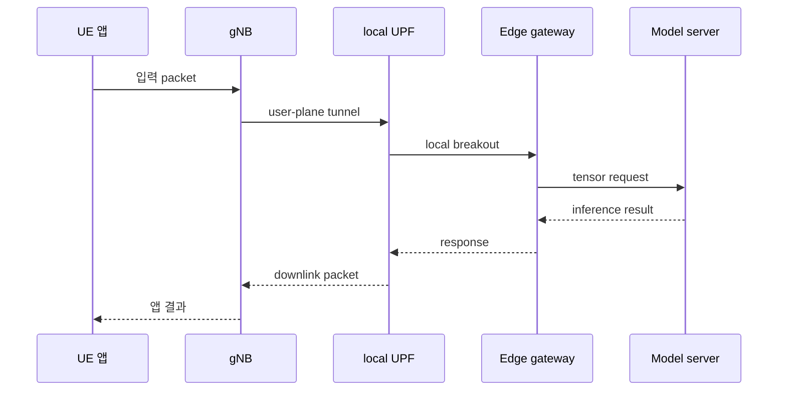
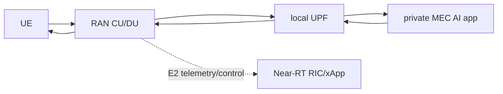

# 17. AI-on-RAN: edge inference와 user-plane 경로

[← 이전: 공유 계산](16-ai-and-ran-shared-compute.md) · [다음: 5G-Advanced와 6G](18-5g-advanced-6g-and-release-status.md)

**AI-on-RAN**은 RAN(Radio Access Network, 무선 접속망) 인프라 또는 그 가까운 edge에서 사용자·산업용 AI 응용을 실행하는 방향이다. 목표는 사용자와 가까운 위치에서 낮은 지연, 데이터 지역성, 현장 서비스를 제공하는 것이다.

**Edge inference(에지 추론)**는 학습을 마친 model이 가까운 계산 위치에서 새 입력의 결과를 계산하는 작업이다. “Model이 edge에 있다”는 말은 weight가 그 위치의 storage 또는 accelerator memory에 배포되고, 실행 runtime과 route가 그 instance로 이어진다는 뜻이다. 서버가 물리적으로 기지국 옆에 있다는 사실만으로 packet 경로나 warm 상태가 보장되지는 않는다.

**UE(User Equipment, 사용자 장비)**는 사용자 단말이고, **gNB(gNodeB, 5G 기지국)**는 UE의 무선 packet을 5G core 경로로 연결한다.

## 1. Packet 경로와 model 위치의 기본 단어

**User plane(사용자 평면)**은 사용자의 video, game, sensor, web packet을 운반하는 경로다. **Control plane(제어 평면)**은 접속, 인증, session 설정과 network 제어 신호를 다룬다. 두 경로가 협력하지만 application payload와 network 제어 message는 같은 것이 아니다.

**UPF(User Plane Function)**는 5G core의 user-plane 기능이다. UE packet을 data network로 전달하고 정책에 따라 가까운 edge 또는 중앙 network 쪽 경로를 선택하는 지점이 될 수 있다.

**Local breakout(로컬 분기)**은 특정 UE traffic을 먼 중앙 data center까지 보내지 않고 가까운 data network나 MEC application으로 분기하는 routing이다. “Local”의 범위는 사업장, metro edge, operator edge 등 배치에 따라 다르다.

**MEC(Multi-access Edge Computing)**는 access network 가까이에서 application을 실행하고 network 정보를 활용할 수 있게 하는 edge computing 체계다. MEC는 GPU 한 대의 이름도, 특정 Kubernetes distribution의 이름도 아니다.

**RIC(RAN Intelligent Controller)**는 O-RAN architecture에서 RAN 최적화 application을 실행·지원하는 구성요소다. Near-RT RIC는 비교적 빠른 제어 고리를, Non-RT RIC는 더 긴 시간 범위의 정책·모델 관리와 연결된다.

**E2 interface**는 Near-RT RIC와 O-RAN node 사이에서 telemetry, subscription, control을 전달하는 interface다. UE의 video packet을 MEC detector로 운반하는 일반 application data tunnel이 아니다.

**Service latency(서비스 지연)**는 사용자가 request를 시작한 때부터 쓸 수 있는 response를 받을 때까지의 시간이다. Radio latency, transport, queue, preprocessing, inference, postprocessing, return path를 모두 포함한다.

**Cold start(콜드 스타트)**는 service instance가 준비되지 않은 상태에서 image load, process 시작, model weight load, GPU memory allocation 등을 처음 수행하는 시작 비용이다. 이미 준비된 instance의 **warm inference**보다 훨씬 길 수 있다.

### 1.1 누가 packet과 model을 처리하는가

UE camera가 frame을 보낼 때 주체를 순서대로 적어 보자.

1. **UE application**이 camera frame을 압축하고 IP packet을 만든다.
2. **RAN**이 radio resource를 배정하고 packet을 uplink로 전달한다.
3. **5G core session과 UPF**가 이 traffic이 어느 data network로 갈지 결정된 경로를 적용한다.
4. **Local UPF**가 해당 flow를 private MEC network로 breakout한다.
5. **Load balancer/service gateway**가 준비된 inference instance를 고른다.
6. **Preprocessor**가 JPEG 같은 payload를 tensor shape와 dtype으로 바꾼다.
7. **Model runtime**이 CPU/GPU에서 inference를 실행한다.
8. **Postprocessor**가 score를 label과 confidence로 바꾼다.
9. **Application**이 결과를 UE에 반환하거나 권한 있는 후속 system에 전달한다.

이 중 RIC/E2는 RAN 최적화를 위해 별도로 radio telemetry를 읽고 제어할 수 있지만, 위 frame payload의 기본 전달 단계에는 들어가지 않는다.



### 1.2 Warm 요청과 cold start

```text
Warm request
  radio+RAN 4 ms
  UPF+transport 2 ms
  queue 2 ms
  inference 6 ms
  return 4 ms
  합계 18 ms

Cold request 추가 비용
  container/process 시작 120 ms
  model weight load 380 ms
  GPU initialization 100 ms
  총 추가 600 ms
```

이 표는 warm 18 ms와 cold 추가 600 ms라는 한 교육 조건이다. 다른 model·image 가정에서는 warm inference 20 ms, cold start 2초처럼 더 큰 차이가 날 수도 있다. 두 숫자를 같은 측정의 서로 다른 합계로 섞지 않는다.

20 ms service 목표에서 618 ms cold request는 실패한다. 해결책은 instance를 미리 준비하고 model을 memory에 올려 두는 warm pool, traffic 예측에 따른 scale-out, 더 작은 fallback model일 수 있다. 단순히 inference kernel 6 ms라고 보고 목표를 만족했다고 결론 내리면 안 된다.

## 2. User plane과 RIC 제어 경로

UE(User Equipment)의 application packet은 user plane을 지난다.
RAN 제어 최적화는 RIC(RAN Intelligent Controller)와 E2 같은 control 경로를 사용할 수 있다.



영상 frame을 edge AI에 보내는 packet이 E2를 타는 것은 아니다.
E2는 O-RAN node와 Near-RT RIC 사이의 제어·관측 interface다.
AI-on-RAN 응용 traffic은 보통 user-plane routing과 UPF를 기준으로 설명한다.

## 3. 입력 byte에서 결과까지

Private MEC(Multi-access Edge Computing)에서 제조 카메라 결함 탐지를 수행한다고 하자.

```text
입력: UE camera frame 200 KiB
담당 주체: UE app → RAN → local UPF → MEC inference service
중간 상태: uplink queue, PDU session route, inference queue, model input tensor
결과: defect=true, confidence=0.94
후속 동작: private application이 설비 정지 후보를 생성
```

MEC 결과가 RAN scheduler action은 아니다.
설비 제어도 별도 safety controller가 확인해야 한다.

## 4. 왕복 service latency budget

왕복 service latency는 radio scheduling, uplink payload, transport, queue, preprocessing, inference, postprocessing과 downlink를 모두 포함한다. 먼저 큰 image의 교육 예를 보자. UE가 200 kB image를 실제 uplink goodput 20 Mbit/s로 보내면 순수 uplink는 `200×8/20=80 ms`다.

| 125 ms 예의 단계 | 시간 | 주요 상태 위치 |
|---|---:|---|
| radio scheduling | 8 ms | UE·gNB queue |
| uplink payload | 80 ms | radio bearer·UPF path |
| edge network | 4 ms | switch·gateway |
| preprocessing | 6 ms | CPU memory |
| inference | 20 ms | GPU memory·queue |
| postprocessing·downlink | 7 ms | user-plane return path |
| **합계** | **125 ms** | request에서 결과까지 |

입력을 50 kB로 줄이면 같은 가정에서 uplink는 20 ms, 총합은 65 ms 후보가 된다. 압축이 model 정확도를 낮출 수 있으므로 latency와 accuracy를 함께 측정한다.

다음 표는 작은 입력과 warm instance를 전제로 전체 목표를 20 ms로 잡은 **별도 저지연 가정**이다.

| 구간 | budget |
|---|---:|
| UE encoding·uplink queue | 3 ms |
| radio와 RAN 처리 | 4 ms |
| local UPF와 transport | 2 ms |
| AI queue | 2 ms |
| inference | 6 ms |
| response transport | 2 ms |
| guard | 1 ms |
| 합계 | 20 ms |

Inference를 6 ms에서 4 ms로 줄여도 uplink queue가 12 ms로 늘면 목표를 놓친다.
Model-only benchmark와 end-to-end latency를 분리한다.

## 5. Local breakout과 실제 packet 경로

Local breakout은 특정 UE traffic을 가까운 data network 또는 edge application으로 보내는 routing이다.
물리적으로 MEC 서버가 기지국 옆에 있어도 session route가 중앙 data center UPF로 향하면 왕복 경로가 길어진다.

```text
중앙 경로: UE → RAN → transport → central UPF → cloud AI
로컬 경로: UE → RAN → local UPF → private MEC AI
```

Breakout 정책은 DNN(Data Network Name), S-NSSAI, UE/session, application steering 같은 조건과 구현에 의존한다.
“Edge에 설치했다”는 문장만으로 실제 packet path를 증명하지 않는다.

## 6. Private MEC라는 배치 label

이 교재의 `private MEC`는 사업장이나 operator가 제한된 사용자·network를 위해 운영하는 edge 환경이라는 배치 label이다.
ETSI MEC 규격 전체를 대체하는 Kubernetes label 이름이 아니다.

문서에는 다음을 함께 적는다.

- 위치와 운영 주체
- 연결되는 UPF와 data network
- 허용 UE·tenant
- model/data 소유자
- 중앙 cloud fallback 경로

## 7. Model 배포와 route 변경의 책임

```text
Model owner       학습 artifact와 품질 승인
Platform operator image, accelerator, secret, rollout
Network operator  UPF route와 RAN 연결
Application owner API, result handling, user consent
Safety owner      action guard와 fallback 승인
```

한 팀이 여러 역할을 맡아도 책임 항목은 분리한다.
Model rollout과 user-plane route 변경을 같은 배포로 묶으면 원인 분석이 어려워진다.

## 8. Request 상태 전이와 batch deadline

```text
t=0 ms   UE frame 전송
t=4 ms   RAN uplink 처리 완료
t=6 ms   local UPF가 MEC route 선택
t=7 ms   inference queue 진입
t=9 ms   GPU batch에 admission
t=15 ms  inference 완료
t=18 ms  UE가 결과 수신
```

이 요청은 20 ms 목표 안에 끝났다.
하지만 평균 18 ms만 보고 p99를 알 수 없다.
Radio 재전송, queue, model cold start를 별도로 측정한다.

### 8.1 Batch와 deadline

Batch를 기다리면 GPU throughput은 올라갈 수 있다.
요청 A가 t=0, B가 t=4 ms에 도착하고 batch wait가 5 ms라면 A는 inference 전 4~5 ms 기다린다.

Interactive deadline이 짧으면 작은 batch나 dynamic batching을 쓴다.
Offline 분석은 큰 batch를 허용할 수 있다.
같은 model에도 service class별 정책이 필요하다.

## 9. 데이터 지역성과 privacy

Edge 처리로 raw data가 중앙 cloud로 가지 않게 설계할 수 있다.
그러나 log, embedding, model telemetry, 실패 sample이 중앙으로 복제될 수 있다.

다음을 확인한다.

- 어떤 원본과 파생값을 저장하는가
- 보존 기간과 삭제 주체
- tenant 사이 cache 공유 여부
- model update가 데이터를 외부로 보내는가
- 장애 dump에 user data가 들어가는가

## 10. RIC 응용과 user inference의 차이

xApp은 Near-RT RIC에서 E2를 통해 RAN을 관찰·제어하는 응용이다.
rApp은 Non-RT RIC/SMO 쪽의 비실시간 최적화와 연관된다.

Edge object detection service는 UE user traffic을 처리하므로 xApp이라고 부를 이유가 없다.
같은 cluster에서 실행돼도 interface와 목적이 다르다.

## 11. Edge 위치와 지연을 오해하는 반례

Edge inference가 낮은 지연을 “보장”하지 않는다.
Queue와 radio 상태가 지배할 수 있다.

UPF가 가까워도 model image pull과 cold start가 길 수 있다.

E2 연결이 있어도 UE application payload를 E2로 보내는 구조라고 추론하지 않는다.

## 12. 실패와 fallback의 운영 경계

MEC AI가 timeout이면 다음 선택지가 있다. Transport가 성공했더라도 오래된 model이 품질 기준에 못 미치는 결과를 내면 model 품질 실패로 따로 기록한다.

1. 명시적 실패를 UE app에 반환.
2. 작은 local fallback model 사용.
3. Deadline 여유가 있으면 central cloud로 전달.
4. 마지막 안전 결과를 제한 시간 재사용.

중앙 fallback은 항상 안전하지 않다.
왕복 지연이 남은 deadline보다 크면 늦은 성공보다 빠른 실패가 낫다.

## 13. 통합 문제와 완전 해설

### 13.1 User packet의 경로

UE 영상이 edge detector로 가는 주 경로는 E2인가?

**해설:** 아니다. User plane과 UPF routing 경로다. E2는 Near-RT RIC 제어·관측 interface다.

### 13.2 Model 시간과 E2E 목표

Inference 5 ms, 나머지 경로 18 ms이고 E2E 목표가 20 ms면 성공인가?

**해설:** 합계 23 ms라 실패다. Model 시간만 줄였다는 사실로 E2E 목표를 만족하지 않는다.

### 13.3 Private MEC와 privacy

Private MEC가 개인정보 보호를 자동 보장하는가?

**해설:** 아니다. Log, cache, telemetry, 중앙 복제와 접근 정책을 함께 검토해야 한다.

### 13.4 100 kB를 10 Mbit/s로 보내는 순수 전송 시간은?

**해설:** `100×8/10=80 ms`다. Scheduling, header, retry와 return path는 별도다.

### 13.5 서버가 물리적으로 가까우면 local breakout이 성립하는가?

**해설:** 아니다. PDU session과 UPF routing·application steering이 실제 edge data network를 가리켜야 한다.

### 13.6 Warm inference 15 ms와 batch wait 20 ms, deadline 30 ms라면?

**해설:** 이미 35 ms이므로 다른 경로 시간을 더하기 전에도 deadline을 넘는다. Batch를 줄이거나 즉시 실행·거절 정책이 필요하다.

### 13.7 Cold start를 줄이는 방법은?

**해설:** Service instance를 미리 실행하고 model weight와 필요한 runtime을 memory에 올린 warm pool을 유지한다. 예상 load에 맞는 capacity와 rollout 정책도 필요하다.

### 13.8 Cloud fallback은 항상 안전한가?

**해설:** 아니다. 남은 deadline보다 왕복이 길 수 있고 data locality, privacy, 비용·연결 실패 조건도 달라진다. 빠른 명시적 실패나 작은 local model이 더 안전할 수 있다.

## 14. 공식 자료

- [AI-RAN Alliance](https://ai-ran.org/)
- [ETSI MEC overview](https://www.etsi.org/technologies/multi-access-edge-computing)
- [ETSI MEC deployment white paper](https://www.etsi.org/images/files/ETSIWhitePapers/etsi_wp24_MEC_deployment_in_4G_5G_FINAL.pdf)
- [O-RAN Alliance specifications](https://www.o-ran.org/specifications)

공식 근거 확인일: **2026-10-11**.

[← 이전](16-ai-and-ran-shared-compute.md) · [다음 →](18-5g-advanced-6g-and-release-status.md)
