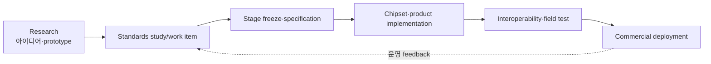
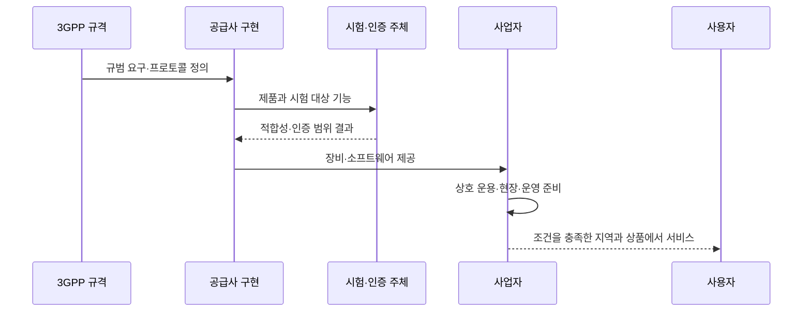

# 18. 5G-Advanced, 6G, Release 상태 읽기

[이전: RAN edge AI inference](17-ai-on-ran-edge-inference.md) · [목차](README.md) · [다음: 로컬 모델과 연구](19-local-models-and-research.md)

자료 확인일: **2026-10-11**

이 장은 미래 이동통신을 기능 목록으로 예언하지 않는다. **3GPP Release가 어느 단계에 있고, ITU IMT-2030이 어떤 framework와 requirements를 만들고 있으며, 연구·표준·제품·상용망을 어떻게 구분할지** 설명한다.

## 1. 먼저 네 상태를 분리한다

| 상태 | 의미 | 아직 말할 수 없는 것 |
| --- | --- | --- |
| 연구 제안 | 논문·프로젝트가 아이디어와 실험을 제시 | 표준 채택, 제품 지원 |
| 표준화 work item | 단체가 normative specification을 개발 | 모든 항목 완료, 상호 운용 |
| 규격 freeze·release | 정해진 stage의 변경 경계가 굳어짐 | 장비 구현·망 배포 완료 |
| 상용 서비스 | 사업자가 제품을 검증·배포해 고객에게 제공 | 세계 공통 기능·coverage |

## 2. 3GPP Release는 specification 묶음이다

3GPP는 요구사항, architecture, protocol, test specification을 Release 단위로 묶는다. Release 번호가 곧 한 날 모든 문서가 완성되는 단일 software release는 아니다.

대표 stage:

| Stage | 질문 |
| --- | --- |
| Stage 1 | 사용자가 필요로 하는 service·requirement는 무엇인가 |
| Stage 2 | 기능과 architecture를 어떻게 나눌까 |
| Stage 3 | protocol message·정보 요소를 어떻게 정의할까 |
| ASN.1/OpenAPI freeze | machine-readable protocol schema 변경 경계는 언제인가 |

ASN.1은 Abstract Syntax Notation One, telecom protocol message 구조 표현에 널리 쓰인다. OpenAPI는 HTTP API의 machine-readable description에 쓰인다.

## 3. 5G-Advanced의 범위

3GPP 공식 presentation은 Release 18부터 Release 20을 5G-Advanced 범위로 설명한다. 따라서 5G-Advanced를 Release 18 하나의 제품명으로만 쓰면 좁다.

가능한 주제는 향상된 MIMO, energy efficiency, positioning, NTN, sidelink, AI/ML 지원, XR 지원 등이다. 실제 포함 여부와 maturity는 release별 work item과 specification을 확인한다.

MIMO는 Multiple-Input Multiple-Output, 여러 송수신 antenna를 사용하는 기술이다. NTN은 Non-Terrestrial Network, 위성·고고도 platform 등을 포함하는 비지상망이다. XR은 Extended Reality다.

## 4. 공식 portal 날짜를 정확히 읽는다

2026-10-11에 확인한 3GPP Release Portal의 `End date` 열은 다음 날짜를 표시한다.

| Release | Portal End date | 해석 주의 |
| --- | --- | --- |
| Release 18 | 2024-06-21 | TSG SA meeting 기준 end date |
| Release 19 | 2025-12-12 | TSG SA meeting 기준 end date |
| Release 20 | 2027-06-18 목표 | 미래 계획이며 변동 가능 |

Portal의 별도 `Closure date` 열은 비어 있다. 따라서 위 날짜를 release 전체의 모든 Stage-3, ASN.1, OpenAPI coding freeze와 같은 날짜라고 쓰면 안 된다.

## 5. Freeze가 여러 번 보이는 이유

2024년에 공개된 Release 20 공식 planning 자료는 Stage 3 freeze를 2027년 3월, ASN.1/OpenAPI freeze를 2027년 6월로 나눠 계획했다. 여기서는 서로 다른 산출물의 freeze를 읽는 예로 사용한다. 과거 계획의 날짜를 현재 확정 일정으로 그대로 옮기지 않고, 최신 작업계획과 각 TSG의 결정으로 다시 확인한다.

Release 19 공식 update는 2025년 9월 TSG #109의 functional freeze를 설명한다. Portal end date 2025-12-12와 같은 용어가 아니다.

~~~text
잘못된 문장:
  "Release 20은 2027-06-18에 완전히 확정된다."

더 정확한 문장:
  "2024년 공개 planning은 Release 20 Stage-3 freeze를
   2027년 3월, ASN.1/OpenAPI freeze를 2027년 6월로 두며,
   portal에는 2027-06-18 End date가 표시된다."
~~~

## 6. Release 상태를 읽는 시간표

가상의 기능 F를 추적한다.

| 시점 | 입력 | 주체 | 중간 상태 | 말할 수 있는 결과 |
| --- | --- | --- | --- | --- |
| T0 | 연구 결과 | 대학·기업 | prototype | 가능성 |
| T1 | study item | 3GPP group | use case·gap 분석 | 표준 연구 중 |
| T2 | work item | 3GPP group | normative text 작성 | 표준 개발 중 |
| T3 | functional freeze | TSG | 기능 범위 안정화 | 큰 기능 변경 제한 |
| T4 | protocol freeze | working groups | message 세부 안정화 | 구현 기준 강화 |
| T5 | 제품 구현 | vendor | chipset·software | 지원 후보 |
| T6 | 망 배포 | operator | 시험·상용 설정 | 실제 제공 |

T3에 도달했다고 T6가 자동으로 발생하지 않는다.

## 7. 6G와 IMT-2030

ITU-R은 International Telecommunication Union Radiocommunication Sector다. ITU-R Working Party 5D는 IMT 체계를 다룬다. IMT-2030은 6G로 불리는 차세대 이동통신의 국제 framework와 requirements 작업이다.

ITU는 IMT-2030 framework를 마련하고 technical performance requirements와 evaluation method를 발전시키고 있다. 2026년 공식 update는 technical requirements가 개발 중이며 2026년 12월 승인 목표를 설명한다.

따라서 2026-10-11 현재 “6G 국제 표준이 완성됐다” 또는 “6G 상용망 요구사항이 최종 확정됐다”고 쓰면 안 된다.

## 8. 3GPP와 ITU의 역할

| 주체 | 대표 역할 |
| --- | --- |
| ITU-R | IMT vision, framework, minimum technical requirements, evaluation |
| 3GPP | system architecture와 radio/core protocol specification |
| 시험 단체·vendor | 구현·conformance·interoperability |
| operator·regulator | spectrum·망 구축·상용 service |

ITU의 IMT-2030 요구와 3GPP Release 번호를 1:1로 단순 대응하지 않는다. 3GPP의 큰 구분은 **Release 20의 6G 연구와 Release 21의 첫 규범 작업**이다. 연구 항목이 존재한다는 사실은 완성된 6G protocol이 존재한다는 뜻이 아니다. 개별 연구가 여러 Release에서 이어질 수도 있어 제목·번호만으로 완료 여부를 판단하지 않는다. [3GPP의 6G 작업 설명](https://www.3gpp.org/ftp/Information/Highlights/3GPP_Highlights_Issue_9_WEB_Download.pdf)은 studies와 normative work를 구분한다.

## 9. 후보 기술을 읽는 법

6G 문헌에는 다음 주제가 자주 나온다.

- sensing and communication integration
- AI-native air interface 또는 AI-assisted RAN
- sub-THz와 새로운 spectrum
- NTN integration
- extreme MIMO
- semantic communication
- digital twin과 network automation

후보라는 사실과 standard feature라는 사실을 분리한다. 논문에서 좋은 결과가 나와도 spectrum regulation, power, hardware, training data, safety, backward compatibility 문제를 해결해야 한다.

## 10. 숫자 목표와 실제 사용자 경험

Vision 문서는 peak data rate, user experienced rate, latency, connection density 같은 목표를 제시할 수 있다.

Peak 1 Tbit/s 후보가 언급됐다고 모든 UE가 1 Tbit/s를 받는 것은 아니다.

~~~text
cell peak capacity = 1 Tbit/s라고 가정
동시 UE = 1,000
완전 균등 분배의 단순 상한
= 1 Gbit/s per UE
~~~

여기서 control overhead, coverage, channel, scheduler, backhaul, server 병목을 빼지 않았다. 실제 값은 더 낮고 불균등할 수 있다. 이 숫자는 vision target을 사용자 보장으로 바꾸지 말라는 교육용 반례다.

## 11. AI-RAN claim을 검증하는 질문

| 주장 | 확인할 근거 |
| --- | --- |
| AI로 spectral efficiency 향상 | baseline, channel model, overhead, confidence interval |
| Energy 절감 | traffic·coverage 동일성, wake-up cost |
| Near-RT 최적화 | inference+transport+actuation deadline |
| AI-native | 어느 protocol block을 대체·보조하는가 |
| 상용 준비 | 표준 stage, silicon, interoperability, field trial |

시뮬레이션에서 20% 향상과 상용망 전체 20% 향상은 다른 주장이다.

## 12. Release feature matrix 작성법

~~~text
Feature:
3GPP specification numbers:
Release:
Stage/status:
Portal End date:
Stage-3 freeze:
ASN.1/OpenAPI freeze:
UE support:
RAN support:
Core support:
시험 evidence:
상용 지역·주파수·제약:
확인일:
~~~

빈 칸은 “지원 안 함”이 아니라 “확인하지 못함”일 수 있다.

## 13. 반례와 경계

- Release가 끝나도 optional feature는 제품이 지원하지 않을 수 있다.
- Chipset 지원이 있어도 operator가 기능을 켜지 않을 수 있다.
- “6G-ready”라는 marketing 문구는 IMT-2030 승인이나 conformance 증거가 아니다.
- Field trial은 제한된 장소·단말·traffic의 결과일 수 있다.
- Release 20/21의 6G 관련 study가 normative 범위를 미리 확정하지 않는다.
- 표준 날짜는 planning 변경과 portal field 의미를 함께 확인해야 한다.

## 14. 확인 문제

### 문제 1

Release 20 portal End date와 ASN.1 freeze는 같은 개념인가?

**해설:** 아니다. Portal End date와 stage별 freeze는 다른 field와 milestone이다. 예로 읽은 2024년 planning은 Stage 3와 ASN.1/OpenAPI freeze를 별도 날짜로 나눴다. 각 날짜의 최신 여부도 해당 작업계획과 TSG 결정으로 확인한다.

### 문제 2

IMT-2030 requirements 개발 중이라는 사실이 6G 상용 완료를 뜻하는가?

**해설:** 아니다. Framework·requirements·evaluation 이후 specification, 구현, 시험, 배포 단계가 남는다.

### 문제 3

Release 18 기능이 표준에 있으면 모든 5G-Advanced UE가 지원하는가?

**해설:** 아니다. Optional 여부, UE·RAN·core 구현, 사업자 설정을 확인해야 한다.

## 15. 공식 출처

- 3GPP, [Release Portal](https://portal.3gpp.org/Releases.aspx?SubTB=Specifications&TabId=56&dnn_ctr559_View_ctl00_ctl06_ctr593_SpecificationsList_rgSpecificationListChangePage=3_50&language=en-US&q=1&releases=193&rgCrListChangePage=2967_200&tbid=535)
- 3GPP, [Release 20 planning presentation](https://www.3gpp.org/ftp/Information/presentations/Presentations_2024/03_2024_09_17_Puneet_v03.pdf)
- 3GPP, [Official specification and Release updates](https://www.3gpp.org/specifications)
- ITU-R WP 5D, [IMT-2030](https://www.itu.int/en/ITU-R/study-groups/rsg5/rwp5d/imt-2030/pages/default.aspx)
- ITU, [IMT-2030 technical requirements update, 2026](https://www.itu.int/hub/2026/03/imt-2030-technical-requirements-for-the-6g-future/)

다음 장에서는 [로컬 모델과 연구](19-local-models-and-research.md)로 넘어가 표준 claim과 재현 가능한 실험을 연결한다.
## 표준 문서와 상용 서비스를 잇는 긴 경로

`Study Item`의 **study**는 후보 기술, 사용 사례, 성능 목표, 구현 가능성을 조사한다는 뜻이다. 연구 보고서가 유용해도 장비가 반드시 따라야 하는 메시지 필드와 상태 전이가 아직 정해지지 않을 수 있다. 반면 **normative(규범적)** 는 상호 운용을 위해 구현이 따라야 할 요구사항을 규격 문장과 프로토콜 정의로 정한다는 뜻이다. 흔히 규범 문서의 `shall`은 필수 요구를 나타낸다.

한 기능이 제품에 도달하는 흐름은 여러 주체를 지난다.

1. 사업자와 제조사가 사용 사례와 문제를 제안한다.
2. Study Item에서 입력 가정, 후보 방식, 이득과 제약을 분석한다.
3. Work Item이 승인되면 3GPP 작업반이 규범 요구사항, 절차, 메시지, 시험 가능한 동작을 구체화한다.
4. 정해진 단계가 freeze되면 그 단계의 큰 기능 변경을 제한하고 오류 수정과 후속 코딩 작업을 이어 간다.
5. 칩셋·단말·기지국·코어 공급사가 규격을 구현한다.
6. 시험 기관과 사업자가 적합성, 상호 운용성, 현장 성능을 확인한다.
7. 주파수 허가, 장비 조달, 망 구축, 단말 보급까지 진행되어야 실제 상용 서비스가 된다.

따라서 “Study Item에 포함됐다”는 말의 결과는 조사 범위에 들어갔다는 뜻이다. “normative 규격이 freeze됐다”는 말의 결과는 특정 표준 단계가 안정됐다는 뜻이다. 둘 다 해당 기능이 모든 국가와 모든 망에서 사용 가능하다는 뜻은 아니다.

### freeze 이후에도 남는 일

`freeze`는 문서를 얼려 더는 어떤 글자도 고치지 않는다는 뜻이 아니다. 합의된 범위를 안정시켜 구현자가 움직일 기준점을 제공하되, 오류 수정과 정합성 보완은 이어질 수 있다. 또한 기능, Stage 3, ASN.1/OpenAPI는 서로 다른 산출물을 잠근다.

- **기능 freeze**의 입력은 합의된 기능 범위다. 3GPP의 관련 그룹이 새 대형 기능 추가를 제한해 범위를 안정시킨다.
- **Stage 3 freeze**의 입력은 앞 단계의 요구와 구조다. 프로토콜 작업반이 메시지, 정보 요소, 상태 전이 같은 상세 동작을 안정시킨다.
- **ASN.1/OpenAPI freeze**의 입력은 상세 프로토콜 정의다. 구현 도구가 읽는 스키마와 API 표현을 안정시켜 실제 코드 생성과 상호 운용 시험의 기준으로 쓸 수 있게 한다.

예를 들어 기능 이름이 목록에 있고 기능 freeze가 끝났어도, 단말과 기지국이 주고받을 정보 요소의 최종 코딩이 남아 있을 수 있다. 반대로 코딩 freeze가 끝나도 칩 생산, 소프트웨어 통합, 인증, 망 도입은 별도 일정이다. 이 시간 순서를 건너뛰면 “표준 날짜 = 상용 시작일”이라는 잘못된 결론이 나온다. 아래 본문에서 다루는 Release Portal의 `End date`도 이 구분을 대신하지 않는다.

### 적합성, 인증, 상호 운용 시험도 서로 다르다

**적합성 시험(conformance testing)** 은 한 구현이 정해진 규격 요구를 따르는지 시험 사례로 확인한다. 입력은 제품 동작과 표준 기반 시험 조건이고, 시험 장비나 시험 기관이 예상 응답과 실제 응답을 비교한다. 통과 결과는 시험한 범위의 적합성을 보여 주지만, 모든 제조사의 모든 장비 조합이 잘 동작한다는 뜻은 아니다.

**인증(certification)** 은 정해진 제도와 범위에 따라 시험 결과와 문서를 심사해 자격을 부여하는 절차다. 인증 주체와 대상은 지역, 산업 제도, 제품 유형에 따라 다르다. “3GPP가 상용 단말을 직접 인증한다”라고 한 문장으로 표현하면 역할을 혼동할 수 있다. 3GPP는 규격을 만들고, 별도의 시험·인증 체계가 그 규격을 활용한다.

**상호 운용 시험(interoperability testing)** 은 서로 다른 구현을 실제로 연결해 메시지 해석과 상태 전이가 맞는지 확인한다. 예를 들어 단말 A와 기지국 B가 등록과 데이터 세션을 끝까지 수행하는지 본다. 적합성 시험을 각각 통과했어도 선택 기능, 버전, 설정 조합 때문에 상호 운용 문제가 남을 수 있다.

**현장 시험(field trial)** 은 실험실 밖의 전파, 이동, 부하, 장애 조건에서 시스템을 검증한다. **상용 운영(commercial operation)** 은 사업자가 고객에게 서비스를 제공하며 장애 대응, 과금, 보안, 용량 계획까지 지속하는 상태다. 현장 시연 한 번을 상용 완료로 부를 수 없는 이유다.

어떤 기능의 규범 문서와 시험 규격이 준비되어도 해당 국가에 필요한 주파수가 없거나, 사업자가 장비 업그레이드를 하지 않았거나, 사용자 단말이 그 기능을 지원하지 않으면 상용 사용자는 기능을 경험하지 못한다. 반대로 특정 회사가 표준 완료 전에 시험망 시연을 할 수는 있지만, 그것을 전 세계 공통 규격의 상용 완료로 일반화할 수 없다.
