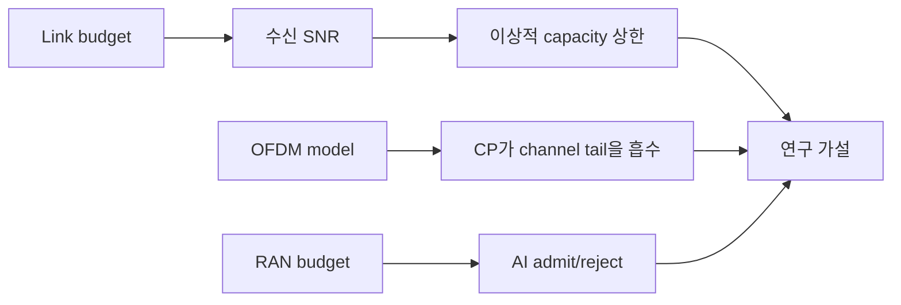

# 19. 로컬 모형 실습과 연구 설계

## toy model은 실제 RF를 재현하는 장비가 아니다

작은 숫자를 넣어 원리의 계산 결과를 확인하는 프로그램을 **toy model**이라 한다. 입력, 상태 전이, 출력, assert가 명확해 손 계산과 비교하기 좋다. 실제 oscillator, PA 비선형, ADC, antenna pattern, multipath 측정이 없으므로 현장 성능을 증명하지 않는다.

link-budget toy의 입력이 TX 20 dBm, cable -2, antenna +5, path -80, RX antenna +2, cable -1이면 출력은 -56 dBm이다. 프로그램은 각 항을 순서대로 더하고 예상값을 assert해야 한다. 결과 -56을 상수로 출력하고 다시 -56과 비교하면 계산을 검증하지 않는다.

| 단계 | 입력 | 누적 |
|---|---:|---:|
| TX | 20 dBm | 20 |
| cable | -2 dB | 18 |
| antenna | +5 dBi | 23 |
| path | -80 dB | -57 |
| RX antenna+cable | +1 dB | -56 |

## N=8 OFDM toy의 경계

주파수 bin 배열 X[0..7]에 알려진 복소 symbol을 놓고 IFFT로 시간 sample x를 만든 뒤 FFT로 되돌린다. 이상적인 부동소수점·무잡음 조건이면 복원 오차가 작은지 assert한다. CP, channel convolution, frequency offset을 하나씩 추가해 어떤 조건에서 orthogonality가 깨지는지 본다.

실제 RF에서는 DAC image, PA, oscillator phase noise, ADC quantization이 있다. Python complex 배열 복원이 antenna 사이 무선 송수신 성공을 뜻하지 않는다.

## RAN-AI budget toy

1 ms 창에서 RAN 0.55 ms, 안전 여유 0.15 ms이면 AI budget은 0.30 ms다. AI job 0.25 ms는 단순 합에서 admission 가능하고 0.40 ms는 거부한다. 실제 GPU에서는 queue와 memory interference 때문에 측정 p99가 필요하다.

| case | RAN | guard | AI | 합 | toy 판정 |
|---|---:|---:|---:|---:|---|
| A | 0.55 | 0.15 | 0.25 | 0.95 | 허용 |
| B | 0.55 | 0.15 | 0.40 | 1.10 | 거부 |

## 연구 질문으로 바꾸기

“AI가 좋다” 대신 “속도 15 m/s, 지정 channel model에서 20 ms horizon CSI 예측의 NMSE와 baseline 차이는?”처럼 입력·metric·조건을 쓴다. train/test를 다른 cell·시간으로 나누고 negative transfer와 실패 case를 보고한다.

## 19.1 세 실습의 위치

| 파일 | 확인하는 개념 | 확인하지 못하는 것 |
|---|---|---|
| `examples/link_budget_capacity.py` | link budget, noise, Shannon 상한 | 실제 MCS throughput |
| `examples/ofdm_model.py` | N=8 OFDM과 CP, 선형 channel | RF impairment와 표준 파형 전체 |
| `examples/ran_ai_budget.py` | 1 ms 창의 AI admission 산술 | 실제 GPU worst-case |



## 19.2 실습 1: link budget

입력은 다음과 같다.

```text
송신 전력      23 dBm
송신 안테나    +2 dBi
자유공간 손실  -103.32 dB
기타 손실      -2 dB
수신 안테나    +0 dBi
대역폭         20 MHz
noise figure   7 dB
```

수신 전력은 부호를 지켜 더한다.

```text
Pr = 23 + 2 - 103.32 - 2 + 0
   = -80.32 dBm
```

290 K 근처의 thermal noise density를 `-174 dBm/Hz`로 근사한다.

```text
10 log10(20,000,000) ≈ 73.01 dB
N = -174 + 73.01 + 7
  ≈ -93.99 dBm
SNR = -80.32 - (-93.99)
    ≈ 13.67 dB
```

Linear SNR은 `10^(13.67/10) ≈ 23.28`이다.
Shannon 식의 이상적 상한은 다음과 같다.

```text
C = B log2(1 + SNRlinear)
  = 20e6 × log2(1 + 23.28)
  ≈ 92.03 Mbit/s
```

위 손 계산은 중간 수치를 반올림했다. Script는 경로 손실·SNR의 내부 값을 반올림하지 않고 마지막 출력만 소수 두 자리로 표시하므로 용량 출력은 `92.01 Mbit/s`다. 약 92 Mbit/s라는 같은 상한이며 0.02 Mbit/s 차이는 전파 측정 차이가 아니다.

이 초안을 작성하며 script를 실행하지 않았다. 아래는 소스 식과 출력 formatting을 따라 계산한 **예상 출력**이며 실제 RF 또는 현재 서버 측정값이 아니다.

```text
파장: 0.08571 m
자유공간 경로 손실: 103.32 dB
수신 전력: -80.32 dBm
잡음 전력: -93.99 dBm
SNR: 13.67 dB
이상적 AWGN 용량 상한: 92.01 Mbit/s
```

### 결과 해석

Shannon 값은 이상적인 AWGN 채널에서 가능한 정보 전달률의 상한이다. 실제 코딩의 유한 길이 손실, pilot·control·guard와 scheduling overhead를 이 계산에서 따로 반영하지 않았다.
실제 NR throughput이나 사용자 속도로 보고하면 안 된다.

Free-space path loss도 차폐, fading, interference를 포함하지 않는다.
이 실습은 단위와 항의 방향을 확인한다.

## 19.3 실습 2: N=8 OFDM 모형

OFDM(Orthogonal Frequency-Division Multiplexing)은 data symbol을 여러 subcarrier에 놓고 IFFT/IDFT로 시간 영역 신호를 만든다.
예제는 `N=8`, cyclic prefix 길이 `CP=2`, channel impulse response `[1, 0.4, 0.2]`를 사용한다.

```text
frequency symbols X[0..7]
→ 8-point IDFT
→ 마지막 2 sample을 앞에 복사
→ channel [1,0.4,0.2]과 convolution
→ CP 2 sample 제거
→ 8-point DFT
→ channel frequency response로 equalize
→ 원래 symbol과 비교
```

Channel 길이는 3이므로 최대 지연은 `3-1=2 sample`이다.
CP 길이 2가 이 tail을 흡수하는 교육 조건이다.
Noise가 없고 수치 오차만 있다면 equalization 뒤 symbol은 입력에 매우 가깝다.

### 중간 상태

| 단계 | 길이 |
|---|---:|
| 주파수 symbol | 8 |
| IDFT time sample | 8 |
| CP 추가 | 10 |
| 길이 3 channel과 선형 convolution | 12 |
| 올바른 구간 선택 | 8 |
| DFT 결과 | 8 |

구현이 어느 8 sample을 선택하는지는 indexing과 convolution 정의에 맞아야 한다.
예제의 비교 결과는 다음과 같다. 두 경우 모두 같은 심벌·채널·equalizer를 쓰며 CP 유무를 바꾼다.

```text
CP 있음: 최대 복원 오차 < 1e-10: True
CP 없음: 최대 복원 오차 0.2486
```

부동소수점의 아주 작은 오차가 0이 되는지를 검사하기보다 임계값과 비교한다. 예제에서 CP를 제거하면 첫 유효 샘플에 필요한 과거 샘플이 없어 가정한 circular convolution 관계가 깨진다. 실제 연속 OFDM에서는 이전 심벌이 들어오는 ISI도 고려한다.

### 반례

CP를 1로 줄이면 channel tail 2보다 짧다.
이전 symbol 간섭을 완전히 막는다는 단순 circular convolution 모델이 깨진다.

Noise가 없다는 것은 RF가 완벽하다는 뜻이 아니다.
이 예제가 noise, CFO(Carrier Frequency Offset), phase noise를 아예 모델링하지 않은 것이다.

## 19.4 실습 3: RAN-AI budget

1 ms window에 RAN worst-case `0.6 ms`, guard `0.1 ms`를 예약한다.

```text
AI slack = 1.0 - 0.6 - 0.1 = 0.3 ms
```

AI 작업의 가정한 시간 예산이 `0.2 ms`면 교육 규칙상 admit 가능하다.
`0.5 ms`면 `0.5 > 0.3`이므로 admit하지 않는다.

| AI 요구 시간 | slack | 결과 |
|---:|---:|---|
| 0.20 ms | 0.30 ms | admit 후보 |
| 0.30 ms | 0.30 ms | 경계, 추가 overhead 때문에 보수적 판단 |
| 0.50 ms | 0.30 ms | reject |

이 script는 산술 판단만 한다.
`0.5 ms`가 실제 GPU에서 측정됐다는 증거나 RAN deadline 보장이 아니다.

## 19.5 실제 코드의 입력·상태·출력·assert

### Link budget 코드

`calculate()`의 입력은 함수 인자가 아니라 함수 안에 고정된 Python 부동소수점 변수다. `frequency_hz=3.5e9`, `distance_m=1000`, `bandwidth_hz=20e6`, `tx_dbm=23`, antenna gain 2·0 dBi, 기타 손실 2 dB, noise figure 7 dB다.

상태 변화는 다음 순서다.

1. `wavelength=3e8/3.5e9≈0.085714 m`
2. `4πd/λ≈146,607`, 자유공간 손실 `20log10(...)≈103.32 dB`
3. 수신 전력 `23+2+0-103.32-2≈-80.32 dBm`
4. Noise `-174+10log10(20e6)+7≈-93.99 dBm`
5. SNR `-80.32-(-93.99)≈13.67 dB`, 선형 약 23.3
6. Capacity `20e6×log2(1+23.3)≈92.01 Mbit/s`

함수는 여섯 값을 tuple로 반환하고 main이 단위를 붙여 출력한다. 이 파일에는 수치 `assert`가 없다. 따라서 실행 성공만으로 기대 숫자가 맞는지 자동 판정하지 않는다. 연구용이면 입력 인자화, 단위 검사와 알려진 기대값 assert를 추가해야 한다.

### OFDM 코드

`carriers`는 복소 QPSK 모양 값 8개, `taps=[1.0,0.4,0.2]`, `prefix_size=2`다. `idft`의 이중 반복은 각 time index n에서 8개 carrier 회전을 더하고 8로 나눈다. CP는 마지막 두 time sample을 앞에 복사한다.

`channel_convolution`은 길이 10의 CP+signal과 tap 3개를 곱해 길이 12 output을 만든다. `received[2:10]`의 8개를 useful로 고른다. Tap 뒤에 0을 다섯 개 붙여 8-point DFT한 `frequency_response`로 각 received bin을 나눈다.

첫 assert는 CP가 있을 때 8개 복원 오차의 최대가 `1e-10`보다 작은지 본다. 둘째는 같은 함수에서 CP=0일 때 최대 오차가 `1e-3`보다 큰지 본다. 예상 출력은 CP 있음 `True`, 없음 최대 약 `0.2486`이다. Noise, 연속 이전 symbol, timing·frequency offset과 response 0은 생략한다.

### RAN-AI budget 코드

`decide(window,ran,guard,ai)`는 모두 millisecond 단위의 숫자를 받고 `slack=window-ran-guard`와 `ai<=slack` Boolean을 반환한다. 1.0 ms 창, RAN 0.6, guard 0.1이면 slack은 부동소수점 약 0.3 ms다.

| AI 입력 | slack | 비교 | 출력 |
|---:|---:|---|---|
| 0.2 ms | 0.3 ms | `0.2<=0.3` | 허용 |
| 0.5 ms | 0.3 ms | `0.5<=0.3` | 거절 |

두 assert는 앞 결과가 참, 뒤 결과가 거짓인지 확인한다. Queue, context switch, GPU kernel preemption과 실행시간 분포는 없다. 특히 평균 0.2 ms를 넣었다고 worst-case deadline을 증명하지 않는다.


## 19.6 숫자가 실제 물리량이 되는 과정

세 모형은 모두 숫자를 다루지만 숫자의 단위와 수명이 다르다. 링크 예산의 \`23 dBm\`은 송신기가 안테나 쪽으로 내보내는 전력의 로그 표현이다. dBm은 1mW를 기준으로 하므로 23dBm은 약 200mW다. 안테나 이득의 dBi와 경로 손실의 dB는 비율이므로 더하고 빼지만, 대역폭 20MHz처럼 초당 주기의 수를 나타내는 값과 직접 더하지 않는다. 코드에서 수신 전력은 \`23 + 2 + 0 - 103.32 - 2 = -80.32 dBm\`으로 끝난다. 이 값은 Python 변수로는 함수가 끝날 때 사라지지만, 실제 무선기에서는 안테나에 도착한 전자기파가 수신 회로의 전압으로 바뀌는 한 순간의 상태를 나타낸다.

잡음 계산은 \`-174 dBm/Hz + 10 log10(20,000,000) + 7 dB = -93.99 dBm\`이다. 첫 항은 상온에서 1Hz 폭에 들어오는 열잡음의 근사치, 둘째 항은 20MHz 전체로 폭을 넓힐 때 더해지는 잡음, 마지막 항은 수신 회로가 보태는 잡음의 불리함이다. 따라서 신호 대 잡음비는 \`-80.32 - (-93.99) = 13.67 dB\`가 된다. 대역폭을 두 배로 넓히면 잡음은 약 3dB 증가하지만 Shannon 식의 앞쪽 대역폭도 두 배가 된다. 용량이 무조건 정확히 두 배가 되지는 않는다. 변조 방식, 부호화, 제어 신호와 재전송을 생략한 이론 상한이기 때문이다.

OFDM 모형에서 복소수 한 개는 크기와 위상을 함께 가진다. 예를 들어 \`1+1j\`는 실수축 1, 허수축 1인 점이며, 무선 회로에서는 서로 90도 어긋난 두 파형 성분으로 구현한다. 여덟 부반송파 값은 IDFT에 들어가는 입력 배열로 만들어지고, IDFT가 끝나면 여덟 시간 샘플 배열이 생긴다. 순환 전치 두 샘플은 그 배열의 마지막 두 원소를 앞에 복사한 별도 배열이다. 채널의 세 탭 \`[1.0, 0.4, 0.2]\`은 현재 샘플과 직전 두 샘플의 복사본이 서로 다른 크기로 합쳐진다는 뜻이다. 길이 10 신호와 길이 3 채널을 선형 합성곱하면 길이는 \`10+3-1=12\`가 된다.

수신기는 앞의 두 샘플을 버리고 다음 여덟 샘플만 FFT에 넣는다. 전치 길이 2가 채널 기억 길이 \`3-1=2\`와 같아서, 이 구간에서는 선형 합성곱을 여덟 칸짜리 원형 합성곱으로 볼 수 있다. FFT 뒤 각 부반송파 값은 원래 심볼과 그 부반송파의 채널 응답을 곱한 값이다. 그래서 코드가 채널 응답으로 나누면 원래 값을 되찾는다. 다만 응답이 0에 매우 가까우면 나눗셈이 잡음까지 크게 키운다. 실제 수신기는 채널 추정 오차와 잡음 때문에 단순 나눗셈보다 안정적인 등화기를 쓴다.

다음은 세 객체가 언제 생기고 끝나는지 정리한 표다.

| 객체 | 코드에서의 위치와 수명 | 현실의 대응물 | 모형이 끝났다고 보는 조건 |
|---|---|---|---|
| 부반송파 심볼 배열 | \`carriers\`가 생성된 뒤 함수 종료까지 | 송신할 비트가 변조된 복소수 값 | 복원 오차를 계산한 뒤 |
| 시간 샘플과 전치 | \`time_symbol\`, \`tx\` 배열 | DAC 전 단계의 디지털 표본 | 채널 입력으로 복사된 뒤에도 배열은 남지만 물리 파형은 시간에 따라 지나감 |
| 채널 탭 | \`taps\` 배열 | 여러 경로의 지연·감쇠를 단순화한 값 | 한 프레임 동안 고정이라고 가정 |
| RAN 여유 시간 | \`slack_ms\` 숫자 | 마감 전 다른 작업에 쓸 수 있는 시간 | 결정 함수가 허용 여부를 반환할 때 |
| 허용 결정 | 불리언 \`True/False\` | 스케줄러가 작업을 받아들이거나 거절하는 정책 결과 | 실제 시스템에서는 큐 상태가 바뀌면 다시 계산해야 함 |

RAN-AI 예제의 1ms 구간을 시간축으로 펼치면 0.0~0.6ms는 무선 처리가 예약되고 0.6~0.9ms가 AI 후보 구간이며 0.9~1.0ms는 흔들림을 흡수하는 보호 시간이다. 0.2ms AI 작업은 0.8ms에 끝나므로 허용되지만, 0.5ms 작업은 1.1ms까지 걸려 마감을 넘기므로 거절된다. 이 계산은 두 작업이 직렬로 같은 계산 자원을 쓴다는 전제다. 서로 다른 가속기에서 완전히 겹쳐 실행된다면 단순 덧셈은 과도하게 보수적이다. 반대로 큐 대기, 메모리 복사, 인터럽트 지연이 추가되면 0.2ms라는 커널 실행 시간만으로는 허용을 보장하지 못한다.

### 민감도 질문으로 모형을 읽기

입력 하나를 바꿀 때 무엇이 연쇄적으로 바뀌는지를 따져야 모형을 연구 도구로 쓸 수 있다.

- 거리를 1km에서 2km로 늘리면 자유공간 경로 손실은 약 6dB 커진다. 다른 조건이 같다면 수신 전력과 SNR이 약 6dB 낮아진다.
- 전치 길이를 2에서 1로 줄이면 채널 기억 길이를 덮지 못한다. 앞 심볼의 꼬리가 유효 구간에 남아 부반송파별 단순 나눗셈으로 완전히 복구되지 않는다.
- AI 실행 시간이 평균 0.2ms여도 꼬리 지연이 0.35ms라면 마감 위반이 생길 수 있다. 연구에서는 평균뿐 아니라 상위 백분위와 위반 횟수를 기록해야 한다.
- 잡음을 넣으면 \`max_error < 1e-10\` 같은 판정은 더 이상 맞지 않는다. 전송 신호 대 잡음비에 맞춘 오류율이나 EVM 같은 측정값으로 성공 조건을 다시 정의해야 한다.


## 19.7 연구 가설과 실패 조건

Link 가설은 “거리만 1 km에서 2 km로 늘리면 자유공간 손실이 약 6.02 dB 증가하고 capacity 상한이 감소한다”로 쓸 수 있다. 독립 변수는 거리, 통제 변수는 주파수·power·gain·bandwidth, 종속 변수는 수신전력·SNR·상한이다. Field에서는 반사·차폐가 자유공간 가정을 깨므로 모델 검증과 측정을 분리한다.

OFDM 가설은 “고정 tap 길이 3에서 CP 2는 무잡음 복원하고 CP 0은 오류를 만든다”다. CP 길이만 바꾸고 carrier·tap·window를 고정한다. Response가 0에 가까운 channel, noise와 동기 오차를 별도 실패 조건으로 둔다.

RAN-AI 가설은 “RAN p99 0.6 ms와 guard 0.1 ms를 보장하는 1 ms 창에서 AI worst-case 0.2 ms 작업은 직렬 예산을 만족한다”다. 평균 대신 p99·최대 관측과 deadline miss를 종속 변수로 둔다. Simulation, 제한된 testbed와 field workload를 별도 결과로 보고한다.

## 19.5 세 모형을 연구 질문으로 바꾸기

Link budget 질문: path loss와 bandwidth를 바꾸면 이상적 상한이 어떻게 변하는가?

OFDM 질문: CP가 channel tail보다 짧을 때 error가 얼마나 생기는가?

Shared compute 질문: AI 실행 시간 분포의 p99를 쓰면 admission 수가 어떻게 달라지는가?

한 번에 한 독립 변수를 바꾸고 input, output, seed, version을 기록한다.

## 19.6 실제 장비로 확장할 때

1. 모형의 가정과 실제 system의 차이를 표로 만든다.
2. 측정 clock과 시작·종료 경계를 고정한다.
3. Baseline을 먼저 측정한다.
4. 실패와 timeout도 결과에 포함한다.
5. 평균 외 p95/p99와 worst observed를 기록한다.
6. RAN KPI와 AI KPI를 동시에 본다.

## 19.7 종합 문제와 완전 해설

### 문제 1. 거리 두 배

자유공간에서 거리를 1 km에서 2 km로 늘리면 path loss는 얼마나 변하는가?

**해설.** 식의 거리 항은 `20log10(d)`이므로 `20log10(2)≈6.02 dB` 증가한다. 반사·차폐가 있는 field 값을 보장하지 않는다.

### 문제 2. Noise figure

Noise figure를 7에서 10 dB로 바꾸면 SNR은?

**해설.** Noise가 3 dB 커져 13.67에서 약 10.67 dB로 줄어든다. 다른 link 항은 고정한 조건이다.

### 문제 3. OFDM 길이

8 sample에 CP 2, tap 3이면 convolution output 길이는?

**해설.** 입력 10과 tap 3의 선형 convolution은 `10+3-1=12` sample이다. Receiver는 코드 정의에 맞는 useful 8개를 고른다.

### 문제 4. CP 부족

Tap 길이가 4이면 CP 2가 충분한가?

**해설.** 최대 지연 index는 3이라 CP 2보다 길다. 단순 circular convolution 보호 조건이 깨진다.

### 문제 5. Equalizer 0

어떤 subcarrier의 channel response가 0이면 코드의 `value/response`는 안전한가?

**해설.** 아니다. 0 나눗셈 또는 작은 값에 의한 noise 증폭이 생긴다. 실제 receiver는 regularization, coding과 outage 처리가 필요하다.

### 문제 6. AI slack

Window 1, RAN 0.6, guard 0.2 ms이면 AI slack은?

**해설.** `1-0.6-0.2=0.2 ms`다. 전환 overhead가 빠졌으므로 정확히 0.2 작업은 경계 상태다.

### 문제 7. 평균 실행시간

AI 평균 0.2 ms, p99 0.38 ms이고 slack 0.3 ms다. Admit 보장인가?

**해설.** 아니다. 적어도 약 1% tail이 slack을 넘을 수 있다. Deadline miss와 fallback을 포함해 정책을 정한다.

### 문제 8. 연구 주장

무잡음 Python OFDM assert가 통과했다. 실제 RF OFDM이 검증됐는가?

**해설.** 아니다. DAC/ADC, PA, oscillator, noise, 연속 frame, synchronization과 표준 mapping을 실행하지 않았다. Testbed와 field 단계가 별도다.

## 19.8 공식 자료

- [3GPP specifications](https://www.3gpp.org/specifications-technologies/specifications-by-series)
- [AI-RAN Alliance](https://ai-ran.org/)
- [NVIDIA Aerial SDK documentation](https://docs.nvidia.com/aerial/)

공식 근거 확인일: **2026-10-11**.

[← 이전](18-5g-advanced-6g-and-release-status.md) · [다음 →](20-exercises-glossary-and-sources.md)
