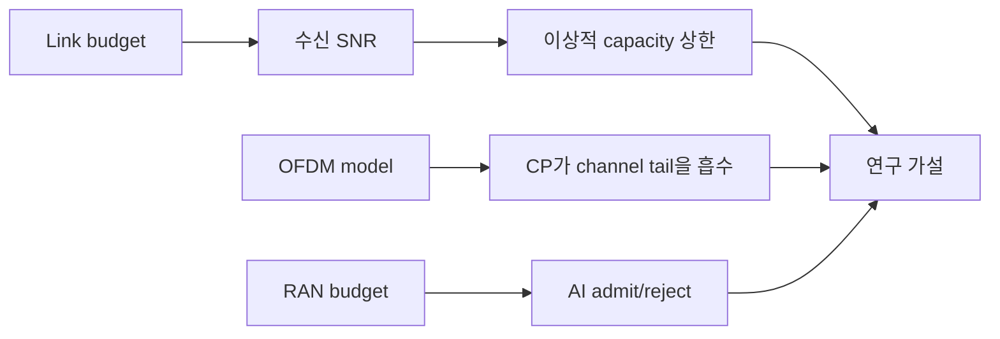

# 19. 로컬 모형 실습과 연구 설계

## toy model은 실제 RF를 재현하는 장비가 아니다

작은 숫자를 넣어 원리의 계산 결과를 확인하는 프로그램을 **toy model**이라 한다. 입력, 상태 전이, 출력, assert가 명확해 손 계산과 비교하기 좋다. 실제 oscillator, PA 비선형, ADC, antenna pattern, multipath 측정이 없으므로 현장 성능을 증명하지 않는다.

link-budget toy의 입력이 TX 20 dBm, cable -2, antenna +5, path -80, RX antenna +2, cable -1이면 출력은 -56 dBm이다. 프로그램은 각 항을 순서대로 더하고 예상값을 assert해야 한다. 결과 -56을 상수로 출력하고 다시 -56과 비교하면 계산을 검증하지 않는다.

| 단계 | 입력 | 누적 |
|---|---:|---:|
| TX | 20 dBm | 20 |
| cable | -2 dB | 18 |
| antenna | +5 dBi | 23 |
| path | -80 dB | -57 |
| RX antenna+cable | +1 dB | -56 |

## N=8 OFDM toy의 경계

주파수 bin 배열 X[0..7]에 알려진 복소 symbol을 놓고 IFFT로 시간 sample x를 만든 뒤 FFT로 되돌린다. 이상적인 부동소수점·무잡음 조건이면 복원 오차가 작은지 assert한다. CP, channel convolution, frequency offset을 하나씩 추가해 어떤 조건에서 orthogonality가 깨지는지 본다.

실제 RF에서는 DAC image, PA, oscillator phase noise, ADC quantization이 있다. Python complex 배열 복원이 antenna 사이 무선 송수신 성공을 뜻하지 않는다.

## RAN-AI budget toy

1 ms 창에서 RAN 0.55 ms, 안전 여유 0.15 ms이면 AI budget은 0.30 ms다. AI job 0.25 ms는 단순 합에서 admission 가능하고 0.40 ms는 거부한다. 실제 GPU에서는 queue와 memory interference 때문에 측정 p99가 필요하다.

| case | RAN | guard | AI | 합 | toy 판정 |
|---|---:|---:|---:|---:|---|
| A | 0.55 | 0.15 | 0.25 | 0.95 | 허용 |
| B | 0.55 | 0.15 | 0.40 | 1.10 | 거부 |

## 연구 질문으로 바꾸기

“AI가 좋다” 대신 “속도 15 m/s, 지정 channel model에서 20 ms horizon CSI 예측의 NMSE와 baseline 차이는?”처럼 입력·metric·조건을 쓴다. train/test를 다른 cell·시간으로 나누고 negative transfer와 실패 case를 보고한다.

## 추가 문제와 완전 해설

### 1. 상수 출력과 assert가 왜 부족한가?
입력에서 상태를 계산하지 않아 잘못된 전이를 찾지 못한다.

### 2. OFDM 무잡음 복원이 실제 RF 증거인가?
아니다. 많은 analog·channel 조건을 생략했다.

### 3. 1 ms-RAN0.6-guard0.2의 AI budget은?
0.2 ms다.

### 4. seed를 기록하는 이유는?
난수 channel·오류 trace를 재현하기 위해서다.

### 5. simulation 결과를 현장 주장으로 바꾸려면?
장비·환경·metric·반복·오차와 외삽 한계를 추가 검증해야 한다.

[이 책 목차](README.md)

[← 이전: 5G-Advanced·6G 상태](18-5g-advanced-6g-and-release-status.md) · [다음: 문제·용어·자료](20-exercises-glossary-and-sources.md)

이 장의 실습은 GPU, 실제 기지국, 전파 송신 없이 표준 Python으로 계산 구조를 확인한다.
숫자는 교육용 모형이며 경험적 무선 성능 측정값이 아니다.

## 19.1 세 실습의 위치

| 파일 | 확인하는 개념 | 확인하지 못하는 것 |
|---|---|---|
| `examples/link_budget_capacity.py` | link budget, noise, Shannon 상한 | 실제 MCS throughput |
| `examples/ofdm_model.py` | N=8 OFDM과 CP, 선형 channel | RF impairment와 표준 파형 전체 |
| `examples/ran_ai_budget.py` | 1 ms 창의 AI admission 산술 | 실제 GPU worst-case |



## 19.2 실습 1: link budget

입력은 다음과 같다.

```text
송신 전력      23 dBm
송신 안테나    +2 dBi
자유공간 손실  -103.32 dB
기타 손실      -2 dB
수신 안테나    +0 dBi
대역폭         20 MHz
noise figure   7 dB
```

수신 전력은 부호를 지켜 더한다.

```text
Pr = 23 + 2 - 103.32 - 2 + 0
   = -80.32 dBm
```

290 K 근처의 thermal noise density를 `-174 dBm/Hz`로 근사한다.

```text
10 log10(20,000,000) ≈ 73.01 dB
N = -174 + 73.01 + 7
  ≈ -93.99 dBm
SNR = -80.32 - (-93.99)
    ≈ 13.67 dB
```

Linear SNR은 `10^(13.67/10) ≈ 23.28`이다.
Shannon 식의 이상적 상한은 다음과 같다.

```text
C = B log2(1 + SNRlinear)
  = 20e6 × log2(1 + 23.28)
  ≈ 92.03 Mbit/s
```

위 손 계산은 중간 수치를 반올림했다. Script는 경로 손실·SNR의 내부 값을 반올림하지 않고 마지막 출력만 소수 두 자리로 표시하므로 용량 출력은 `92.01 Mbit/s`다. 약 92 Mbit/s라는 같은 상한이며 0.02 Mbit/s 차이는 전파 측정 차이가 아니다.

2026-10-11에 Python 3.12.3에서 세 script를 각각 한 번 실행했다. 첫 script의 실제 출력은 다음과 같다.

```text
파장: 0.08571 m
자유공간 경로 손실: 103.32 dB
수신 전력: -80.32 dBm
잡음 전력: -93.99 dBm
SNR: 13.67 dB
이상적 AWGN 용량 상한: 92.01 Mbit/s
```

### 결과 해석

Shannon 값은 이상적인 AWGN 채널에서 가능한 정보 전달률의 상한이다. 실제 코딩의 유한 길이 손실, pilot·control·guard와 scheduling overhead를 이 계산에서 따로 반영하지 않았다.
실제 NR throughput이나 사용자 속도로 보고하면 안 된다.

Free-space path loss도 차폐, fading, interference를 포함하지 않는다.
이 실습은 단위와 항의 방향을 확인한다.

## 19.3 실습 2: N=8 OFDM 모형

OFDM(Orthogonal Frequency-Division Multiplexing)은 data symbol을 여러 subcarrier에 놓고 IFFT/IDFT로 시간 영역 신호를 만든다.
예제는 `N=8`, cyclic prefix 길이 `CP=2`, channel impulse response `[1, 0.4, 0.2]`를 사용한다.

```text
frequency symbols X[0..7]
→ 8-point IDFT
→ 마지막 2 sample을 앞에 복사
→ channel [1,0.4,0.2]과 convolution
→ CP 2 sample 제거
→ 8-point DFT
→ channel frequency response로 equalize
→ 원래 symbol과 비교
```

Channel 길이는 3이므로 최대 지연은 `3-1=2 sample`이다.
CP 길이 2가 이 tail을 흡수하는 교육 조건이다.
Noise가 없고 수치 오차만 있다면 equalization 뒤 symbol은 입력에 매우 가깝다.

### 중간 상태

| 단계 | 길이 |
|---|---:|
| 주파수 symbol | 8 |
| IDFT time sample | 8 |
| CP 추가 | 10 |
| 길이 3 channel과 선형 convolution | 12 |
| 올바른 구간 선택 | 8 |
| DFT 결과 | 8 |

구현이 어느 8 sample을 선택하는지는 indexing과 convolution 정의에 맞아야 한다.
예제의 비교 결과는 다음과 같다. 두 경우 모두 같은 심벌·채널·equalizer를 쓰며 CP 유무를 바꾼다.

```text
CP 있음: 최대 복원 오차 < 1e-10: True
CP 없음: 최대 복원 오차 0.2486
```

부동소수점의 아주 작은 오차가 0이 되는지를 검사하기보다 임계값과 비교한다. 예제에서 CP를 제거하면 첫 유효 샘플에 필요한 과거 샘플이 없어 가정한 circular convolution 관계가 깨진다. 실제 연속 OFDM에서는 이전 심벌이 들어오는 ISI도 고려한다.

### 반례

CP를 1로 줄이면 channel tail 2보다 짧다.
이전 symbol 간섭을 완전히 막는다는 단순 circular convolution 모델이 깨진다.

Noise가 없다는 것은 RF가 완벽하다는 뜻이 아니다.
이 예제가 noise, CFO(Carrier Frequency Offset), phase noise를 아예 모델링하지 않은 것이다.

## 19.4 실습 3: RAN-AI budget

1 ms window에 RAN worst-case `0.6 ms`, guard `0.1 ms`를 예약한다.

```text
AI slack = 1.0 - 0.6 - 0.1 = 0.3 ms
```

AI 작업의 가정한 시간 예산이 `0.2 ms`면 교육 규칙상 admit 가능하다.
`0.5 ms`면 `0.5 > 0.3`이므로 admit하지 않는다.

| AI 요구 시간 | slack | 결과 |
|---:|---:|---|
| 0.20 ms | 0.30 ms | admit 후보 |
| 0.30 ms | 0.30 ms | 경계, 추가 overhead 때문에 보수적 판단 |
| 0.50 ms | 0.30 ms | reject |

이 script는 산술 판단만 한다.
`0.5 ms`가 실제 GPU에서 측정됐다는 증거나 RAN deadline 보장이 아니다.

## 19.5 세 모형을 연구 질문으로 바꾸기

Link budget 질문: path loss와 bandwidth를 바꾸면 이상적 상한이 어떻게 변하는가?

OFDM 질문: CP가 channel tail보다 짧을 때 error가 얼마나 생기는가?

Shared compute 질문: AI 실행 시간 분포의 p99를 쓰면 admission 수가 어떻게 달라지는가?

한 번에 한 독립 변수를 바꾸고 input, output, seed, version을 기록한다.

## 19.6 실제 장비로 확장할 때

1. 모형의 가정과 실제 system의 차이를 표로 만든다.
2. 측정 clock과 시작·종료 경계를 고정한다.
3. Baseline을 먼저 측정한다.
4. 실패와 timeout도 결과에 포함한다.
5. 평균 외 p95/p99와 worst observed를 기록한다.
6. RAN KPI와 AI KPI를 동시에 본다.

## 19.7 확인 문제와 해설

### 문제 1

Noise figure를 7 dB에서 10 dB로 바꾸면 SNR은 어떻게 되는가?

**해설:** Noise power가 3 dB 커져 SNR은 약 `10.67 dB`로 3 dB 줄어든다.

### 문제 2

Channel 길이가 4이면 CP=2로 충분한가?

**해설:** 최대 지연은 3 sample이므로 일반적인 단순 조건에서는 부족하다.

### 문제 3

AI 평균이 0.2 ms이면 항상 admit할 수 있는가?

**해설:** 아니다. Worst-case 또는 신뢰 가능한 상한, 전환 비용, 이미 실행 중인 작업을 함께 본다.

## 19.8 공식 자료

- [3GPP specifications](https://www.3gpp.org/specifications-technologies/specifications-by-series)
- [AI-RAN Alliance](https://ai-ran.org/)
- [NVIDIA Aerial SDK documentation](https://docs.nvidia.com/aerial/)

공식 근거 확인일: **2026-10-11**.

[← 이전](18-5g-advanced-6g-and-release-status.md) · [다음 →](20-exercises-glossary-and-sources.md)
