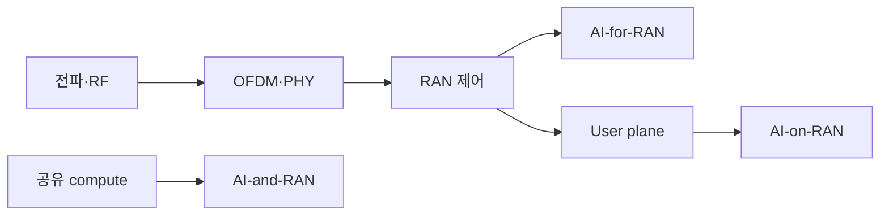

# 20. 종합 문제·용어사전·공식 자료

[이 책 목차](README.md)

[← 이전: 로컬 모형](19-local-models-and-research.md) · [무선통신 교재 목차](README.md)

이 장은 link budget, OFDM, RAN, AI-RAN을 한 번 더 연결한다.
문제에서는 식보다 먼저 입력, 담당 주체, 중간 상태, 결과를 구분한다.



## 20.0 처음 문제를 읽는 순서

무선과 AI-RAN 문제에는 서로 다른 단위와 주체가 한 문장에 함께 나온다. 다음 다섯 칸으로 다시 쓰면 무엇을 계산하고 무엇을 검증해야 하는지 보인다.

| 칸 | 묻는 내용 | 예 |
|---|---|---|
| 입력 | 이미 주어진 관측·설정은 무엇인가 | 송신 20 dBm, bandwidth 10 MHz |
| 변환 | 어떤 식이나 처리로 바꾸는가 | gain/loss 합산, feature 집계 |
| 주체 | 누가 그 처리를 수행하는가 | receiver, feature pipeline, scheduler |
| 중간 상태 | 다음 단계가 읽는 값은 무엇인가 | 수신 power, SNR, prediction, queue 상태 |
| 결과 | 무엇을 결정하거나 사용자에게 주는가 | throughput 상한, action, inference response |

### dB와 dBm을 섞지 않기

`dBm`은 1 mW를 기준으로 한 **절대 power**다. `23 dBm`은 약 200 mW다. `dB`는 두 값의 **비율 또는 변화량**이다. Antenna gain 2 dBi와 path loss 100 dB는 변화량이므로 dBm power 장부에 더하거나 뺄 수 있다.

```text
23 dBm + 2 dBi - 100 dB = -75 dBm
```

마지막 값은 다시 절대 수신 power이므로 dBm이다. `23 dBm + -90 dBm`처럼 두 절대 power를 단순히 더하는 것은 이 link budget 식의 의미가 아니다.

### SNR에서 capacity까지의 인과

1. 송신 power와 경로 gain/loss로 수신 signal power를 구한다.
2. Bandwidth와 noise figure로 receiver noise power를 구한다.
3. Signal power에서 noise power를 빼 dB SNR을 얻는다.
4. Shannon 식에는 dB가 아니라 linear SNR을 넣는다.
5. 나온 capacity는 이상적 상한으로 해석한다.

한 단계의 단위가 틀리면 뒤의 숫자가 모두 그럴듯하게 틀릴 수 있다.

### Model prediction에서 RAN action까지의 인과

Model은 KPI를 직접 이해하지 않는다. 정해진 feature vector를 받는다. Prediction이 `0.91`이면 controller가 최신성, 범위, confidence, 허용 action을 검사한다. Guard를 통과한 뒤에야 설정을 바꾸며, 이후 KPI를 다시 읽어 효과와 부작용을 확인한다.

```text
KPI → feature → prediction → guard → action → feedback
```

Prediction과 action 사이를 생략하면 “AI가 0.91이라고 했으니 network가 자동으로 바뀌었다”는 잘못된 설명이 된다.

### 장치 할당에서 deadline까지의 인과

ResourceClaim은 어떤 GPU를 쓸지 정할 수 있다. Container runtime은 그 장치를 process에 보이게 한다. 그 뒤 CPU가 GPU kernel을 제출하고, kernel은 queue와 shared resource의 영향을 받아 완료된다. Deadline 검증은 마지막 completion 시각까지 봐야 한다.

```text
GPU 선택 → node prepare → container 주입 → kernel queue → 실행 → completion
```

앞 단계 성공은 뒤 단계의 시간 보장이 아니다.

### Edge 위치에서 서비스 지연까지의 인과

MEC server가 가까이 있어도 UE packet이 중앙 UPF로 routing되면 먼 경로를 돈다. Local breakout, inference queue, cold start, return path가 모두 맞아야 낮은 E2E latency가 나온다.

```text
UE → radio/RAN → UPF route → MEC queue → inference → response
```

“Edge에 설치했다”는 배치 설명과 “20 ms에 응답했다”는 측정 결과를 구분한다.

## 20.1 Worked 문제 12개

### 문제 1. Link budget

송신 20 dBm, 송신 gain 3 dBi, path loss 100 dB, 기타 손실 2 dB, 수신 gain 1 dBi다. 수신 전력은?

**해설:** `20+3-100-2+1=-78 dBm`이다. Gain은 더하고 손실은 뺀다. 이 값만으로 interference와 fading까지 알 수 없다.

### 문제 2. Thermal noise와 SNR

대역폭 10 MHz, noise figure 5 dB이면 `-174 dBm/Hz` 근사에서 noise power는? 수신 전력이 -80 dBm이면 SNR은?

**해설:** `10log10(10^7)=70 dB`다. Noise는 `-174+70+5=-99 dBm`, SNR은 `-80-(-99)=19 dB`다.

### 문제 3. Shannon 상한

대역폭 20 MHz, linear SNR 15일 때 이상적 capacity는?

**해설:** `20e6×log2(16)=80 Mbit/s`다. Protocol overhead와 실제 modulation/coding을 뺀 값이 아니므로 사용자 throughput으로 단정하지 않는다.

### 문제 4. OFDM cyclic prefix

Channel impulse response 길이가 5 sample일 때 CP 3 sample로 단순 ISI-free 조건을 만족하는가?

**해설:** 최대 지연은 `5-1=4 sample`이므로 CP 3은 부족하다. 실제 channel timing과 window도 함께 본다.

### 문제 5. Numerology

Subcarrier spacing이 커지면 OFDM symbol 시간이 일반적으로 짧아진다. 왜 지연과 channel 조건을 함께 봐야 하는가?

**해설:** 짧은 symbol은 빠른 시간 단위를 제공하지만 같은 CP 비율·coverage·Doppler 조건이 자동 유지되지 않는다. Numerology 선택은 trade-off다.

### 문제 6. AI-RAN 세 방향

혼잡 예측, 공유 GPU admission, edge 번역을 각각 분류하라.

**해설:** 혼잡 예측은 AI-for-RAN, 공유 GPU admission은 AI-and-RAN, edge 번역은 AI-on-RAN이다. 한 제품에 세 방향이 함께 있을 수 있다.

### 문제 7. Train/test leakage

같은 cell의 인접 10 ms window를 무작위로 train과 test에 섞었다. 위험은?

**해설:** 같은 UE와 traffic event가 양쪽에 들어가 test가 독립적이지 않을 수 있다. 시간 block과 cell-held-out 평가를 둔다.

### 문제 8. 안전한 AI-for-RAN action

혼잡 확률 0.95이면 즉시 RAN 설정을 바꿔도 되는가?

**해설:** 아니다. Feature freshness, 범위, confidence calibration, 허용 action, KPI guard, fallback을 확인해야 한다.

### 문제 9. 공유 compute budget

1 ms 창에서 RAN 0.58 ms, guard 0.12 ms다. AI 작업 0.35 ms를 받을 수 있는가?

**해설:** Slack은 `1-0.58-0.12=0.30 ms`다. `0.35>0.30`이므로 교육 규칙에서는 거절한다.

### 문제 10. DRA의 보장

ResourceClaim이 GPU를 할당했다. 0.3 ms AI deadline도 증명됐는가?

**해설:** 아니다. DRA는 장치 선택과 준비를 다룬다. 실행 deadline은 runtime, kernel, priority, CPU/NIC 경로를 포함해 별도로 검증한다.

### 문제 11. AI-on-RAN 경로

UE 영상이 private MEC detector로 갈 때 E2가 application payload 경로인가?

**해설:** 일반적으로 아니다. Payload는 user plane과 UPF routing을 따른다. E2는 O-RAN node와 Near-RT RIC의 제어·관측 interface다.

### 문제 12. 6G와 AI-RAN

AI-RAN Alliance 자료가 있으면 6G 전파 규격이 완성됐다고 말할 수 있는가?

**해설:** 없다. Alliance 분류·reference architecture, 3GPP 규격 단계, 연구 prototype, 상용 제품 성숙도를 분리한다. AI-RAN은 단일 air-interface 규격명이 아니다.

## 20.2 용어사전

**3GPP:** 이동통신 규격을 만드는 파트너십 프로젝트.

**5G-Advanced:** 주로 3GPP Release 18 이후의 5G 진화를 가리키는 표현.

**6G:** 차세대 이동통신 연구·표준화 범주이며 완성된 단일 현재 규격으로 취급하지 않는다.

**AI:** Artificial Intelligence, 인공지능.

**AI-for-RAN:** AI로 RAN 성능과 운영을 개선하는 방향.

**AI-and-RAN:** AI와 RAN workload가 compute를 공유하는 방향.

**AI-on-RAN:** RAN edge에서 AI 응용을 실행하는 방향.

**AI-RAN:** 위 세 방향을 포괄하는 산업·연구 범주이며 전파 규격명이 아님.

**AMC:** Adaptive Modulation and Coding, channel 조건에 맞춘 변조·부호화 선택.

**Admission control:** 실행 전 자원과 deadline을 보고 요청 수락 여부를 정하는 절차.

**Antenna gain:** 특정 방향의 방사·수신 이득을 dBi 등으로 표현한 값.

**Baseline:** AI 결과와 비교하는 단순 규칙이나 기존 방식.

**BLER:** Block Error Rate, 전송 block 오류 비율.

**Cell:** 기지국의 특정 무선 coverage·자원 단위.

**CDI:** Container Device Interface, container 장치 주입 명세.

**Channel impulse response:** 전파 channel의 지연별 응답.

**CQI:** Channel Quality Indicator, UE가 보고하는 channel 품질 지표.

**CP:** Cyclic Prefix, OFDM symbol 앞에 복사하는 보호 구간.

**CU:** Central Unit, gNB 기능 분할의 상위 unit.

**cuMAC:** NVIDIA CUDA 가속 MAC scheduler library 이름이며 3GPP 규격명은 아님.

**cuPHY:** NVIDIA Aerial의 GPU 가속 PHY library·SDK 이름이며 3GPP 규격명은 아님.

**dB:** 두 power 비율의 로그 단위.

**dBi:** Isotropic antenna 대비 antenna gain 단위.

**dBm:** 1 mW 기준 절대 power의 로그 단위.

**DNN:** Data Network Name, 5G data network 선택 식별자.

**DRA:** Dynamic Resource Allocation, Kubernetes의 구조화된 장치 할당 API.

**Drift:** 운영 데이터나 입력-결과 관계가 training 때와 달라지는 현상.

**DU:** Distributed Unit, gNB 기능 분할의 하위 unit.

**E2:** Near-RT RIC와 O-RAN node 사이의 interface.

**E2E latency:** 입력 발생부터 최종 결과까지의 전체 지연.

**EIRP:** Equivalent Isotropically Radiated Power, 송신 power와 antenna gain 등을 반영한 등가 방사 power.

**Equalization:** Channel 영향을 보상해 symbol을 복원하는 처리.

**Fallback:** AI 또는 공유 경로 실패 때 돌아갈 안전한 기존 동작.

**Feature:** 원시 데이터를 모델 입력으로 변환한 값.

**FFT:** Fast Fourier Transform, DFT를 빠르게 계산하는 알고리즘.

**FSPL:** Free-Space Path Loss, 자유공간 전파 손실 모형.

**Guard:** Timing·capacity 불확실성을 위해 남기는 안전 여유.

**HARQ:** Hybrid Automatic Repeat Request, 오류 정정과 재전송을 결합한 방식.

**HIL:** Hardware-in-the-Loop, 실제 hardware를 제어 고리에 넣는 시험.

**IFFT:** Inverse Fast Fourier Transform, OFDM 송신의 시간 영역 변환에 쓰임.

**Inference:** 학습된 모델이 입력에서 예측을 만드는 단계.

**ISI:** Inter-Symbol Interference, symbol 사이 간섭.

**KPI:** Key Performance Indicator, 성능·운영 핵심 지표.

**Label:** Supervised learning에서 예측할 정답 또는 목표 값.

**Link budget:** 송신 power, gain, loss를 합해 수신 power를 계산하는 장부.

**Local breakout:** UE traffic을 가까운 data network나 edge로 보내는 routing.

**MAC:** Medium Access Control, 무선 자원 접근과 scheduling을 담당하는 계층.

**MEC:** Multi-access Edge Computing, access network 가까이의 computing 환경.

**MIG:** Multi-Instance GPU, 지원 GPU를 hardware instance로 나누는 기능.

**MIMO:** Multiple-Input Multiple-Output, 여러 antenna를 사용하는 송수신 기술.

**MPS:** Multi-Process Service, 여러 CUDA process의 GPU 공유 기능.

**Near-RT RIC:** Near-real-time RAN 제어 응용을 위한 O-RAN 구성요소.

**NF:** Noise Figure, receiver가 추가하는 noise 열화를 dB로 나타낸 값.

**Non-RT RIC:** 비실시간 정책·모델 관리와 연관된 O-RAN 구성요소.

**Numerology:** Subcarrier spacing과 symbol timing 등의 OFDM parameter 체계.

**OFDM:** Orthogonal Frequency-Division Multiplexing, 직교 subcarrier 다중화.

**O-RAN:** Open RAN architecture와 interface를 다루는 alliance·규격 생태계.

**Path loss:** 송신점에서 수신점까지 signal power가 줄어드는 양.

**PHY:** Physical Layer, waveform과 coding 등 물리계층 처리.

**PRB:** Physical Resource Block, NR/LTE 무선 자원 단위.

**Private MEC:** 제한된 사업장·사용자를 위한 edge 배치 label; 표준 Kubernetes label은 아님.

**RAN:** Radio Access Network, UE를 이동통신 core와 연결하는 무선 접속망.

**ResourceClaim:** Kubernetes DRA에서 workload의 장치 요구를 표현하는 객체.

**RIC:** RAN Intelligent Controller, O-RAN의 지능형 제어 구성요소.

**SIL:** Software-in-the-Loop, simulator·replay software에서 닫힌 고리를 시험하는 방법.

**SINR:** Signal-to-Interference-plus-Noise Ratio, 간섭과 noise 대비 signal 비.

**SLO:** Service Level Objective, 지연·가용성 등 서비스 목표.

**S-NSSAI:** 5G network slice 선택 정보를 나타내는 식별자.

**TTFT:** Time To First Token, 생성 AI 요청부터 첫 token까지의 시간.

**UE:** User Equipment, 휴대전화·modem 같은 사용자 장비.

**UPF:** User Plane Function, 5G user-plane packet 전달과 routing 기능.

**User plane:** 사용자 application packet을 운반하는 경로.

**xApp:** Near-RT RIC에서 실행되는 제어·최적화 응용.

**rApp:** Non-RT RIC/SMO 환경의 비실시간 최적화 응용.

## 20.3 공식 자료 지도

| 주제 | 공식 출발점 |
|---|---|
| 이동통신 규격 | [3GPP specifications](https://www.3gpp.org/specifications-technologies/specifications-by-series) |
| O-RAN architecture·E2·RIC | [O-RAN specifications](https://www.o-ran.org/specifications) |
| AI-RAN 세 방향 | [AI-RAN Alliance](https://ai-ran.org/) |
| AI-for-RAN 연구 | [AI-for-RAN white paper](https://ai-ran.org/documents/AI-RAN-WG1-AI-for-RAN-Whitepaper.pdf) |
| Edge computing | [ETSI MEC](https://www.etsi.org/technologies/multi-access-edge-computing) |
| GPU RAN SDK | [NVIDIA Aerial](https://docs.nvidia.com/aerial/) |
| GPU 장치 할당 | [NVIDIA GPU Operator DRA](https://docs.nvidia.com/datacenter/cloud-native/gpu-operator/26.7/dra-intro-install.html) |

공식 문서도 version과 범위를 확인한다.
Vendor의 compliance 표현은 해당 제품의 지원 claim이며 3GPP나 O-RAN 전체 구현의 보편 보장으로 확대하지 않는다.

공식 근거 확인일: **2026-10-11**.

[← 이전](19-local-models-and-research.md) · [무선통신 교재 목차](README.md)
