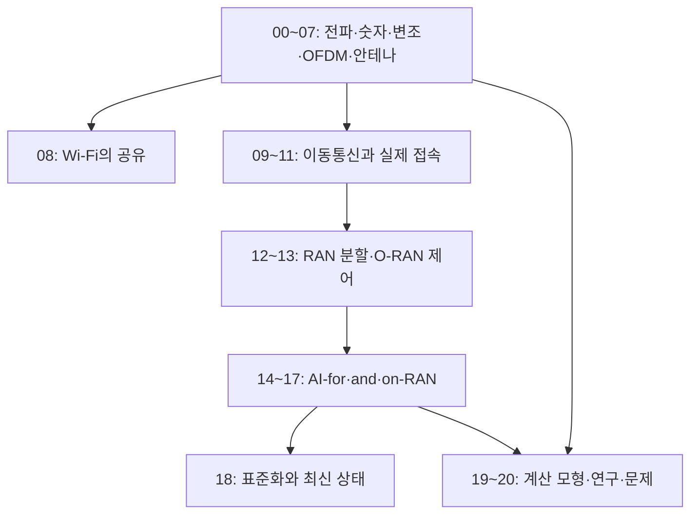

# 처음부터 배우는 무선통신과 AI-RAN

**휴대전화가 선 없이 보낸 비트는 어떻게 기지국을 지나 서버에 도착할까? 그 과정의 어느 부분에 AI가 들어갈까?** 이 책은 전파·주파수·전력부터 시작해 변조, 오류 정정, OFDM, 안테나, Wi-Fi와 이동통신을 연결한다. 그 뒤 기지국의 계산을 맡는 RAN, O-RAN의 제어 구조, AI-RAN의 세 방향과 연구 방법으로 이어간다.

RAN은 **Radio Access Network, 무선 접속망**이다. 휴대전화 같은 단말과 통신망을 무선으로 연결하는 기지국과 그 처리 기능을 포함한다. AI-RAN을 이해하려면 전파를 주고받는 일, 데이터를 전달하는 일, 무선 자원을 제어하는 일, 서버에서 AI를 계산하는 일을 함께 보아야 한다. 이 책은 각 장에서 작은 입력과 숫자를 사용해 그 연결을 한 단계씩 따라간다.

자료 확인 기준일은 **2026-10-11**이다. 세대 이름, 표준화 진행, 인증, 제품 구현과 실제 상용 배포의 상태는 서로 구별한다. 최신 상태와 근거는 [18장](18-5g-advanced-6g-and-release-status.md), AI-RAN의 공식 분류는 [14장](14-ai-ran-three-directions.md)에 있다.

## 처음 읽을 때 필요한 것

주파수·복소수·로그·확률·통신공학을 이미 공부했다고 가정하지 않는다. 곱셈·나눗셈과 단위를 읽는 것부터 시작하고, 필요한 식은 그 장에서 의미와 작은 계산으로 풀어 설명한다. 컴퓨터 용어부터 필요하면 [첫 지도](../START-HERE.md)를 먼저 읽는다. Python 예제는 코드 실행 없이 손 계산으로도 따라갈 수 있다.

**같은 단어의 단위를 구분한다.** 무선에서 대역폭 `20 MHz`는 사용할 주파수 구간의 폭이다. 네트워크에서 `100 Mbit/s`는 초당 보내는 비트의 속도다. 둘은 연결되지만 같은 양이 아니다. 안테나 수, 공간 계층 수, 사용자의 실제 다운로드 속도도 각각 다른 값이다.

## 한 권의 목차

| 장 | 출발 질문 | 따라갈 동작 |
| --- | --- | --- |
| [00. 첫 연결과 전체 지도](00-map-and-first-connection.md) | 선 없이 글자를 보낸다는 말은 무엇일까? | 비트·무선 신호·기지국·패킷·서버의 연결 |
| [01. 전파·주파수·스펙트럼](01-waves-frequency-and-spectrum.md) | 주파수와 파장이 무엇을 바꿀까? | 파형·주기·주파수·주파수 구간·공유 |
| [02. 전력·dB·링크 예산](02-power-db-and-link-budget.md) | 송신한 전력 중 얼마나 수신될까? | dBm·dB·안테나 이득·경로 손실·수신 예산 |
| [03. 샘플링·I/Q·무선 장치](03-sampling-iq-and-radio-chain.md) | 연속적인 전파를 컴퓨터가 어떻게 계산할까? | ADC/DAC·기저대역·I/Q·RF 처리 순서 |
| [04. 변조·부호화·오류](04-modulation-coding-and-errors.md) | 0과 1을 파형에 어떻게 담을까? | 심벌·QPSK/QAM·오류 정정·판정·재전송 |
| [05. 채널·잡음·용량](05-channel-noise-and-capacity.md) | 같은 신호가 왜 이동하거나 가려지면 달라질까? | 다중 경로·페이딩·간섭·SNR/SINR·용량 상한 |
| [06. OFDM과 시간·주파수 자원](06-ofdm-time-frequency-and-resources.md) | 많은 작은 주파수에 정보를 나누면 무엇이 좋아질까? | 직교·FFT·CP·자원 격자·오버헤드 |
| [07. 안테나·MIMO·빔포밍](07-antennas-mimo-and-beamforming.md) | 안테나가 많으면 무조건 여러 배 빨라질까? | 공간 채널·계층·빔·rank·관측과 한계 |
| [08. Wi-Fi와 채널 공유](08-wifi-and-medium-access.md) | 여러 기기가 같은 공기를 어떻게 나눌까? | 채널 감지·backoff·충돌·hidden node·OFDMA |
| [09. 이동통신 세대와 구조](09-cellular-generations-and-architecture.md) | 휴대전화와 인터넷 사이에 무엇이 있을까? | UE·RAN·core·4G/5G·NSA/SA·두 plane |
| [10. NR 무선과 프로토콜](10-nr-radio-and-protocol-stack.md) | 비트와 패킷은 어떤 처리 층을 거칠까? | PHY·MAC·RLC·PDCP·SDAP·RRC·NAS·numerology |
| [11. 접속·스케줄링·이동](11-access-scheduling-and-mobility.md) | 단말은 언제 어느 자원으로 보낼 수 있을까? | 접속 절차·grant·CQI/MCS·HARQ·handover |
| [12. RAN 분할과 클라우드](12-ran-splits-fronthaul-and-cloud.md) | 기지국의 계산을 여러 장치에 나누면 무엇이 달라질까? | RU·DU·CU·fronthaul·지연·동기화·서버 실행 |
| [13. O-RAN·RIC·제어 루프](13-oran-ric-and-control-loops.md) | 외부 앱이 기지국을 어떻게 관측하고 제어할까? | SMO·RIC·xApp/rApp·A1/E2/O1/O2·시간 척도 |
| [14. AI-RAN의 세 방향](14-ai-ran-three-directions.md) | AI-for·AI-and·AI-on-RAN은 무엇이 다를까? | 무선 최적화·계산 자원 공유·사용자 AI 서비스 |
| [15. AI-for-RAN](15-ai-for-ran-data-training-control.md) | 모델의 예측을 실제 무선 동작으로 어떻게 바꿀까? | 데이터·학습·추론·제어·피드백·실패 시 복귀 |
| [16. AI-and-RAN](16-ai-and-ran-shared-compute.md) | 기지국과 AI가 GPU를 같이 써도 될까? | deadline·동시 실행·간섭·여유 예산·장치 할당 |
| [17. AI-on-RAN](17-ai-on-ran-edge-inference.md) | 기지국 가까이 AI 서버를 두면 무엇이 달라질까? | 사용자 데이터·UPF·edge 추론·왕복 지연·용량 |
| [18. 5G-Advanced·6G와 최신 상태](18-5g-advanced-6g-and-release-status.md) | 연구·표준·제품·상용화 중 지금 어느 단계일까? | 3GPP Release·IMT-2030·표준화와 구현의 경계 |
| [19. 로컬 모형과 연구 설계](19-local-models-and-research.md) | 무선 장비 없이 무엇을 직접 계산할 수 있을까? | 링크 예산·OFDM·RAN/AI 시간 예산·공정한 비교 |
| [20. 문제·해설·용어·자료](20-exercises-glossary-and-sources.md) | 계산과 설명을 스스로 확인할 수 있을까? | 종합 문제·단계별 해설·용어사전·공식 자료 지도 |

## 읽는 순서

처음이라면 **00 → 01 → 02 → 03 → 04 → 05 → 06 → 07**로 읽는다. 전파를 숫자로 표현하고 그 숫자로 비트를 복원하는 한 경로를 이해한 뒤 Wi-Fi와 이동통신을 비교한다. 그림의 화살표가 실제 신호 이동인지, 데이터 처리인지, 설정·제어인지 본문과 함께 읽는다.

AI-RAN이 먼저 궁금하면 **00 → 09 → 12 → 13 → 14**로 전체 구조를 본다. 그 뒤 15·16·17에서 각 방향의 입력, 계산 위치, 결과와 실패 조건을 공부한다. `AI-for-RAN`은 무선망을 개선하는 AI, `AI-and-RAN`은 AI와 RAN의 계산 자원 공유, `AI-on-RAN`은 무선망을 통해 제공하는 AI 서비스라는 출발점으로 읽는다. 실제 제안은 여러 방향을 함께 포함할 수 있다.

## 그림과 실행 예제

교재에는 [직접 작성한 한국어 SVG 그림 9개](assets/README.md)와 장별 Mermaid가 있다. 그림은 배치·연결·시간 척도를 설명하며 실제 장비의 사진이나 측정값은 아니다.

- [링크 예산과 용량](examples/link_budget_capacity.py): 전력 손실, 잡음, SNR과 이상적인 용량을 단위와 함께 계산한다.
- [OFDM 모형](examples/ofdm_model.py): 작은 DFT/IDFT와 cyclic prefix가 다중 경로에서 무엇을 하는지 확인한다.
- [RAN과 AI 시간 예산](examples/ran_ai_budget.py): 짧은 처리 창에 RAN 작업과 AI 작업을 넣을 수 있는지 계산한다.

세 예제는 Python 표준 라이브러리만 사용하는 작은 계산 모형이다. 실행 방법과 입력·예상 결과는 [19장](19-local-models-and-research.md)에 있다. 실제 RF 송신, SDR 설정, 휴대전화망 접속이나 클러스터 변경을 수행하지 않는다. 계산 모형으로 전파 품질이나 실제 GPU deadline 달성을 인증할 수는 없다.

## 기존 교재와 연결

- [네트워크 교재](../../kubernetes/networking/networking-foundations/README.md): 무선 링크 위에서 IP·TCP·DNS·HTTP가 이어지는 과정.
- [서버 하드웨어](../../hardware/learning/server-hardware/README.md): 안테나 뒤에서 계산을 맡는 CPU·RAM·NIC·GPU와 장치 연결.
- [운영체제](../operating-systems/README.md): 실행 시간·동시성·메모리·입출력 관리.
- [AI 인프라](../../ai/learning/ai-infrastructure/README.md): 학습·추론·메모리·지연·측정.
- [Kubernetes](../kubernetes/README.md)와 [GPU Operator·DRA](../gpu-operator-dra/README.md): 계산 프로그램의 배치와 장치 할당. 무선 처리의 시간 제약은 별도로 다룬다.
- [알고리즘](../algorithms/README.md): 스케줄링·탐색·최적화에서 정확성과 비용을 따지는 방법.

[통합 learning 목차](../README.md) · [첫 장 시작](00-map-and-first-connection.md)
